# Design Document

**Version:** V8 (revised against requirements V8, frontend only; requirements V6 and V7 text unchanged by this step; initial design was V3)

> **V8 change summary.** V8 is a frontend-only revision (no endpoint, model, migration, or backend test changes). It adds (1) the Header logo link target `logoTarget` (B12), (2) the redesigned Welcome_Page structure, copy, and decorative preview (B13), (3) the single 1 px separator between the board toolbar and the board content (B14), plus the V8 testing strategy, Correctness Properties 59 and 60, traceability rows, and Open issues 33 to 38. Where V8 supersedes V6 text (the B2 `/welcome` row, the B7-V6 welcome responsive note, the `WelcomeActions` row of B1, and the single-toolbar markup of `BoardView`), the V6 text stays and a "V8 change" note names the replacement. `proxy.ts` and `decideRoute` are unchanged. Index of V8 sections: D16 and D17 (decisions), B12, B13, B14, Correctness Properties 59 and 60, Testing Strategy (V8 additions), Traceability (V8 table), Open issues 33 to 38.

> **V8 design refinements (no version bump).** After the V8 consistency check the requirements were refined (CHANGELOG V8, "Refinements after consistency check"). This design follows them: (1) `isVisitorAuthenticated` uses only the AuthContext `status` and no cookie or token (B12, D16, Property 59); (2) the Header "Log in" and "Register" are anchor links and the other Welcome actions are `BaseButton` (B3, B13); (3) the preview scroller lies outside the `aria-hidden` container and has `tabindex="-1"`, and only the dragged preview card carries `shadow-overlay` (B13); (4) the add-column control stays at the end of the Kanban row, outside `BoardToolbar` (B14); (5) the forbidden-claims scan is a case-insensitive substring match with "free" as a whole word (B13, Property 60). Superseded text is kept and marked "V8 change" or "Superseded". Open issues 33 to 38 are marked resolved.

> **V6 change summary.** V6 adds card status, the guest role, board invitation links, a fixed email with password change, a welcome page, and E2E credentials from `web/.env.test`. Amended or new design sections are marked with a "V6 change" note. No V5 decision was deleted. Where V6 supersedes a V5 decision, the V5 text stays and the note says what replaced it. Index of V6 sections: D12 to D15 (decisions), V6 migration note, A3 (users PATCH), A4 and A4-V6 (roles and permission matrix), A7 and A8 (notifications, analytics), A10, A11 (endpoints), A12-V6 (security), A13 (card status), A14 (invitations), B1 to B11 (frontend), Data Models (V6 columns, ER, migration), Correctness Properties 44 to 58, Error Handling, Testing Strategy (V6), D1 and D3 notes, Traceability (V6 table, rows 37 and 38), Open issues 21 to 32.

## Overview

Kano is a Trello-like task manager. This document designs a single combined spec: a Flask REST API in `app/` (Part A), a Next.js App Router frontend in `web/` (Part B), the test suites (Part C), and deployment and documentation (Part D). Sections are ordered backend first, then frontend, then testing and deployment, as the user asked.

Key design decisions:

| # | Decision | Rationale |
|---|----------|-----------|
| D1 | Per-feature Blueprint_Packages `app/blueprints/<feature>/{routes,service,schema}.py`. `schema.py` holds Marshmallow schemas and the SQLAlchemy model(s). | Required by Requirement 1. Keeps one feature per file set. |
| D2 | `routes.py` parses and validates input and calls `service.py`. `service.py` holds business and data-access logic and raises `ApiError`. Routes never touch the session. | Thin routes make the envelope and status handling uniform. |
| D3 | Cross-feature rule: models are imported only from the other feature's `schema.py`. `service.py` may call another feature's `service.py`. `routes.py` is never imported across features. Cross-feature relationships and FKs use string names. | Requirement 1.7 and 1.8. Prevents circular imports. |
| D4 | `boards/service.py` reads `Column` and `Card` (and `Comment` for cascades) directly from their `schema.py` files. | Requirement-ambiguity decision. Avoids a boards, columns, cards service cycle. |
| D5 | Shared lookups and role checks live in `app/permissions.py`, the only shared module that imports several `schema.py` files. It never imports a `service.py`. | Requirement 1.6 and 28.10. One place enforces 404-then-403 ordering. |
| D6 | Status code lives only on the HTTP status line. Body is `{ "data": ... }` or `{ "error": "..." }`. | Requirement 4 (V3, option A). |
| D7 | Soft delete everywhere through a `SoftDeleteMixin`. Services use explicit `select(...).where(is_deleted is false)` queries. Relationships are `lazy="raise"` so no soft-deleted child can leak through lazy loading. | Requirement 2.8. Also gives fixed query counts (Requirement 29.2). |
| D8 | FLOAT ordering is computed on the server for create and on the client for drop. Pure functions in `app/ordering.py` and `web/lib/order.ts` hold the logic. | Requirements 10, 11, 22. Pure functions are property-testable. |
| D9 | Two JWT types, both sent as `Authorization: Bearer`: an access token (`type=access`, 3600 s) for every protected endpoint and a refresh token (`type=refresh`, 604800 s) accepted only by `POST /api/auth/refresh`. Each is mirrored into its own non-httpOnly cookie so Server Components and the middleware can read them. Refresh tokens are stateless: no rotation, no server-side revocation (assumption, see Open issues). | Requirements 6, 16, 17, 28.7. XSS trade-off for both tokens is documented in Requirement 28.8. |
| D10 | Two Vercel projects. The backend project root is the repository root with a root `vercel.json` that routes to `app/wsgi.py`. The frontend project root is `web/`. | The package is named `app` and must be importable. See the deployment risk notes. |
| D11 | Denormalized `board_id` on `cards` and `notifications`. | Keeps search, permission checks, and notification navigation to one join, and keeps `notifications` independent of `cards` code. A card cannot change Board (Requirement 11.8), so the value is immutable. |
| D12 | **V6.** Three roles per Board: `admin`, `member`, `guest`. Permission helpers are split by level: reader (any role), writer (`admin` or `member`), admin. The old single `require_board_member` is replaced by `require_board_reader` and `require_board_writer` so that no call site can silently let a guest write. | Requirements 8.11, 8.12, 9.13 to 9.15, 28.14, 37.14. The glossary term Board_Member excludes the guest, so the helper names say what they allow. |
| D13 | **V6.** Invitation logic lives inside the `boards` Blueprint_Package (`boards/service/invite_service.py`, `boards/service/accept.py`, `boards/routes/invite_routes.py`). The two tokens are columns of `boards`. No ninth package and no new table. | Requirement 1.2 allows exactly 8 packages and Requirement 37.1 allows no new table. |
| D14 | **V6.** Card status is stored on `cards` (`status`, `completed_at`) and changes only through PATCH `/api/cards/<id>`. The transition rule is the pure function `apply_status_change`. Moving a card never changes its status. Analytics uses `status = DONE` and `completed_at`, not the Column named `Done`. | Requirements 11.17 to 11.21, 14.2. Supersedes the V5 rule "completed = in Column named Done with `updated_at` in this week" (see A8 and Open issue 3). |
| D15 | **V6.** Route decisions come from one pure function `decideRoute` (replaces `guardDecision`). The first-visit redirect to `/welcome` uses the cookie `kano_welcome_seen`. `/invite/<token>` is a protected route that sends anonymous visitors to `/login?next=...`. The `next` value is validated by one pure function `safeNext`. | Requirements 17.7 to 17.13, 19.11, 38. One function makes the whole routing table property-testable and prevents open redirects. |

**V8 decisions (frontend only).**

| # | Decision | Rationale |
|---|----------|-----------|
| D16 | **V8.** The Header logo target comes from one pure function `logoTarget(isAuthenticated)` in `lib/logoTarget.ts`, with the input computed by a second pure function `isVisitorAuthenticated(status)` (**V8 refinement:** AuthContext `status` only, no cookie and no token; the first V8 form `isVisitorAuthenticated({ user, accessToken, refreshToken })` is superseded, see B12). The target is `/welcome` or `/`, never `/login`. `decideRoute`, `proxy.ts`, and the Welcome_Cookie logic are not touched. | Requirements 18.14, 18.15, 17.14. A pure function makes "never `/login`" property-testable, and leaving `decideRoute` alone keeps Properties 52 and 53 valid. |
| D17 | **V8.** The Welcome_Page is a Server Component tree of small presentational components (one per file, each at most 300 lines), with one Client Component for the call-to-action buttons. All copy and link targets live in one constants module `lib/welcomeContent.ts`, and a pure function `findForbiddenClaims(text)` scans that copy. The board preview is decorative (`aria-hidden`, no focusable element). The separator on the board page is a single element in a new `BoardToolbar` boundary, so no second border can appear (V8 refinement: the add-column control is not part of that toolbar, and the forbidden-claims scan is a case-insensitive substring match with "free" as a whole word). | Requirements 38.15 to 38.21, 21.24 to 21.28. One copy module makes the forbidden-claims check (R38.19) testable over exactly what is rendered, and `BoardView.tsx` is already near the 300-line limit (Requirement 30.6). |

Pure logic (ordering, validation boundaries, recipient computation, pagination, week boundaries, optimistic-move reducers, route-guard decisions, badge formatting) is isolated in side-effect-free functions so it can be tested with property-based tests. See Correctness Properties.

### Manual migration dependency

> **MANUAL STEP (user-owned, Requirement 3):** `flask db init`, `flask db migrate`, `flask db upgrade`, in that order, from `app/` against the local PostgreSQL database. Production and the test database get `flask db upgrade` as separate manual runs. No automated task generates or commits migration scripts.

Parts of this design that depend on that step: every endpoint that reads or writes the database (all except `GET /api/health`), all service and end-to-end pytest tests, the performance checks (Requirement 29), the production verification (Requirement 34), and the Playwright suite. Pure-function unit tests, schema tests, and all frontend unit tests do not depend on it.

> **V6 change, manual migration (Requirement 3.8 to 3.10).** V6 adds columns to existing tables, so the user runs a second manual Migration_Step, `flask db migrate` and `flask db upgrade` from `app/`, against the development database and the test database. Production is not deployed yet, so its first `flask db upgrade` applies the complete history including V6. Alembic autogenerate does not detect changes to check constraints on existing tables, so the user must review the generated script and add the check constraints by hand (details under Data Models, "V6 schema changes and migration"). This design commits no migration script. Everything that reads `status`, `completed_at`, the invite tokens, or the role `guest` in the database is blocked until that step is done. Pure functions (`apply_status_change`, `resolve_accept`, `start_of_week_utc`, `role_allows`, `decideRoute`, `safeNext`) and all frontend unit tests are not blocked.

## Architecture

### System context

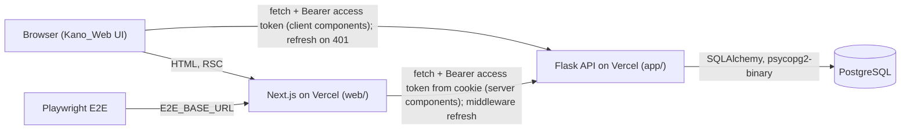

### Backend folder layout (flat; `app/` is the backend root)

```
app/
|-- __init__.py          create_app(config_overrides=None)
|-- config.py            Config.from_env(): validates env vars, fails fast
|-- extensions.py        db (SQLAlchemy), migrate (Migrate), jwt (JWTManager)
|-- errors.py            ApiError family, error handlers, ok()/fail() envelope helpers
|-- permissions.py       get_board_or_404, require_board_member, require_board_admin, ...
|-- soft_delete.py       SoftDeleteMixin, active(), soft_delete_where(), utcnow()   (additional shared module)
|-- ordering.py          next_last_order, midpoint_order, before_first_order       (additional shared module)
|-- health.py            GET /api/health, no database access                        (additional shared module)
|-- wsgi.py              entry point exposing `app`
|-- requirements.txt     pinned (name==version)
|-- .env.example
|-- blueprints/
|   |-- auth/            routes.py, service.py, schema.py   (no model)
|   |-- users/           routes.py, service.py, schema.py   (User)
|   |-- boards/          routes.py, service.py, schema.py   (Board, BoardMembership; V6: also invitation links and accept, see A14)
|   |-- columns/         routes.py, service.py, schema.py   (Column)
|   |-- cards/           routes.py, service.py, schema.py   (Card)
|   |-- comments/        routes.py, service.py, schema.py   (Comment)
|   |-- notifications/   routes.py, service.py, schema.py   (Notification)
|   `-- analytics/       routes.py, service.py, schema.py   (no model)
|-- tests/               pytest (unit + e2e)
|-- migrations/          generated manually by the user
`-- venv/                already exists; not recreated
```

There is no `app/routes/`, `app/services/`, or `app/models/` directory. `GET /api/health` is registered by `create_app` from one extra shared module, `app/health.py`, which has no database access.

Because `app/` itself is the Python package `app` (it contains `__init__.py`), all internal imports are absolute (`from app.extensions import db`). `wsgi.py` inserts the repository root into `sys.path` before importing, so both `flask run` from `app/` and Vercel work.

### Model ownership

| Blueprint_Package | Owns model(s) | Table(s) |
|---|---|---|
| users | User | `users` |
| boards | Board, BoardMembership (V6: Board also holds the two Invite_Token columns; the invitation endpoints belong to this package) | `boards`, `board_memberships` |
| columns | Column | `columns` |
| cards | Card | `cards` |
| comments | Comment | `comments` |
| notifications | Notification | `notifications` |
| auth | none | none |
| analytics | none | none |

### Module dependency direction (acyclic)

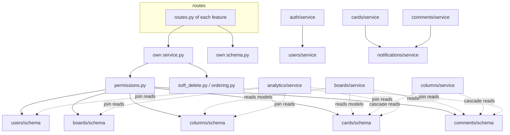

Rules that keep the graph acyclic:

1. No `schema.py` imports any other module of another feature. Cross-feature relationships and FKs use string names (for example `db.ForeignKey("columns.column_id", name="fk_cards_columns")`, `db.relationship("Column", lazy="raise")`).
2. `permissions.py` imports `schema.py` files only and never a `service.py`. Therefore `cards/service` and `comments/service` get Column, Card, and membership lookups from `permissions.py` and do not import `columns/schema` or `boards/schema` directly.
3. Service-to-service calls exist only in three places: `auth` to `users`, `cards` to `notifications`, `comments` to `notifications`.
4. `routes.py` imports only its own `service.py` and `schema.py` plus `errors.py`.
5. `create_app` imports every model-defining `schema.py` (users, boards, columns, cards, comments, notifications) before `Migrate.init_app`, so `flask db migrate` detects all 7 tables (Requirement 1.9).
6. **V6.** `boards/service` keeps owning Board_Memberships, including the invitation accept (a membership write). `cards/service` imports nothing from `boards` except through `permissions.py` and `notifications/service`, and never imports a `routes.py`. The invitation routes are registered by the `boards` blueprint under `/api/invites/...` and `/api/boards/<id>/invite-links...`, so no other package is involved.
7. **V6.** `apply_status_change` (cards), `resolve_accept` (boards), `role_allows` (permissions), and `start_of_week_utc` (analytics) are pure functions with no import of `db`, so they are unit and property testable without a database.

### File size and split rule (Requirement 30.6, 30.7)

Every Python and TSX file stays at or below 300 lines. Splits are decided now where growth is likely:

| File | Planned split when over 300 lines |
|---|---|
| `blueprints/boards/service.py` | `boards/service/` package: `board_service.py`, `member_service.py`, `cascade.py`, with `__init__.py` re-exporting so `from app.blueprints.boards import service` still works |
| `blueprints/cards/service.py` | `cards/service/`: `card_service.py`, `position_service.py`, `search_service.py` |
| `blueprints/boards/schema.py` | `boards/schema/`: `models.py`, `board_schemas.py`, `member_schemas.py` |
| `blueprints/cards/routes.py` | `cards/routes/`: `card_routes.py`, `search_routes.py` |
| **V6** `blueprints/boards/service/` (with invitations) | `board_service.py`, `member_service.py`, `cascade.py`, `invite_service.py` (tokens, lazy creation, regenerate, lookup), `accept.py` (pure `resolve_accept` and the accept transaction) |
| **V6** `blueprints/boards/routes.py` | `boards/routes/`: `board_routes.py`, `member_routes.py`, `invite_routes.py` |
| **V6** `blueprints/boards/schema.py` | `boards/schema/`: `models.py`, `board_schemas.py`, `member_schemas.py`, `invite_schemas.py` |
| **V6** `blueprints/cards/service.py` | `cards/service/`: add `status.py` (pure `apply_status_change`, `CARD_STATUSES`) next to `card_service.py`, `position_service.py`, `search_service.py` |
| **V6** `web/components/boards/MemberPanel.tsx` | `MemberPanel.tsx` (shell), `MemberList.tsx`, `AddMemberForm.tsx`, `InviteLinksPanel.tsx`, `InviteLinkRow.tsx`, one component per file |
| **V6** `web/components/cards/CardDetailModal.tsx` | `CardDetailModal.tsx` (shell and save logic), `CardDetailForm.tsx`, `StatusSelect.tsx`, with `CommentList.tsx` unchanged |

The package `__init__.py` keeps `routes`, `service`, and `schema` importable under those names.

### Request lifecycle

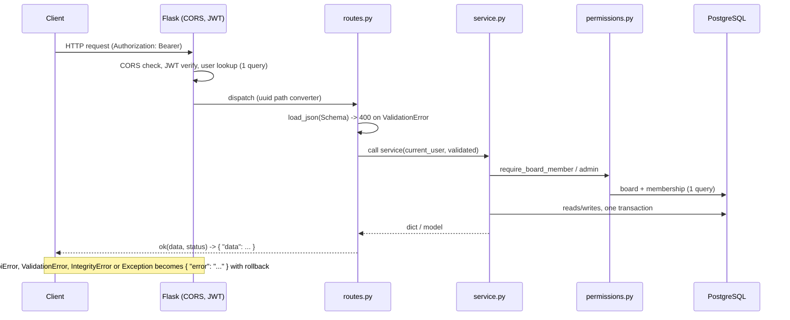

## Components and Interfaces

## Part A: Backend

### A1. Application factory and configuration (Requirements 1.5, 1.12, 1.13, 28.5, 28.6, 4.16, 4.17)

`Config.from_env()` reads these variables through python-dotenv and raises `ConfigError("Missing required environment variable: NAME")` for any that is missing or empty. The message names the variable and never prints values.

| Variable | Used for | Required at startup |
|---|---|---|
| `DATABASE_URL` | SQLAlchemy URI (`postgresql+psycopg2://...`) | yes |
| `JWT_SECRET_KEY` | signing secret for both access and refresh tokens | yes |
| `JWT_ACCESS_TOKEN_EXPIRES` | access token lifetime in seconds, positive integer; `.env.example` placeholder `3600` | yes |
| `JWT_REFRESH_TOKEN_EXPIRES` | refresh token lifetime in seconds, positive integer; `.env.example` placeholder `604800` | yes |
| `CORS_ORIGINS` | comma-separated allowed origins | yes |
| `TEST_DATABASE_URL` | pytest only; must differ from `DATABASE_URL` | tests only |

`create_app(config_overrides=None)`:

1. Build `Config`. Tests pass overrides that point `DATABASE_URL` at `TEST_DATABASE_URL`.
2. Set `JWT_ACCESS_TOKEN_EXPIRES` and `JWT_REFRESH_TOKEN_EXPIRES` on `app.config` as `timedelta(seconds=...)` (Flask-JWT-Extended reads them as defaults), then `db.init_app`, `jwt.init_app`, import all model-defining `schema.py` files, then `migrate.init_app(app, db)`.
3. Engine options: when the environment variable `VERCEL` is set, use `poolclass=NullPool` (no pooled connections in a serverless function). Otherwise `pool_size=5`, `pool_pre_ping=True`.
4. `CORS(app, resources={r"/api/*": {"origins": cfg.cors_origins, "allow_headers": ["Authorization", "Content-Type"]}})` with `supports_credentials=False`. flask-cors omits the allow-origin header for an origin not in the list (Requirement 4.17).
5. Register error handlers and JWT callbacks from `errors.py`, register the health blueprint and the 8 feature blueprints under `/api`.
6. Never log request bodies or `Authorization` headers. A logging filter drops records that contain `password` or `Bearer` text (Requirement 28.2). **V6 change:** the same filter, attached to the root logger and to the `werkzeug` logger, also rewrites every record with `redact_invite_tokens(text)` (see A12-V6) so an Invite_Token in a request path never reaches the log (Requirement 28.13). `current_password` is dropped by the existing `password` rule.

### A2. Error handling and Response_Envelope (`errors.py`, Requirement 4)

```python
def ok(data, status=200):            # -> flask Response {"data": data}
def fail(message, status):           # -> flask Response {"error": message[:500]}
class ApiError(Exception):           # status, message
class BadRequest(ApiError): ...      # 400
class Unauthorized(ApiError): ...    # 401
class Forbidden(ApiError): ...       # 403
class NotFound(ApiError): ...        # 404
class Conflict(ApiError): ...        # 409
```

| Source | Handler result |
|---|---|
| `ApiError` | its status and message |
| `marshmallow.ValidationError` | 400, message lists each invalid field name (`"name: Length must be between 1 and 100"`) |
| `werkzeug` `NotFound` / `MethodNotAllowed` (unknown path, bad method, non-UUID path id) | 404 / 405 with `{ "error": "..." }` |
| `sqlalchemy.exc.IntegrityError` | rollback, then by `pgcode`: `23505` gives 409, `23503` and `23502` give 400, anything else 500; message is generic, no SQL text |
| `OperationalError`, `ProgrammingError` (missing table, DB down) | rollback, log, 500 generic (Requirement 3.6, 3.7) |
| any other `Exception` | rollback, `logger.exception`, 500 `"Internal server error"` |
| JWT callbacks (`unauthorized_loader`, `invalid_token_loader` (also fires for a wrong token type), `expired_token_loader`, `revoked`, `user_lookup_error_loader`) | 401 envelope |

`load_json(schema)` in `errors.py` reads `request.get_json(silent=True)`, rejects a non-object body with 400, and calls `schema.load(data)`. All schemas use `unknown = RAISE`, so a `password` key in `PATCH /api/users/me` fails with 400 (Requirement 7.3). Query strings use the same pattern through `schema.load(request.args)`.

Success status is chosen in `routes.py`: `ok(data, 201)` for the six creating POSTs, `ok(data)` otherwise. DELETE routes return `ok({"<resource>_id": "<uuid>"})`.

Serialization: `UuidField` outputs `str(uuid)` (lowercase, 36 characters). `UtcDateTime` outputs `value.astimezone(timezone.utc).isoformat().replace("+00:00", "Z")`.

### A3. Authentication and users (Requirements 6, 7, 28.1)

- Password hashing: `werkzeug.security.generate_password_hash(password)` (salted, adaptive scrypt). Verification uses `check_password_hash`. A dummy hash check is run when the email is unknown so both login failures take similar time.
- Emails are trimmed and lowercased on write and on lookup (see the normalization bullet below), the stored value is always lowercase, and the partial unique index on `email` therefore gives the case-insensitive uniqueness of Requirements 2.12, 6.2, and 7.4.
- Two token types (Requirements 6.4, 6.5, 6.10 to 6.15). Both are signed with `JWT_SECRET_KEY` and carry `sub = str(user.user_id)` (a string because current PyJWT rejects non-string subjects). Flask-JWT-Extended sets the `type` claim itself:

  | Token | Created by | `type` | Lifetime | Accepted by |
  |---|---|---|---|---|
  | access | `create_access_token(identity=str(user_id))` | `access` | `JWT_ACCESS_TOKEN_EXPIRES` (3600 s) | every protected endpoint (`@jwt_required()`) |
  | refresh | `create_refresh_token(identity=str(user_id))` | `refresh` | `JWT_REFRESH_TOKEN_EXPIRES` (604800 s) | only `POST /api/auth/refresh` (`@jwt_required(refresh=True)`) |

- Type enforcement: `@jwt_required()` (default) rejects a refresh token and `@jwt_required(refresh=True)` rejects an access token. Flask-JWT-Extended raises its wrong-token error in both cases (it would answer 422 by default). The `invalid_token_loader` registered in `errors.py` maps it to 401 in the envelope (Requirement 4.6). A test asserts the 401 for each direction, so a library default change is caught.
- `jwt.user_lookup_loader` loads the non-deleted User by id once per request and caches it on `flask.g`. A missing or soft-deleted user returns `None`, which the lookup-error callback turns into 401 (Requirement 6.9). This is query 1 of every protected request.
- `POST /api/auth/refresh` (`auth/service.refresh(identity)`): `@jwt_required(refresh=True)`, then loads the non-deleted User by `get_jwt_identity()` and raises `Unauthorized` if missing (Requirement 6.13), then returns `create_access_token(...)`. It does not issue a new refresh token (no rotation), and it keeps no server state (Requirement 6.15).
- `GET/PATCH /api/users/me` use the cached user. **V6 change (supersedes the V5 PATCH, which accepted `email` and rejected `password`):** PATCH accepts only `name` and/or `password` with `current_password`, and the email can never change (Requirements 7.2 to 7.5, 7.8). `UserUpdateSchema` declares `name` (1 to 100, stripped), `password` (8 to 128), `current_password` (load only, non-empty string), and an explicit `email = fields.Raw(load_only=True)` whose validator always raises `ValidationError("email cannot be changed")`, so a body that contains `email` with any value (including the current one, null, or an empty string) returns 400 naming `email` (the `unknown = RAISE` rule alone would also reject it, but the explicit field gives the clear message). A `@validates_schema` hook rejects a body with neither `name` nor `password`, a `current_password` without `password`, and a `password` without `current_password` (400 naming `current_password`). `users/service.update_me` runs in this order: (1) if `password` is present, `check_password_hash(user.password_hash, current_password)`; a mismatch raises `BadRequest("current_password: does not match")` before any field is touched, so the name of the same request is not saved (never 403); (2) set `name`; (3) set `password_hash = generate_password_hash(password)` (same salted adaptive hash as registration, reused through `users/service.hash_password`); (4) one commit. There is no token invalidation: access and refresh tokens stay valid after a password change (Requirement 6.15, stateless, see Open issue 13). `UserSchema` output never contains a password field, and the log filter drops any record that contains `password` or `current_password`, including those of failed requests (Requirement 7.8). A token whose subject is a soft-deleted or nonexistent user never reaches the route: the lookup loader answers 401 on every protected endpoint, including these two (Requirements 6.9 and 7.6). There is no 404 for a missing current user.
- No endpoint deletes or deactivates a user (Requirement 7.7). Soft-deleted users exist only as seed data: tests insert a `User` row with `is_deleted = true` directly through the test session (a `make_deleted_user` fixture). Requirements 6.6, 6.9, 6.13, and 31.11 are tested with those rows.
- Email normalization: `normalize_email(value) = value.strip().lower()` in `users/schema.py`, applied by a Marshmallow `pre_load` hook on every schema that carries an email (`RegisterSchema`, `LoginSchema`, `UserUpdateSchema`, `MemberAddSchema`), so register, login lookup, PATCH, and add-member lookup all work on the lowercased value, and the stored column is always lowercase (Requirements 2.12, 6.1, 7.2, 9.1).
- The login response is `{ "data": { "access_token": "<jwt>", "refresh_token": "<jwt>", "token_type": "Bearer", "expires_in": 3600, "refresh_expires_in": 604800, "user": { ... } } }`. `expires_in` is `JWT_ACCESS_TOKEN_EXPIRES` and `refresh_expires_in` is `JWT_REFRESH_TOKEN_EXPIRES`, both in seconds. The refresh response is `{ "data": { "access_token": "<jwt>", "token_type": "Bearer", "expires_in": 3600 } }`. Register returns the user profile only and no tokens.
- Logout is client-only. Because refresh tokens are stateless, a stolen refresh token stays usable until it expires (assumption, see Open issues).

### A4. Permissions helpers (`permissions.py`, Requirements 1.6, 28.10, 28.11)

```python
def get_board_or_404(board_id) -> Board
def require_board_member(board_id, user_id) -> tuple[Board, BoardMembership]   # 404 then 403
def require_board_admin(board_id, user_id) -> tuple[Board, BoardMembership]    # 404, 403 non-member, 403 non-admin
def get_column_for_member(column_id, user_id) -> tuple[Column, Board, BoardMembership]
def get_card_for_member(card_id, user_id)   -> tuple[Card, Board, BoardMembership]
def get_comment_for_member(comment_id, user_id) -> tuple[Comment, Card, BoardMembership]
def assert_assignee_is_member(board_id, assignee_id) -> None                   # 400
```

Each helper does one joined query that selects the resource with its Board and the caller's active membership (`board_memberships.is_deleted = false`). Order of checks: resource missing or soft deleted gives 404, then missing membership gives 403, then role gives 403. A 403 response body contains only a generic message, never resource data (Requirement 28.11). Every `service.py` that enforces membership or role calls these helpers (Requirement 1.6).

**V6 change: this helper list is superseded by A4-V6 below.** The signatures above are kept for history. In V6 `require_board_member` and the `*_for_member` helpers no longer exist, because "member" was ambiguous once the guest role was added.

#### A4-V6. Role levels, helpers, and the endpoint by role matrix (Requirements 8.11, 8.12, 9.13 to 9.15, 10.10, 11.22, 11.23, 12.10, 12.11, 14.10, 28.14, 37.14)

Role levels (pure, in `permissions.py`, no database access):

```python
ROLE_RANK = {"guest": 0, "member": 1, "admin": 2}
LEVEL_RANK = {"reader": 0, "writer": 1, "admin": 2}      # reader = any role, writer = admin or member
def role_allows(role: str | None, level: str) -> bool:    # None (no active membership) -> False
    return role is not None and ROLE_RANK[role] >= LEVEL_RANK[level]
```

| V6 helper | Replaces (V5) | Behavior |
|---|---|---|
| `require_board_reader(board_id, user_id)` | `require_board_member` for read endpoints | 404, 403 without active membership, any role passes |
| `require_board_writer(board_id, user_id)` | `require_board_member` for write endpoints | 404, 403 without membership, 403 for `guest` |
| `require_board_admin(board_id, user_id)` | unchanged | 404, 403 for `member`, `guest`, and non-participants |
| `get_column_for_writer(column_id, user_id)` | `get_column_for_member` | column rename, delete, create card; guest gets 403 |
| `get_card_for_reader(card_id, user_id)` and `get_card_for_writer(card_id, user_id)` | `get_card_for_member` | reader for GET comments; writer for PATCH, DELETE, position, create comment |
| `get_comment_for_reader(comment_id, user_id)` and `get_comment_for_writer(comment_id, user_id)` | `get_comment_for_member` | the comment PATCH and DELETE use the writer variant and then the owner check, so a guest who is the author of an old Comment (possible after being removed and re-joining as guest) still gets 403 (Requirement 12.11) |
| `assert_assignee_is_writer(board_id, assignee_id)` | `assert_assignee_is_member` | 400 unless the assignee has an active membership with role `admin` or `member`; a guest, a removed member, and a non-participant all give 400 (Requirements 11.5, 11.22) |

Every helper still does one joined query and returns the membership, so the number of queries per request does not change (Property 25). Check order stays 404, then 403 for no membership, then 403 for role. A guest on a write endpoint gets 403 with the generic message, never resource data.

Matrix (server-verified; `ok` = allowed; `403` = forbidden; "any user" = authenticated, no Board role needed):

| Endpoint group | admin | member | guest | non-participant |
|---|---|---|---|---|
| GET board detail, GET members, GET card comments | ok | ok | ok | 403 |
| GET `/api/cards?q=...` (with or without `board_id`) | ok | ok | ok | 403 with `board_id`, boards not included without it |
| PATCH or DELETE board; POST or DELETE members; GET analytics | ok | 403 | 403 | 403 |
| GET invite-links; POST regenerate | ok | 403 | 403 | 403 |
| POST column; PATCH, DELETE column; PATCH reorder | ok | ok | 403 | 403 |
| POST card; PATCH, DELETE card; PATCH position | ok | ok | 403 | 403 |
| POST comment | ok | ok | 403 | 403 |
| PATCH or DELETE comment | author only | author only | 403 | 403 |
| GET `/api/invites/<token>`; POST accept | any user (token-gated) | any user | any user | any user |
| POST and GET `/api/boards`, `/api/cards?assignee=me`, notifications, users/me, refresh | any user | any user | any user | any user |

`role_allows` is the single decision point, so Property 47 can test the whole matrix as a table over role and level.

### A5. Soft delete and cascade (`soft_delete.py`, Requirement 2)

```python
class SoftDeleteMixin:        # created_at, updated_at, deleted_at, is_deleted
def utcnow() -> datetime      # timezone-aware UTC
def active(model)             # model.is_deleted.is_(False)
def soft_delete_where(session, model, *conditions, deleted_at) -> int
```

Cascade rules, all inside one `db.session` transaction with a single `deleted_at = utcnow()` captured once and reused (Requirements 2.9 to 2.11):

| Deleted | Also soft deleted |
|---|---|
| Board | Board_Memberships, Columns, Cards, Comments of that Board (Notifications are kept) |
| Column | Cards of the Column, Comments of those Cards |
| Card | Comments of the Card |
| Board_Membership | no row cascade; assignee cleared on the member's Cards of that Board in the same transaction (Requirement 9.11) |

Each cascade runs bulk `UPDATE ... SET is_deleted = true, deleted_at = :ts WHERE <parent ids> AND is_deleted = false`. The commit happens once at the end of the service function. Any exception triggers `db.session.rollback()` in the handler, leaving every row unchanged (Requirement 2.13, 8.10). Comment ids of a Column cascade use a subquery on `cards.column_id`.

### A6. FLOAT order strategy (`ordering.py`, Requirements 10.1, 10.4, 11.1, 11.7, 22)

```python
def next_last_order(current_max: float | None) -> float:   # None -> 1.0, else max + 1.0
def midpoint_order(prev: float, nxt: float) -> float:      # (prev + nxt) / 2
def before_first_order(first: float) -> float:             # first / 2
```

Create uses `SELECT max(order)` over active rows of the parent (Board for columns, Column for cards). Reorder and position endpoints store the order supplied by the client after schema validation (`order` is a float greater than 0, finite). Ties are broken by `created_at` in every ordered query. The same three formulas are implemented on the client in `web/lib/order.ts`.

### A7. Notifications creation rules (`notifications/service.py`, Requirement 13)

`create_notification(recipient_id, type, card, message)` inserts one row. Pure function `comment_recipients(author_id, assignee_id, admin_id) -> list[UUID]` returns the de-duplicated set of `{assignee_id, admin_id}` minus `author_id` minus `None`. Callers:

| Trigger | Caller | Recipients |
|---|---|---|
| Card created with assignee, or PATCH changes assignee | `cards/service` | new assignee, unless it is the current user (type `assignment`) |
| Comment added | `comments/service` | `comment_recipients(author, card.assignee_id, board admin)`, type `comment` |

The message is `Assigned to you: "<title>"` or `<author name> commented on "<title>"`. The title is shortened with `...` so the message never exceeds 255 characters. The notification row is inserted in the same transaction as the triggering write. Listing: `page` and `per_page` are validated by `NotificationQuerySchema` (integers from 1 to 2147483647, `per_page` at most 100, defaults 1 and 20). The query is `ORDER BY created_at DESC, notification_id DESC LIMIT per_page OFFSET (page-1)*per_page`. `total` and `unread_count` come from two `count()` queries on active rows of the recipient. A page past the last returns an empty list with the unchanged `total` and `unread_count`. Marking read is idempotent.

**V6 change (Requirement 13.12).** Guests are never notification recipients: a guest cannot be an assignee (`assert_assignee_is_writer`) and is never the Board_Admin, so `comment_recipients` needs no change. Accepting an invitation, changing a status, and moving a card create no notification. A status change that is part of a PATCH which also changes the assignee still creates the `assignment` notification by the existing rule.

### A8. Analytics queries (`analytics/service.py`, Requirement 14)

All use SQLAlchemy joins and aggregation, with every joined table filtered on `is_deleted = false`.

```python
# cards per column, 0 for empty columns -> outer join
select(Column.column_id, Column.name, func.count(Card.card_id))
  .select_from(Column).outerjoin(Card, and_(Card.column_id == Column.column_id, Card.is_deleted.is_(False)))
  .where(Column.board_id == board_id, Column.is_deleted.is_(False))
  .group_by(Column.column_id, Column.name).order_by(Column.order)

# completed this week  (V6 change: status and completed_at; V5 used the Column named "Done" and updated_at)
week_start = start_of_week_utc(now)   # Monday 00:00:00 UTC, pure function, unchanged
select(func.count(Card.card_id))
  .where(Card.board_id == board_id, Card.is_deleted.is_(False), Card.status == "DONE",
         Card.completed_at >= week_start, Card.completed_at <= now)
# no join with columns: a DONE card counts whatever Column it is in (Requirement 14.2);
# cards of a soft-deleted Column are already soft deleted by the cascade (A5), so no extra filter is needed.

# member activity (V6 change: guests excluded): only memberships with role in ("admin", "member")
# assigned cards and written comments per active member (two aggregates left-joined to memberships)
select(BoardMembership.user_id, ...).where(BoardMembership.board_id == board_id,
         BoardMembership.is_deleted.is_(False), BoardMembership.role.in_(("admin", "member")))
```

**V6 change.** If no non-deleted Card has `status = DONE` with `completed_at` in the current week, the completed count is 0 (Requirement 14.3). Cards counted before V6 through the Column named `Done` are not counted after V6 unless the optional backfill (Data Models, V6 migration) was run, which is a breaking change for the numbers (CHANGELOG V6). Cards per Column count every non-deleted Card whatever its status. Only the Board_Admin may call the endpoint (403 for `member`, `guest`, and non-participants, 404 if the Board is missing). `start_of_week_utc` is unchanged and is also used by the tests with the boundary `Monday 00:00:00 UTC` (inclusive) and one second earlier (excluded).

### A9. Board detail query plan (Requirements 8.3, 11.16, 29.1, 29.2)

`GET /api/boards/<id>` runs exactly four queries regardless of Card count: (1) JWT user lookup, (2) Board joined with the caller's membership, (3) active Columns ordered by `order`, (4) active Cards of the Board ordered by `order`, `created_at`, with the assignee loaded through `joinedload`. Columns and Cards are grouped in Python. The response includes `my_role`. Members and admins see all Cards (Requirement 11.16 adds no extra filter).

### A10. Card search and My Tasks (`GET /api/cards`, Requirement 11.10 to 11.14)

`CardQuerySchema` accepts `assignee` (only `me`), `q` (1 to 100 characters), `board_id` (UUID). Valid combinations: `assignee=me`, or `q` with optional `board_id`. Anything else is 400. `q` is escaped for LIKE (`\`, `%`, `_`) and used as `Card.title.ilike(pattern, escape="\\") | Card.description.ilike(pattern, escape="\\")`, so SQL and LIKE metacharacters are literal (Requirement 28.4). Rows join `Column`, `Board`, and the caller's active `BoardMembership`, and return `board_id`, `board_name`, `column_name`. With `board_id`, the membership is checked first (403 for a non-member). **V6 change:** the membership join accepts every role, so a Board_Guest can search the Cards of Boards where the guest holds a membership (Requirement 11.11, 11.13). Every returned Card (search and My Tasks) includes `status` and `completed_at` (Requirement 11.20). `CardQuerySchema` is unchanged. `assignee=me` is unaffected by roles: a guest cannot be an assignee, and removal of a membership already clears the assignee.

### A11. Endpoint table

Legend: Auth `-` = none, `JWT` = any authenticated user holding a valid access token (a refresh token gets 401), `Refresh` = a valid refresh token only (an access token gets 401), `Member` / `Admin` / `Owner` / `Recipient` = per-resource role (server-verified). **V6 change:** `Member` in this table now means the writer level (role `admin` or `member`, a guest gets 403), `Participant` means any role including `guest` (reader level), and `Token` means any authenticated user holding a valid Invite_Token. See the matrix in A4-V6. Success 201 for the six creating POSTs, 200 for everything else; DELETE returns 200 with a data object. Errors list the statuses beyond the always-possible 500 (and 401 for JWT endpoints).

| # | Method | Path | Auth / role | Request schema | Success | Error statuses | Requirement |
|---|---|---|---|---|---|---|---|
| 1 | GET | `/api/health` | - | none | 200 `{status:"ok"}` | 405, 500 | 5 |
| 2 | POST | `/api/auth/register` | - | `RegisterSchema` (name 1-100, email <=254, password 8-128) | 201 user profile | 400, 409 | 6.1-6.3 |
| 3 | POST | `/api/auth/login` | - | `LoginSchema` (email, password) | 200 `{access_token, refresh_token, token_type, expires_in, refresh_expires_in, user}` | 400, 401 | 6.4-6.9 |
| 3a | POST | `/api/auth/refresh` | Refresh | none (token in `Authorization` header) | 200 `{access_token, token_type, expires_in}` | 401 | 6.10-6.15 |
| 4 | GET | `/api/users/me` | JWT | none | 200 profile | 401 | 7.1, 7.6 |
| 5 | PATCH | `/api/users/me` | JWT | **V6:** `UserUpdateSchema` (`name`, `password` with `current_password`; `email` always 400; V5 accepted email and rejected password) | 200 profile | 400 (incl. wrong or missing `current_password`), 401 | 7.2-7.8 |
| 6 | POST | `/api/boards` | JWT | `BoardCreateSchema` (name 1-100, not blank) | 201 board with `my_role` | 400 | 8.1, 8.8, 8.10 |
| 7 | GET | `/api/boards` | JWT | none | 200 list, `created_at` desc | none | 8.2 |
| 8 | GET | `/api/boards/<uuid:id>` | Participant | none | 200 board, columns, cards (with `status`, `completed_at`), `my_role` may be `guest` | 403, 404 | 8.3, 8.6, 8.9, 8.11, 11.16 |
| 9 | PATCH | `/api/boards/<uuid:id>` | Admin | `BoardUpdateSchema` | 200 board | 400, 403, 404 | 8.4, 8.7 |
| 10 | DELETE | `/api/boards/<uuid:id>` | Admin | none | 200 `{board_id}` | 403, 404 | 8.5, 2.9 |
| 11 | POST | `/api/boards/<uuid:id>/members` | Admin | `MemberAddSchema` (email) | 201 member | 400, 403, 404, 409 | 9.1-9.4, 9.9, 9.10 |
| 12 | GET | `/api/boards/<uuid:id>/members` | Participant | none | 200 list, creation asc, roles incl. `guest` | 403, 404 | 9.5, 9.10, 9.13 |
| 13 | DELETE | `/api/boards/<uuid:id>/members/<uuid:user_id>` | Admin | none | 200 `{user_id}` | 400 (self), 403, 404 | 9.6-9.8, 9.11, 9.12 |
| 14 | POST | `/api/boards/<uuid:id>/columns` | Member | `ColumnCreateSchema` | 201 column | 400, 403, 404 | 10.1, 10.6, 10.7 |
| 15 | PATCH | `/api/columns/<uuid:id>` | Member | `ColumnUpdateSchema` | 200 column | 400, 403, 404 | 10.2 |
| 16 | DELETE | `/api/columns/<uuid:id>` | Member | none | 200 `{column_id}` | 403, 404 | 10.3, 2.10 |
| 17 | PATCH | `/api/boards/<uuid:id>/columns/reorder` | Member | `ColumnReorderSchema` (`column_id` UUID, `order` float > 0) | 200 column | 400, 403, 404 | 10.4, 10.5, 10.8 |
| 18 | POST | `/api/columns/<uuid:id>/cards` | Member | `CardCreateSchema` | 201 card | 400, 403, 404 | 11.1, 11.2, 11.4, 11.5 |
| 19 | PATCH | `/api/cards/<uuid:id>` | Member | `CardUpdateSchema` (partial) | 200 card | 400, 403, 404 | 11.3-11.5 |
| 20 | DELETE | `/api/cards/<uuid:id>` | Member | none | 200 `{card_id}` | 403, 404 | 11.6, 2.11 |
| 21 | PATCH | `/api/cards/<uuid:id>/position` | Member | `CardPositionSchema` (`column_id`, `order`) | 200 card | 400, 403, 404 | 11.7-11.9 |
| 22 | GET | `/api/cards?assignee=me` and `/api/cards?q=&board_id=` | JWT (search: Participant of each board searched) | `CardQuerySchema` | 200 list with `status`, `completed_at` | 400, 403 | 11.10-11.14, 11.20 |
| 23 | POST | `/api/cards/<uuid:id>/comments` | Member | `CommentCreateSchema` (content 1-2000, non-blank) | 201 comment | 400, 403, 404 | 12.1, 12.5, 12.8, 13.2, 13.3 |
| 24 | GET | `/api/cards/<uuid:id>/comments` | Participant | none | 200 list, creation asc | 403, 404 | 12.2, 12.8, 12.10 |
| 25 | PATCH | `/api/comments/<uuid:id>` | Owner | `CommentUpdateSchema` | 200 comment | 400, 403, 404 | 12.3, 12.7 |
| 26 | DELETE | `/api/comments/<uuid:id>` | Owner | none | 200 `{comment_id}` | 403, 404 | 12.4, 12.7 |
| 27 | GET | `/api/notifications` | JWT | `NotificationQuerySchema` (`page`, `per_page`) | 200 `{items,page,per_page,total,unread_count}` | 400 | 13.4-13.8 |
| 28 | PATCH | `/api/notifications/<uuid:id>/read` | Recipient | none | 200 notification | 403, 404 | 13.9-13.11 |
| 29 | GET | `/api/boards/<uuid:id>/analytics` | Admin | none | 200 analytics | 403, 404 | 14 |
| 30 | GET | `/api/boards/<uuid:id>/invite-links` | Admin | none | 200 `{member: {role, token}, guest: {role, token}}`, missing tokens created lazily | 403, 404 | 37.3, 37.4, 37.5, 37.8 |
| 31 | POST | `/api/boards/<uuid:id>/invite-links/<role>/regenerate` | Admin | path `role` must be `member` or `guest` (`InviteRoleSchema`) | 200 `{role, token}` (not 201, per R4.3) | 400 (bad role), 403, 404 | 37.5 to 37.8 |
| 32 | GET | `/api/invites/<token>` | Token (JWT) | token format check | 200 `{board_id, board_name, role, current_role}` | 401, 404 | 37.9, 37.10, 37.23 |
| 33 | POST | `/api/invites/<token>/accept` | Token (JWT) | token format check | 200 `{board_id, role}` (not 201, per R4.3) | 401, 404 | 37.11 to 37.13, 37.21, 37.23 |

**V6 change, rows 6 to 29 that gain behavior without a new row.** Row 6 (POST `/api/boards`) also creates both Invite_Tokens in the same transaction (A14). Rows 14 to 17, 18 to 21, 23, 25, 26 return 403 to a guest (matrix in A4-V6). Row 18 rejects a `status` field with 400 and always creates `NOT_STARTED` (A13). Row 19 accepts `status`. Row 11 (add member by email) is unchanged and creates the role `member` (Requirement 37.22).

Error status mapping follows Requirement 4.6 exactly. Routes with a `<uuid:...>` converter return 404 for a malformed id because the URL rule does not match.

JSON shapes (fields only):

| Resource | Fields |
|---|---|
| user | `user_id`, `name`, `email`, `created_at` |
| board | `board_id`, `name`, `my_role`, `created_at`, `updated_at` |
| board detail | board + `columns: [{column_id, name, order, cards: [card]}]` |
| member | `user_id`, `name`, `email`, `role` |
| column | `column_id`, `board_id`, `name`, `order` |
| card | `card_id`, `board_id`, `column_id`, `title`, `description`, `due_date`, `labels`, `assignee: {user_id, name} or null`, `status` (V6), `completed_at` (V6, UTC string or null), `order`, `created_at`, `updated_at` |
| invite links (V6) | `{ member: {role: "member", token}, guest: {role: "guest", token} }`; regenerate returns `{role, token}`; invite info returns `{board_id, board_name, role, current_role}`; accept returns `{board_id, role}` |
| card search result | card + `board_name`, `column_name` |
| comment | `comment_id`, `card_id`, `content`, `author: {user_id, name}`, `created_at`, `updated_at` |
| notification | `notification_id`, `type`, `message`, `card_id`, `board_id`, `is_read`, `created_at` |
| analytics | `cards_per_column: [{column_id, name, count}]`, `completed_this_week`, `member_activity: [{user_id, name, assigned_cards, comments}]` |

### A12. Security summary (Requirement 28)

Passwords only as salted adaptive hashes; secrets only from environment; all queries parameterized through SQLAlchemy with LIKE escaping; server-side membership and role checks in `permissions.py` on every endpoint; CORS restricted to configured origins; log filter for secrets; frontend never uses `dangerouslySetInnerHTML`. The non-httpOnly cookies are a deliberate trade-off (D9): any XSS can read both the access token and the 7-day refresh token, which raises the impact compared with a single short token. Mitigations: short access token expiry (3600 s), refresh token expiry (604800 s), React output escaping, no `dangerouslySetInnerHTML` (documented in the README).

#### A12-V6. Security additions (Requirements 28.12 to 28.15, 37)

- **Token entropy and exposure.** Invite_Tokens come from `secrets.token_urlsafe(32)`: 32 random bytes, 43 characters from `A-Z a-z 0-9 _ -`. Tokens are returned only to a Board_Admin (GET invite-links, regenerate) and echoed nowhere else. GET `/api/invites/<token>` returns the board id, name, and the role of the token to any authenticated user who already knows the token, and never returns the other role's token.
- **No token in logs.** `redact_invite_tokens(text)` replaces every match of `/api/invites/[A-Za-z0-9_-]{20,}` and `/invite/[A-Za-z0-9_-]{20,}` with the same prefix plus `<redacted>`. The logging filter applies it to the formatted message of every record (root and `werkzeug` loggers, which print the request line), so a 400, 401, 403, 404, or 500 caused by an invite request leaves no token behind. Services never put a token into an exception message. The platform's own request logs on Vercel are outside the application and cannot be filtered (Open issue 22).
- **Token lookup and timing.** The format check (`^[A-Za-z0-9_-]{43,128}$`) runs before any query, so malformed tokens cost no database access and give the same 404 as unknown tokens. Lookup is an indexed equality on 256-bit random values, so a timing attack is infeasible and no constant-time comparison is added. No rate limit is designed (Open issue 26).
- **Open redirect.** The server never redirects from user input. The frontend validates `next` with `safeNext` (B4), so only `/invite/<1 to 128 URL-safe characters>` is accepted (Requirements 19.11, 28.15).
- **Server-side role checks.** Every write endpoint checks the role through `permissions.py` (Requirement 28.14). Frontend hiding of controls is a convenience only.
- **Passwords.** `current_password` is verified with `check_password_hash` before any write and is never logged or returned.
- **No new environment variable** and no CORS change. Invite endpoints are ordinary JWT-protected `/api/*` routes.

### A13. Card status (Requirements 2.16, 11.2, 11.4, 11.17 to 11.24, 14.2, 25.7)

Constants and pure rule (`cards/service/status.py`, no database import):

```python
CARD_STATUSES = ("NOT_STARTED", "IN_PROGRESS", "DONE")      # exact, case-sensitive
def apply_status_change(old_status: str, old_completed_at, new_status: str | None, now) -> tuple[str, datetime | None]:
    if new_status is None or new_status == old_status:      # not supplied, or unchanged (incl. DONE -> DONE)
        return old_status, old_completed_at
    if new_status == "DONE":                                 # any other value -> DONE
        return "DONE", now
    if old_status == "DONE":                                 # DONE -> any other value
        return new_status, None
    return new_status, old_completed_at                      # NOT_STARTED <-> IN_PROGRESS (completed_at is None here)
```

- **Create.** `CardCreateSchema` does not declare `status` or `completed_at`, and uses `unknown = RAISE`, so a body with `status` returns 400 naming `status` and creates no Card (Requirement 11.17). The service always stores `status = "NOT_STARTED"` and `completed_at = None`.
- **PATCH `/api/cards/<id>`.** `CardUpdateSchema` adds `status = fields.String(validate=validate.OneOf(CARD_STATUSES), allow_none=False)`. `OneOf` is exact, so `done`, `""`, `null`, and unknown values give 400 (Requirement 11.4). `completed_at` is not declared, so a client can never set it. The service calls `apply_status_change(card.status, card.completed_at, supplied_status, utcnow())` once, inside the same transaction and the same single UPDATE as the other supplied fields (Requirement 11.18). The notification rule of A7 is unchanged.
- **Position.** `CardPositionSchema` and `position_service` never read or write `status` or `completed_at`, including a move into a Column named `Done` (Requirement 11.21). The Column named `Done` stays a plain Column.
- **Serialization.** `CardSchema`, `CardSearchSchema`, and the board detail Cards all include `status` and `completed_at` (UTC string ending in `Z`, or null), in every response that returns a Card (Requirement 11.20). Cards created before V6 read as `NOT_STARTED` and `null` through the column default (Requirement 11.24).
- **Invariant used by tests.** After any sequence of PATCH calls, `completed_at is not None` iff `status == "DONE"`, apart from rows changed by the optional manual backfill, which sets both (Property 44).

### A14. Board invitation links and guest accept (Requirements 37, 2.15, 2.17, 8.10, 9.13)

**Storage.** `boards.member_invite_token` and `boards.guest_invite_token`, both `varchar(128)`, nullable, each with a named unique constraint (`uq_boards_member_invite_token`, `uq_boards_guest_invite_token`). PostgreSQL unique constraints allow many NULLs, which gives "unique ignoring NULL" without a partial index. Tokens of soft-deleted Boards stay in the columns and stay unique, but the lookup filters `is_deleted = false`, so they answer 404.

**Generation (`invite_service.py`).**

```python
def new_invite_token() -> str:            # secrets.token_urlsafe(32), 43 chars
def generate_unique_token(session) -> str: # retries up to 3 times if either token column already holds the value (practically never)
```

- **Creation with the Board.** `boards/service.create_board` sets both tokens and inserts the admin membership in one transaction. A failure rolls back all of them (Requirement 8.10).
- **Lazy creation.** GET invite-links for a Board whose tokens are NULL runs `UPDATE boards SET member_invite_token = COALESCE(member_invite_token, :t1), guest_invite_token = COALESCE(guest_invite_token, :t2) WHERE board_id = :id` and re-reads the row, so two concurrent admin requests end with one stored pair and both receive it.
- **Regenerate.** After `require_board_admin`, `InviteRoleSchema` validates the path `role` (`member` or `guest`, else 400, the Board is still checked first for 404 and 403). The service stores a new token in that column only. The old token is invalid at once (the next lookup misses it), the other role's token and all memberships are unchanged, and the response is `{role, token}` with status 200.

**Lookup.** `find_board_by_token(token)` returns `(board, token_role)` or raises `NotFound` for a malformed, unknown, replaced, or soft-deleted-Board token: one query on `member_invite_token = :t OR guest_invite_token = :t` with `is_deleted = false`, and the role is whichever column matched.

**Accept decision (pure, `accept.py`).**

```python
def resolve_accept(existing_role: str | None, token_role: str) -> tuple[str, str]:
    """-> (resulting_role, action) with action in {"create", "upgrade", "none"}"""
    if existing_role is None:                               # no active membership (a soft-deleted row counts as none)
        return token_role, "create"
    if existing_role == "guest" and token_role == "member":
        return "member", "upgrade"
    return existing_role, "none"                            # admin keeps admin; member keeps member (no downgrade); guest + guest stays
```

**Accept transaction (`POST /api/invites/<token>/accept`).** JWT check first (401), then `find_board_by_token` (404), then:

1. Read the caller's active membership for the Board with `SELECT ... FOR UPDATE`.
2. `role, action = resolve_accept(existing.role if existing else None, token_role)`.
3. `create`: insert a new Board_Membership with the token role. A soft-deleted row of the same pair is left untouched and a new row is inserted, which the partial unique index allows (Requirement 37.13). `upgrade`: `UPDATE board_memberships SET role = 'member' WHERE board_membership_id = :id AND role = 'guest'` (conditional, so it cannot lower a role). `none`: no write.
4. Commit and return `{board_id, role}` with status 200 in every case. No Notification is created and the token is not consumed (Requirement 37.21).

**Race.** Two simultaneous accepts of the same pair both try to insert. The partial unique index `uq_board_memberships_board_user_active` makes one fail with an `IntegrityError` (pgcode 23505). The accept service catches it locally, rolls back, re-reads the membership, runs `resolve_accept` again, and returns 200 with the existing role, so the global 409 mapping is never reached by accept and repeated accepts are idempotent.

**Error mapping for the invite endpoints.**

| Case | Status |
|---|---|
| Missing, malformed, expired, or wrong-type JWT | 401 (checked first, Requirement 37.23) |
| Token malformed, unknown, replaced, or Board soft deleted | 404, no Board data, no membership created |
| Regenerate or invite-links by `member`, `guest`, or non-participant | 403 |
| Regenerate with `role` other than `member` or `guest` | 400, tokens unchanged |
| Board missing, soft deleted, or `<id>` not a UUID | 404 |
| Accept, any role combination (including no change) | 200 |

**Module boundaries.** Everything above sits in `boards/service/` and `boards/routes/`. `invite_routes.py` registers `/boards/<uuid:id>/invite-links`, `/boards/<uuid:id>/invite-links/<role>/regenerate`, `/invites/<token>` and `/invites/<token>/accept` on the boards blueprint (the application mounts it under `/api`). `permissions.py` provides the membership helpers and `users` is not touched.

## Part B: Frontend

### B1. File tree (`web/`, App Router, no `src/`)

```
web/
|-- proxy.ts                       route guard (see B4). V6 change: the repo uses the Next.js file name `proxy.ts`; every "middleware.ts" in this document means this file, logic unchanged
|-- next.config.ts                 V6: headers() sets Referrer-Policy no-referrer and Cache-Control no-store for /invite/:path*
|-- app/
|   |-- layout.tsx                 Server: reads both cookies, renders AuthProvider, Toaster, Header, Footer (one each per page)
|   |-- globals.css                Tailwind entry (@source lines for components/ and hooks/)
|   |-- (boards)/page.tsx          "/"  Dashboard (Server Component)
|   |-- (boards)/boards/[id]/page.tsx   Board Detail (Server Component)
|   |-- (cards)/my-tasks/page.tsx  My Tasks (Server Component fetching, client list)
|   |-- (users)/profile/page.tsx   Profile (Client form inside a thin server page)
|   |-- (auth)/login/page.tsx
|   |-- (auth)/register/page.tsx
|   |-- welcome/page.tsx           V6: public Server Component, no API call
|   `-- invite/[token]/page.tsx    V6: Server fetch of GET /api/invites/<token>, renders InviteJoinCard
|-- components/
|   |-- Header.tsx  Footer.tsx  NotificationBell.tsx
|   |-- shared/   BaseButton.tsx  BaseBadge.tsx  BaseModal.tsx  ConfirmDialog.tsx  ErrorPanel.tsx  StatusBadge.tsx (V6)
|   |-- auth/     LoginForm.tsx  RegisterForm.tsx  AuthProvider.tsx
|   |-- boards/   BoardList.tsx  CreateBoardModal.tsx  BoardView.tsx  KanbanColumn.tsx  ColumnHeader.tsx
|   |             AddColumnForm.tsx  CardSearchInput.tsx  MemberPanel.tsx  AnalyticsView.tsx  BoardAccessMessage.tsx
|   |             V6: MemberList.tsx  AddMemberForm.tsx  InviteLinksPanel.tsx  InviteLinkRow.tsx  InviteJoinCard.tsx
|   |             BoardRoleContext.tsx (provides my_role and canEdit to the board tree)
|   |-- cards/    CardItem.tsx  AddCardForm.tsx  CardDetailModal.tsx  MyTasksList.tsx  (V6: CardDetailForm.tsx  StatusSelect.tsx)
|   |-- comments/ CommentList.tsx  CommentItem.tsx  CommentForm.tsx
|   |-- notifications/ NotificationList.tsx
|   |-- welcome/  WelcomeContent.tsx (Server)  WelcomeActions.tsx (Client)            V6
|   `-- users/    ProfileForm.tsx  UserMenu.tsx  (V6: ChangePasswordForm.tsx  ReadOnlyEmail.tsx)
|-- hooks/   useDragAndDrop.ts  useNotifications.ts  useErrorHandler.ts  useDebouncedValue.ts  useAuth.ts
|-- lib/     apiClient.ts  refreshSession.ts  errors.ts  toast.ts  authCookie.ts  authContext.ts  serverAuth.ts
|            order.ts  validation.ts  types.ts  format.ts
|            V6: status.ts  roles.ts  nextParam.ts  decideRoute.ts  inviteRoles.ts  (all pure; authCookie.ts gains welcome cookie helpers)
|-- __tests__/ (Jest or Vitest + React Testing Library)
|-- e2e/       (Playwright specs, playwright.config.ts at web/; V6: e2e/support/credentials.ts, e2e/support/welcome.ts)
|-- scripts/   V6: scanCredentials.ts (pure scanner used by a unit test over web/e2e/)
|-- .env.example   NEXT_PUBLIC_API_BASE_URL, API_BASE_URL
|-- .env.test.example   V6: E2E_BASE_URL, E2E_USER_EMAIL, E2E_USER_PASSWORD (placeholders; the real web/.env.test is git-ignored)
`-- package.json   tailwind, react-hot-toast, test scripts
```

Directories under `components/` follow API resources (auth, boards, cards, comments, notifications, users) per Requirement 15.4. Column and analytics UI sit in `components/boards/` because there is no separate resource directory for them in the requirement (see Open issues). Each file defines exactly one component or module.

### B2. Pages: Server versus Client split

| Route | Component type | Data | Notes |
|---|---|---|---|
| `/register` | Server page, `RegisterForm` Client | POST `/api/auth/register` | Controlled inputs, client validation (`lib/validation.ts`), 409 shows email error, success redirects to `/login` with toast |
| `/login` | Server page, `LoginForm` Client | POST `/api/auth/login` | On 200 calls `AuthContext.login({ access_token, refresh_token, expires_in, refresh_expires_in, user })`, router push `/`; 401 shows one generic message and clears password |
| `/` | Server | GET `/api/boards` with the access cookie token | Renders `BoardList` (role `BaseBadge`), `CreateBoardModal` (Client) opened from `BaseButton`; empty state; load error shows `ErrorPanel` with retry (`router.refresh()`) |
| `/boards/[id]` | Server fetch, `BoardView` Client | GET `/api/boards/<id>` | 403 or 404 renders `BoardAccessMessage` with link to `/`; otherwise `BoardView` owns columns state, drag and drop, search |
| `/my-tasks` | Server fetch, `MyTasksList` Client | GET `/api/cards?assignee=me` | Groups by `board_name`; empty and error states; Server error also fires toast through a small client effect |
| `/profile` | `ProfileForm` Client | PATCH `/api/users/me` | **V6 change:** name pre-filled from `AuthContext`, email shown as read-only text, optional change-password section (B11). V5 had an email input and no password field |
| `/welcome` | Server page, `WelcomeContent` Server, `WelcomeActions` Client | none | V6, public. 1 to 5 sentences plus the eight listed capabilities, "Log in" and "Create account" `BaseButton`s that set the Welcome_Cookie and navigate |
| `/invite/[token]` | Server page, `InviteJoinCard` Client | GET `/api/invites/<token>`, then POST `/api/invites/<token>/accept` | V6, protected by `proxy.ts`. Never renders for an anonymous visitor. 404 shows a not-found message with a link to `/`; 401 calls `redirect("/login?expired=1")` |

**V8 change, `/welcome` row.** The V6 row text "1 to 5 sentences plus the eight listed capabilities, Log in and Create account buttons" is superseded by B13: hero, decorative preview, four feature cards, bottom call to action, with the copy of Requirement 38 criteria 16 and 17. The page is still public and still a Server Component without an API call.

**V6 change, other pages.** `/` shows the role badge `admin`, `member`, or `guest` per Board (`ROLE_VARIANT` in `lib/roles.ts`). `/boards/[id]` provides `my_role` through `BoardRoleContext` and gates every edit control (B6). `/my-tasks` shows a `StatusBadge` per task (B7). `/login` and `/register` read `next` through `safeNext` (B4).

Unauthenticated access to protected pages is blocked in `middleware.ts` before rendering. A 401 inside a Server Component (the middleware has already refreshed an expired access token, so this means the API rejected the token) calls `redirect("/login?expired=1")`.

### B3. Shared components (`components/shared/`)

| Component | Props | Behavior |
|---|---|---|
| `BaseButton` | `variant?: "primary" or "secondary" or "destructive"` (default `primary`), `disabled`, `type`, `onClick`, native button props | Distinct Tailwind class set per variant; when disabled sets `disabled` and `aria-disabled`, and `onClick` is not invoked; min size 44 x 44 px |
| `BaseBadge` | `variant: "gray" or "blue" or "green" or "red" or "yellow"`, `children` | One class map per variant, so every page renders the same colors |
| `BaseModal` | `open`, `onClose`, `title`, `children` | Portal; renders nothing when closed; Escape and backdrop click call `onClose`; content clicks stop propagation; focuses first focusable (else container) on open; traps Tab; restores previous focus on close; `role="dialog"`, `aria-modal`; mobile: `max-h-[100dvh] overflow-y-auto`, width inside viewport |
| `ConfirmDialog` | `open`, `message`, `onConfirm`, `onCancel`, `busy` | `BaseModal` wrapper used for delete confirmations |
| `ErrorPanel` | `message`, `onRetry?` | Error text with a `BaseButton` retry |
| `StatusBadge` (V6) | `status: CardStatus` | Renders `BaseBadge` with `STATUS_LABEL[status]` and `STATUS_VARIANT[status]` from `lib/status.ts`; the only place a status becomes text, so board, modal, and My Tasks always agree |

**V8 change, Header.** The brand link (logo mark and wordmark) no longer has the fixed target `/`. Its `href` is `logoTarget(isVisitorAuthenticated(auth))` (B12). The Header links "Log in" and "Register" for anonymous visitors stay plain `Link`s with the V5 classes (see Open issue 34). **V8 refinement:** this is now the rule (Requirement 38.2): the two Header actions are anchor elements, never `BaseButton`. The logo link and every authentication-dependent part of the Header (the Log in and Register links, "My Tasks", `NotificationBell`, `UserMenu`) read one shared check, `isVisitorAuthenticated(status)` (B12), so they cannot disagree.

Every button in pages and feature components uses `BaseButton` (Requirement 18.6). `Header` contains the app link, `NotificationBell`, `UserMenu` (profile link, logout) and links to `/my-tasks`; it shows only login and register links for anonymous visitors.

### B4. Auth, cookie, and route guard

- Two cookies, both path `/`, `SameSite=Lax`, not httpOnly, `Secure` on HTTPS:

  | Cookie | Holds | Lifetime (`Max-Age`) | Source of the lifetime |
  |---|---|---|---|
  | `kano_access` | access token | 3600 s | `expires_in` from the login or refresh response |
  | `kano_refresh` | refresh token | 604800 s by default | `refresh_expires_in` from the login response (no constant) |

  `lib/authCookie.ts` exposes `setAccessCookie(token, expiresIn)`, `setRefreshCookie(token, refreshExpiresIn)`, `getAccessToken()`, `getRefreshToken()`, `clearAuthCookies()` (clears both), the constants `ACCESS_COOKIE` and `REFRESH_COOKIE`, and the pure functions `decodeJwtExp(token): number | null` and `guardDecision(...)`. Both lifetimes come from the API responses (`expires_in`, `refresh_expires_in`), so there is no lifetime constant and changing `JWT_REFRESH_TOKEN_EXPIRES` needs no frontend change. `AuthProvider.login(r)` calls `setAccessCookie(r.access_token, r.expires_in)` and `setRefreshCookie(r.refresh_token, r.refresh_expires_in)`. The cookie max-age is a browser convenience only. The API remains the authority on token validity.
- `AuthProvider` receives `initialAccessToken` and `initialRefreshToken` from the root layout (Server reads both cookies). On mount, if either cookie exists it calls GET `/api/users/me` through `apiRequest`. When only the refresh token exists, `apiRequest` refreshes first (see B5). Success sets the user and both tokens. A 401 that survives the refresh flow clears both cookies and all auth state and redirects to `/login`. A network error or 5xx keeps both cookies, leaves the user unset, and calls `useErrorHandler`. It exposes `login({ access_token, refresh_token, expires_in, refresh_expires_in, user })`, `logout()` (clears both cookies and state, then `router.push("/login")`, no API call), `updateUser(user)` (replaces only the user object), `setAccessToken(token)` (used after a refresh), and `status`. It registers its session callbacks with `lib/refreshSession.ts` (see B5).
- `middleware.ts` (matcher excludes `_next`, static files, `favicon.ico`) reads both cookies and computes `guardDecision({ pathname, accessExp, refreshExp, now })` (pure, in `lib/authCookie.ts`). A token is "valid" when its cookie is present and `exp > now` (the signature is verified by the API, not the middleware). The result is one of:

  | Situation | Decision |
  |---|---|
  | Protected path, access token valid | `allow` |
  | Protected path, access token missing or expired, refresh token valid | `refresh` |
  | Protected path, no valid access token and no valid refresh token | `redirect-login` |
  | `/login` or `/register`, access token valid or refresh token valid | `redirect-home` |
  | `/login` or `/register`, otherwise | `allow` |

  On `refresh` the middleware sends `POST ${API_BASE_URL}/api/auth/refresh` with `Authorization: Bearer <refresh>`. On 200 it forwards the new access token to the same request by calling `request.cookies.set("kano_access", token)` and `NextResponse.next({ request: { headers: request.headers } })`, so Server Components in this request read the new value, and it also sets `kano_access` on the response (`Max-Age` = `expires_in`) so the browser stores it. Server Components cannot set cookies, which is why this step lives in the middleware. On 401 it redirects to `/login` and deletes both cookies. On a network error or 5xx it treats the refresh as failed and redirects to `/login?expired=1` (see Open issues). A request to `/login?expired=1` is always allowed and deletes both cookies, which prevents a redirect loop when the API rejected a token that still looks valid.
- Server Components get the access token through `lib/serverAuth.ts`: `getServerToken()` using `cookies()` from `next/headers` and pass it to `apiRequest(..., { token })` (Requirement 17.10). Server-side `apiRequest` never refreshes, never writes or deletes a cookie, and throws `ApiError(401, ...)` on a 401 (Requirement 16.18); the page then calls `redirect("/login?expired=1")`. Only the middleware renews the access token for server rendering.

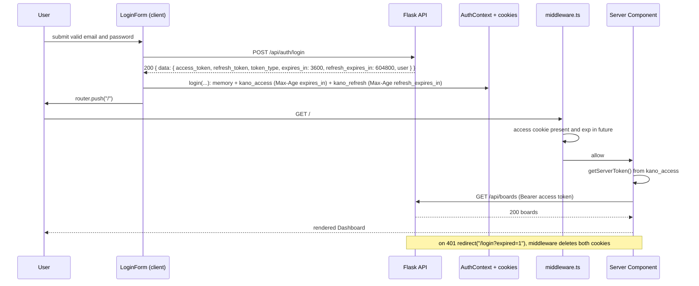

Server-side refresh in the middleware (access cookie expired or missing, refresh cookie valid):

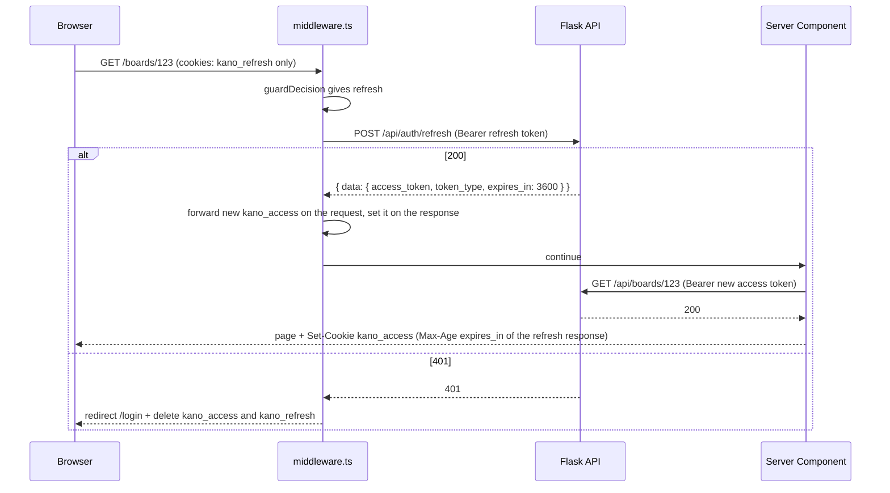

#### B4-V6. Route guard with welcome page, invite links, and safe `next` (Requirements 17.7 to 17.13, 19.3, 19.8, 19.11, 19.12, 37.18 to 37.20, 38)

**V6 change.** `guardDecision` (V5, five rows in the table above) is superseded by `decideRoute` in `lib/decideRoute.ts`. The V5 table stays valid for the paths it covers: the new function adds the `/` first visit, `/welcome`, and `/invite/<token>`. The file that calls it is `web/proxy.ts`.

```ts
// lib/decideRoute.ts  (pure, no I/O, no Date.now)
export type AuthState = "authenticated" | "refreshable" | "unauthenticated";
export type PathClass = "root" | "welcome" | "login" | "register" | "invite" | "protected";
export type RouteDecision =
  | { kind: "continue"; setWelcomeCookie?: boolean }
  | { kind: "refresh-then-continue" }
  | { kind: "redirect"; to: string; setWelcomeCookie?: boolean };
export const INVITE_PATH_RE = /^\/invite\/[A-Za-z0-9_-]{1,128}$/;
export function classifyPath(pathname: string): PathClass;   // "/" root, "/welcome", "/login", "/register", INVITE_PATH_RE -> invite, everything else protected
export function decideRoute(i: { pathname: string; auth: AuthState; welcomeSeen: boolean }): RouteDecision;
```

`auth` is computed as in V5: `authenticated` = access cookie present and `exp` in the future, `refreshable` = access missing or expired and refresh cookie valid, `unauthenticated` = neither. `/login?expired=1` forces `unauthenticated` and deletes both auth cookies (V5 loop guard, unchanged). The table is the complete decision (Requirements 17.7 to 17.13, 38.5 to 38.12):

| Path class | authenticated | refreshable | unauthenticated |
|---|---|---|---|
| `root` (`/`) | continue (no welcome redirect, 38.12) | refresh-then-continue | redirect `/login` if `welcomeSeen`, else redirect `/welcome` (38.5, 38.6) |
| `welcome` | redirect `/` (17.9, 38.8) | redirect `/` (the root then refreshes) | continue, no cookie write (38.9) |
| `login`, `register` | redirect `/` | redirect `/` | continue, with `setWelcomeCookie: true` when `!welcomeSeen` (38.9, 38.10) |
| `invite` (`/invite/<token>`) | continue | refresh-then-continue (17.13) | redirect `/login?next=<encodeURIComponent(pathname)>`, never `/welcome` (17.8, 37.20, 38.11) |
| `protected` (all else, including a malformed `/invite/...`) | continue | refresh-then-continue | redirect `/login` (38.7) |

`proxy.ts` performs the decision: on `refresh-then-continue` it runs the V5 refresh (POST `/api/auth/refresh`, set `kano_access` on the request and the response). If the refresh returns 401, it deletes both auth cookies and then evaluates `decideRoute` again with `auth: "unauthenticated"` and returns that redirect, so an invite path keeps its `next` and `/` goes to `/welcome` or `/login` by the cookie (Requirement 17.8). A network error or 5xx still redirects to `/login?expired=1` (V5, Open issue 15, which drops `next`). When `setWelcomeCookie` is true, `proxy.ts` sets `kano_welcome_seen=1; Max-Age=31536000; Path=/; SameSite=Lax; Secure on HTTPS`, not httpOnly. Logout calls `clearAuthCookies()`, which never touches `kano_welcome_seen`, so the next `/` goes to `/login` (Requirement 38.13).

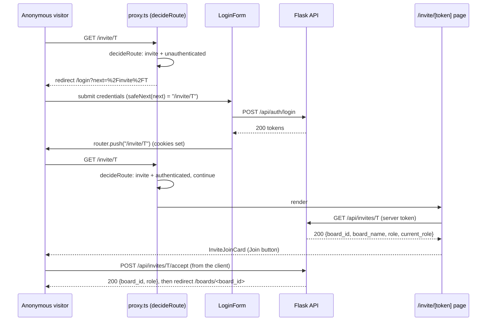

First visit and welcome cookie:

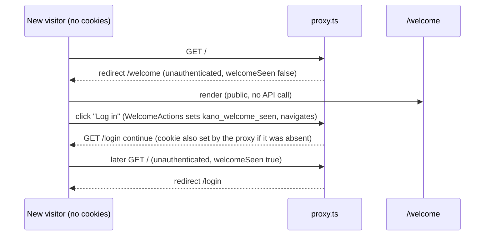

**V8 change (Requirement 17.14).** The table above is unchanged in V8. The Header logo (B12) is a plain link and does not call `decideRoute`: an anonymous click goes to `/welcome`, which the table serves without a redirect (`welcome` row, unauthenticated); an authenticated click goes to `/`, which the table continues (`root` row, authenticated). The first-visit redirect of `/` is not involved, so the logo never reaches `/login`.

**Safe `next` (`lib/nextParam.ts`, pure).**

```ts
const NEXT_RE = /^\/invite\/[A-Za-z0-9_-]{1,128}$/;
export function safeNext(raw: unknown): string | null   // typeof raw === "string" && NEXT_RE.test(raw) ? raw : null
export function withNext(href: "/login" | "/register", next: string | null): string  // next ? `${href}?next=${encodeURIComponent(next)}` : href
```

`raw` is the already-decoded value from `searchParams`. It is tested once, as is: a value that still contains `%`, `\`, `/` after the first segment, a scheme, a host, a query, or a fragment fails the regex, so absolute URLs (`https://evil.test`), protocol-relative URLs (`//evil.test`), and other app paths (`/boards/1`) all return `null` and the form redirects to `/`. `LoginForm` redirects with `router.push(safeNext(next) ?? "/")`, `RegisterForm` redirects to `withNext("/login", safeNext(next))` after the 201, and the two forms link to each other with `withNext` (Requirements 19.3, 19.8, 19.12). `proxy.ts` builds `next` only from a pathname that already matched `INVITE_PATH_RE`.

### B5. API client and errors (Requirement 16)

```ts
// lib/errors.ts
export class ApiError extends Error { constructor(public statusCode: number, message: string) { super(message); } }

// lib/apiClient.ts
export async function apiRequest<T>(path: string, opts?: { method?: string; body?: unknown;
  token?: string | null; signal?: AbortSignal; query?: Record<string, string> }): Promise<T>
```

Behavior:

1. Base URL: `typeof window === "undefined" ? process.env.API_BASE_URL : process.env.NEXT_PUBLIC_API_BASE_URL`. `NEXT_PUBLIC_API_BASE_URL` is referenced literally so Next.js can inline it. Missing or empty gives `ApiError(0, "API base URL is not configured (<VAR>)")` without any request (Requirements 15.7, 16.4).
2. Token: `opts.token` when given, otherwise `getAccessToken()` on the client. Adds `Authorization: Bearer <access token>` only when a token exists; always `Content-Type: application/json` for bodies. On the client, when no access token exists but a refresh token does, the request first awaits `refreshAccessToken()` (below).
3. 10-second timeout through `AbortController`; network error or timeout gives `ApiError(0, "Could not reach the server")`.
4. 2xx: parse JSON and return `body.data as T`.
5. Non-2xx with a body that has a string `error`: `ApiError(response.status, body.error)`. Otherwise `ApiError(response.status, "Unexpected server response")`.
6. Refresh and retry (browser runtime only, Requirements 16.14 to 16.17). When a request that carried an access token gets 401, the path is not `/api/auth/login`, `/api/auth/register`, or `/api/auth/refresh`, a refresh token exists, and the request has not been retried, `apiRequest` awaits `refreshAccessToken()` and repeats the original request once with the new access token. A 401 on the retry, or a failed refresh, calls `sessionExpired()` and throws `ApiError(401, ...)`. Server-side calls (`typeof window === "undefined"`, normally with `opts.token` from `getServerToken()`) never refresh and never write cookies: the 401 handling branch is guarded by `typeof window !== "undefined"`, and on the server a 401 throws `ApiError(401, ...)` directly (Requirement 16.18). Token renewal for server rendering belongs to the middleware (B4).

`lib/refreshSession.ts` (client only) keeps the single-flight state:

```ts
let inFlight: Promise<string> | null = null;           // shared by all concurrent 401s
export function registerSessionHooks(h: { onRefreshed(access: string): void; onExpired(): void }): void
export function refreshAccessToken(): Promise<string> {
  if (!inFlight) {
    inFlight = doRefresh().finally(() => { inFlight = null; });
  }
  return inFlight;
}
async function doRefresh(): Promise<string> {
  // POST /api/auth/refresh with Authorization: Bearer <getRefreshToken()>, built with fetch (not apiRequest, so no recursion)
  // 200 -> setAccessCookie(access_token, expires_in); hooks.onRefreshed(access_token); return access_token
  // 401 or no refresh token -> sessionExpired(); throw ApiError(401, "Session expired")
  // network error or 5xx -> throw ApiError(0 or status, ...) without clearing cookies
}
export function sessionExpired(): void   // clearAuthCookies(); hooks.onExpired() (AuthContext clears state, router.push("/login"))
```

A refresh that fails with a network error or 5xx keeps the cookies and surfaces that error through `useErrorHandler`. Only a 401 from the refresh endpoint ends the session.

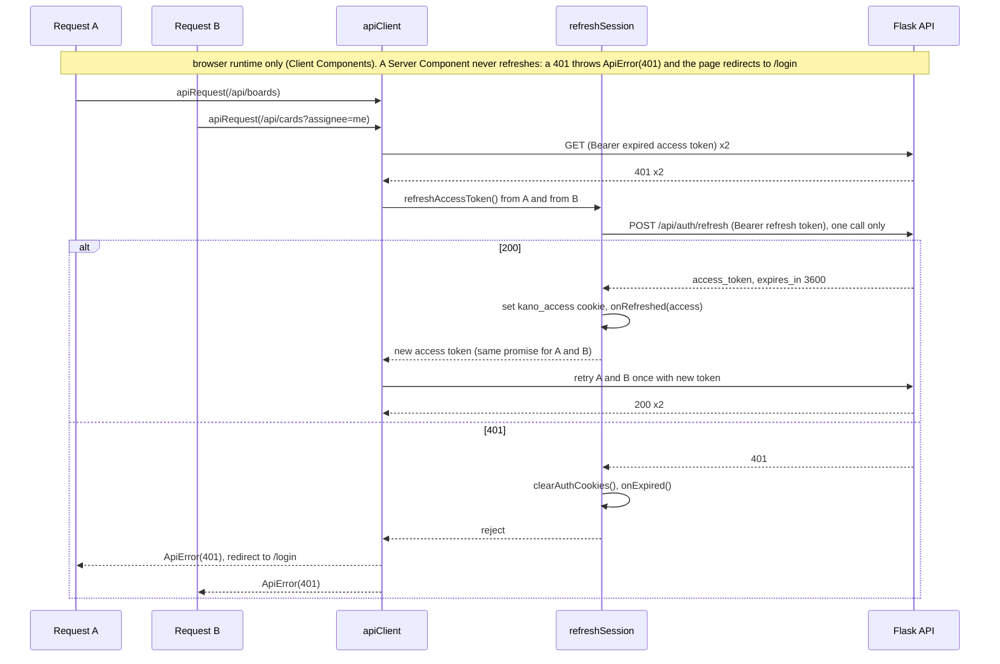

`lib/toast.ts`: `showSuccess(msg)`, `showError(msg)`, `showLoading(msg)`, each requiring a 1 to 200 character message, calling `toast.success`, `toast.error`, `toast.loading`.

`hooks/useErrorHandler.ts` returns `handleError(err: unknown)`: for `ApiError` with status 400, 401, 403, 404, 409, 500 it shows one error toast with a status-specific message from a constant map; any other status or non-ApiError shows a generic message. For 401 it also calls `clearAuthCookies()` (both cookies), `AuthContext.logout()`-style state clearing of the user, access token, and refresh token, and `router.push("/login")`. A 401 reaching the handler has already survived the refresh flow in `apiRequest`.

### B6. Board Detail, drag and drop, search, members, analytics

`BoardView` (Client) holds `columns` state (columns sorted by `order`, cards sorted by `order`), `searchResults`, and modal state. It composes `CardSearchInput`, `KanbanColumn` (renders `ColumnHeader`, `CardItem`, `AddCardForm`), `AddColumnForm`, `CardDetailModal`, and, only when `my_role === "admin"`, `MemberPanel` and an analytics link to `AnalyticsView` (Requirements 21.12, 21.13).

Mutations call `apiRequest` and update state only after success (Requirements 21.2 to 21.8). Failures go to `handleError` and leave state unchanged.

Search: `CardSearchInput` keeps raw text; `useDebouncedValue(text, 300)` yields the debounced value. An effect sends `GET /api/cards?q=<v>&board_id=<id>` when the debounced value is non-empty, cancels the previous request with `AbortController`, and ignores stale responses. Clearing the input restores the full board without a request. An empty result shows a no-results message.

`lib/order.ts` (pure):

```ts
export function computeDropOrder(targetCards: {card_id: string; order: number}[], dropIndex: number): number
// targetCards excludes the dragged card and is sorted ascending.
// empty -> 1.0 ; dropIndex <= 0 -> first.order / 2 ; dropIndex >= length -> last.order + 1 ;
// else (cards[dropIndex-1].order + cards[dropIndex].order) / 2
export function isValidOrder(x: number): boolean   // Number.isFinite(x) && x > 0
export function moveCardInState(cols, cardId, toColumnId, order): Cols    // pure optimistic update
export function restoreCardInState(cols, snapshot): Cols                   // pure revert
export function computeDropIndex(cardMidYs: number[], pointY: number): number
// cardMidYs = vertical midpoints of the target column's cards (excluding the dragged card), top to bottom.
// result = number of midpoints that are < pointY, so 0 = start, cardMidYs.length = end.
export const LONG_PRESS_MS = 300; export const MOVE_TOLERANCE_PX = 10;
export type TouchGesture = { phase: "idle" | "pressing" | "dragging" | "cancelled"; startX: number; startY: number; startedAt: number };
export function touchGestureStep(g: TouchGesture, ev: TouchEv): TouchGesture
// TouchEv = start(x,y,t) | move(x,y,t) | timer(t) | scroll | end | cancel. Pure state machine:
// idle --start--> pressing; pressing --timer(t) with t - startedAt >= 300--> dragging;
// pressing --move farther than 10 px, scroll, end, cancel--> cancelled (no drag, no request);
// dragging --move--> dragging; dragging --end--> idle (drop evaluated by the hook); dragging --cancel--> cancelled.
```

`hooks/useDragAndDrop.ts` API: `{ onDragStart, onDragOver, onDrop, onTouchStart, pendingIds, touchDrag }`. It serves two input paths that share one drop routine `commitDrop(cardId, columnId, index)`.

- **Mouse (Requirement 22.1).** The native HTML5 API is used (`draggable`, `dataTransfer`). On drop: compute the order; if the drop is outside any column, or leaves the card at its current column and index, do nothing and send nothing; if `!isValidOrder(order)` do nothing and call `handleError`; if the card id is in `pendingIds`, ignore. Otherwise snapshot `{column_id, order}`, apply `moveCardInState` immediately (well under 100 ms), add to `pendingIds`, and send `PATCH /api/cards/<id>/position`. On error restore with `restoreCardInState` and call `handleError` once.
- **Touch (Requirements 22.12 to 22.17).** `CardItem` forwards `onTouchStart` from the hook. The hook runs `touchGestureStep`:
  1. On `touchstart` it records the point and starts a 300 ms timer (`LONG_PRESS_MS`). It also marks the input as touch, so a native `dragstart` that a mobile browser may fire on long-press for a `draggable` element is cancelled (`preventDefault`) and the touch path stays the only one active.
  2. If `touchmove` goes more than 10 px away, the page fires `scroll`, or `touchend` / `touchcancel` arrives before the timer fires, the timer is cleared and nothing else happens: no drag, no request, scrolling continues as normal (Requirement 22.14).
  3. When the timer fires the card enters the dragging phase (`touchDrag` shows a lifted style, optional `navigator.vibrate(10)`), and the hook registers `touchmove` and `touchend` listeners on `document` with `{ passive: false }`. From then on `touchmove` calls `preventDefault()`, which stops scrolling for the rest of that touch (Requirement 22.13). Because the finger has not moved before the timer fired, no scroll gesture has started yet, so `preventDefault` is honored.
  4. On each `touchmove` (throttled with `requestAnimationFrame`) the hook calls `document.elementFromPoint(x, y)`, finds the closest ancestor with `data-column-id`, highlights it, and computes `index = computeDropIndex(midYs, y)` from the `getBoundingClientRect()` of that column's cards.
  5. On `touchend`, if the last target is a column, it calls `commitDrop(cardId, columnId, index)` and the rules of the mouse path apply unchanged: same order computation (`computeDropOrder`), same optimistic update, same revert and one toast on failure, same ignore rules for pending cards (Requirement 22.15). If the touch ends outside any column, on the card's own position, or as `touchcancel`, nothing changes and no request is sent (Requirement 22.16).
  6. Listeners and the timer are removed on every exit path and on unmount.

CSS and scrolling (Requirement 22.17): the page and the Kanban container keep the browser default `touch-action: auto`, and `CardItem` must not set `touch-action: none` (it would block panning when the user only wants to scroll). Cards use `select-none [-webkit-touch-callout:none]` so the long-press does not open the text selection or callout menu, and `onContextMenu` calls `preventDefault` during a touch drag. The only scroll blocking is the `preventDefault` on `touchmove` after the long-press, so scrolling works whenever no drag is active. Edge auto-scroll of the board container while dragging near the screen edge is not designed (see Open issues).

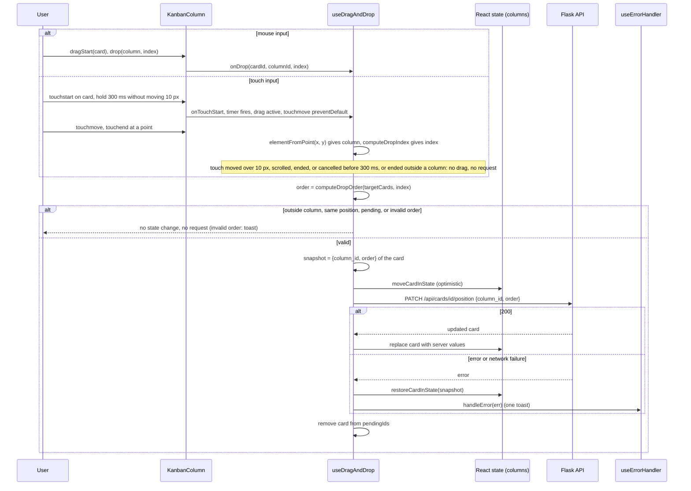

Analytics view: `AnalyticsView` fetches `GET /api/boards/<id>/analytics` when opened and shows cards per column, completed this week, and per-member assigned cards and comments. Errors show an inline message and a toast.

#### B6-V6. Role gating, guests, and the new-card flow (Requirements 21.12, 21.13, 21.17 to 21.23, 22.18, 22.19, 27.8, 37.15 to 37.17)

**Role derivation (`lib/roles.ts`, pure).** `canEdit(role) = role === "admin" || role === "member"`, `isAdmin(role) = role === "admin"`, `isGuest(role) = role === "guest"`, and `ROLE_VARIANT` maps a role to a `BaseBadge` variant. `BoardView` reads `my_role` from the board response and provides `{ role, canEdit, isAdmin }` through `BoardRoleContext`, so `KanbanColumn`, `ColumnHeader`, `CardItem`, `AddColumnForm`, `AddCardForm`, `CardSearchInput`, and `CardDetailModal` read the role from one source instead of receiving a prop per control. The server stays the authority (Requirement 28.14); the gating only removes controls that would get 403.

| Element | admin | member | guest |
|---|---|---|---|
| Header of the board | role badge | role badge | "Guest" `BaseBadge` (read-only indicator, 21.20) |
| `AddColumnForm`, `AddCardForm`, column rename and delete | shown | shown | not rendered |
| Card drag (mouse and touch) | enabled | enabled | disabled (`draggable` attribute absent, touch handler absent) |
| Card search input | shown | shown | shown (guests may search boards where they hold a membership) |
| `CardDetailModal` | editable | editable | read-only (B7-V6) |
| `MemberPanel`, `InviteLinksPanel`, analytics link | shown | hidden | hidden |

**`useDragAndDrop({ enabled })`.** The hook takes `enabled = canEdit`. When `enabled` is false it returns the same shape with every handler `undefined` and `touchDrag = null`, and its internal `commitDrop` returns early, so even a stray event from a browser extension or a test starts no drag, leaves the state unchanged, and sends no request (Requirement 22.18). When enabled it behaves exactly as in V5. A successful drop sends only `column_id` and `order` and never changes the card's `status` in local state (Requirement 22.19, 21.23); `moveCardInState` copies every other field of the card unchanged (Property 56).

**New-card flow (Requirement 21.17 to 21.19).** The quick-add form still asks only for the title. `AddCardForm` returns the created Card to `BoardView`, which appends it to its column and opens `CardDetailModal` with `isNew = true`.

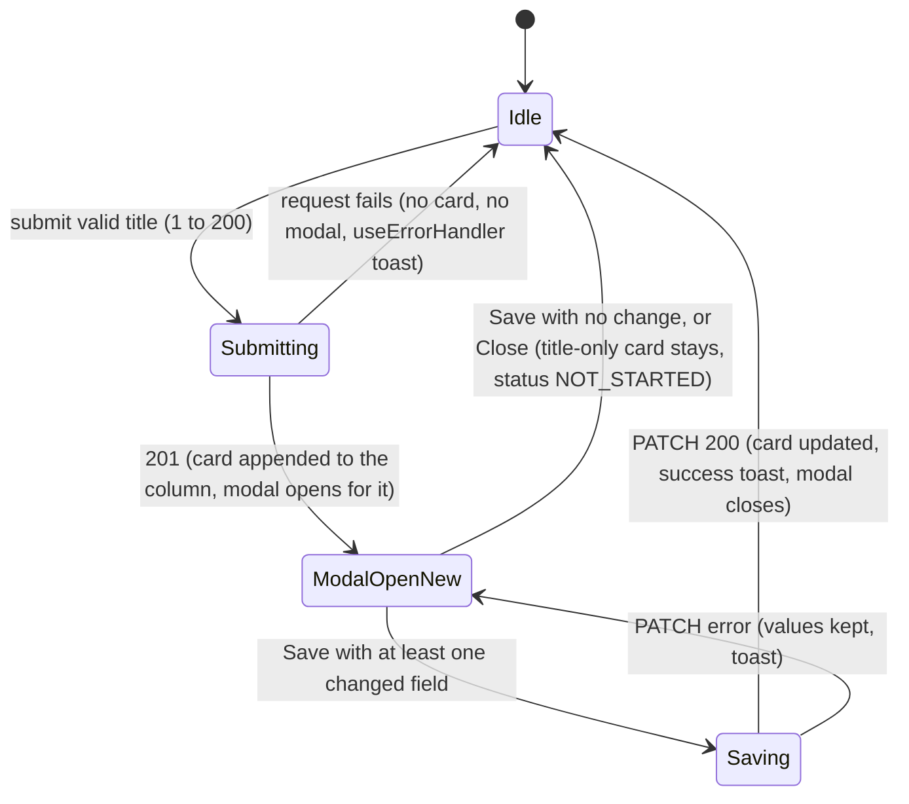

**Member panel and invitation links (admin only).** `MemberPanel` composes `MemberList` (each membership with a `BaseBadge` for `admin`, `member`, or `guest`, and the remove control for every non-admin row, guests included), `AddMemberForm` (email, unchanged), and `InviteLinksPanel`. `InviteLinksPanel` calls GET `/api/boards/<id>/invite-links` when it mounts (this also creates missing tokens) and renders two `InviteLinkRow`s: "Member link: can edit" and "Guest link: view only". Each row shows the full URL `window.location.origin + "/invite/" + token` in a read-only, selectable field (`select-all break-all`), a copy `BaseButton`, and a regenerate `BaseButton`. Copy calls `navigator.clipboard.writeText` inside `try/catch`: success shows a success toast, failure shows an error toast and leaves the URL visible (Requirement 37.15). Regenerate opens `ConfirmDialog` ("the old link stops working"); on confirm it sends POST `.../regenerate`, replaces the row's token and shows a success toast only after a 200; on an error the old link stays and `handleError` runs (Requirement 37.16). Regenerating does not remove members who joined with the old link (Open issue 21).

**Invite page (`/invite/[token]`, Requirement 37.18, 37.19).** The Server page rejects a token that fails `INVITE_PATH_RE`'s token part with the not-found message, otherwise fetches GET `/api/invites/<token>` with the server token. `InviteJoinCard` (Client) shows the board name and "Member: can edit" or "Guest: view only". `acceptOutcome(currentRole, tokenRole)` in `lib/inviteRoles.ts` is the TypeScript twin of `resolve_accept`. If the outcome action is `none` and `current_role` is set, the card shows the current role and an open-board link and no Join button (this also covers a guest holding the guest token and every admin or member). Otherwise (no membership, or a guest with the member token) it shows Join: the button is disabled while POST accept runs, and on 200 the page redirects to `/boards/<board_id>` and shows a success toast. A 404 from either call shows the not-found message with a link to `/` and no Join button. The page header adds `Referrer-Policy: no-referrer` and `Cache-Control: no-store` through `next.config.ts` (Open issue 22).

### B7. Card detail modal and comments

`CardDetailModal` (Client) renders inside `BaseModal`, shows title, description, due date, labels, assignee (a select of board members from `MemberPanel` data or GET members), and composes `CommentList` plus `CommentForm`. It sends PATCH with only changed fields, keeps entered values on error, validates the title (1 to 200) before sending, and uses `ConfirmDialog` for card deletion. `CommentList` loads `GET /api/cards/<id>/comments` on open, shows loading, empty, and error states, and renders `CommentItem`. Edit and delete controls appear only when `comment.author.user_id === user.user_id`, including for the Board_Admin (Requirement 23.14). Comment changes update list state only after a successful response.

#### B7-V6. Status control, guest read-only view, and status badges (Requirements 21.22, 23.17 to 23.22, 25.2, 25.7)

**`lib/status.ts` (pure).**

```ts
export const CARD_STATUSES = ["NOT_STARTED", "IN_PROGRESS", "DONE"] as const;
export type CardStatus = (typeof CARD_STATUSES)[number];
export const STATUS_LABEL: Record<CardStatus, string> = { NOT_STARTED: "Not started", IN_PROGRESS: "In progress", DONE: "Done" };
export const STATUS_VARIANT: Record<CardStatus, "gray" | "blue" | "green"> = { NOT_STARTED: "gray", IN_PROGRESS: "blue", DONE: "green" };
export function isCardStatus(x: unknown): x is CardStatus;
```

`improvements.md` wrote the options in capitals; requirements V6 (21.22, 23.17, 25.2) fix the displayed labels as "Not started", "In progress", and "Done", and the stored values are the exact uppercase strings. The design follows the requirements.

**`CardDetailModal`.** The shell keeps the save logic and composes `CardDetailForm` (title, description, due date, labels, assignee, `StatusSelect`) and `CommentList`. `StatusSelect` is a native select with exactly the three options, preselected with the card's current status. `diffCardFields(original, form)` now includes `status`, so changing only the status sends PATCH `/api/cards/<id>` with only `{ status }` (Requirement 23.18). On 200 the modal calls `onCardUpdated(card)` with the returned card, so the board's `CardItem` badge (`status`, `completed_at`) updates without a reload, and shows a success toast. On error the modal stays open, keeps the entered values, keeps the previously saved status on the board, and calls `handleError` (Requirement 23.19). The assignee options are `members.filter(m => m.role !== "guest")` from GET `/api/boards/<id>/members` (Requirement 23.20). For a newly created card (`isNew`) the modal shows the entered title and a single Save button that sends the same PATCH; Save with an empty diff closes the modal without a request.

**Guest view.** When `canEdit` is false, `CardDetailForm` renders every field `disabled`, `StatusSelect` disabled, and hides the Save button, the Delete button, the comment form, and the edit and delete controls of every Comment (`CommentList` gets `readOnly`). The Comments are still loaded with GET `/api/cards/<id>/comments` (Requirement 12.10). Ownership controls from V5 (author only, Board_Admin excluded) apply to admin and member authors only.

**Badges.** `CardItem` renders `<StatusBadge status={card.status} />` next to the labels. `MyTasksList` renders it after the Column name and keeps Cards with `DONE` in the list, marked "Done", with no status filter (Requirement 25.7). Moving a card by drag never changes the badge (Requirement 21.23).

### B8. Notifications UI

`useNotifications()` returns `{ items, unreadCount, markRead }`. While authenticated it requests `GET /api/notifications?page=1&per_page=20` immediately and every 30 s using `setInterval`, clears the interval on unmount or logout, keeps the previous state silently on a poll error, and `markRead(id)` sends `PATCH /api/notifications/<id>/read`, then marks the item read and sets `unreadCount = max(0, unreadCount - 1)`; on error the item stays unread and `handleError` fires. `NotificationBell` shows `formatBadge(unreadCount)` (`"99+"` above 99, nothing at 0) and toggles `NotificationList` (newest first, unread styled differently, empty state).

### B9. Responsive strategy (Requirement 27)

Mobile-first Tailwind; the minimum design width is 375 px.

| Concern | Rule |
|---|---|
| Page overflow | Layout uses `min-w-0`, `flex-wrap`, and `max-w-full`; only the Kanban container uses `overflow-x-auto` |
| Kanban | Container `flex gap-4 overflow-x-auto`; column `w-72 min-w-[240px] shrink-0` so columns stay at least 240 px below 768 px |
| Modal | `max-h-[100dvh] overflow-y-auto w-[calc(100vw-1rem)] max-w-lg`; close control `sticky top-0` |
| Tap targets | Shared `min-h-[44px] min-w-[44px]` on `BaseButton`, links in `Header`, inputs `min-h-[44px]` |
| Touch drag (Requirement 27.8) | Cards drag by 300 ms long-press (B6). Page, Kanban container, and Cards keep default `touch-action` so panning works; `select-none` and `-webkit-touch-callout: none` on Cards; scroll is blocked only by `preventDefault` on `touchmove` while a touch drag is active |
| Overlap | Stack form controls with `flex-col gap-2` below `md`; no absolute positioning for controls |
| Below 375 px | Page can scroll horizontally; content is not truncated |
| Tailwind scan | v4: `@source "../components"; @source "../hooks";` in `globals.css`. v3: `content` array lists `./app`, `./components`, `./hooks` |

**V6 change, responsive notes (Requirement 27.9).** `/welcome` and `/invite/[token]` use a single column `mx-auto w-full max-w-xl px-4`, `min-w-0` on text, and `flex flex-col gap-2 sm:flex-row` for the button row, so there is no horizontal overflow between 375 px and 1920 px and no two controls overlap. The Join, Log in, and Create account buttons are `BaseButton`s with the 44 px minimum. The invite link rows in `InviteLinksPanel` stack the URL field, the copy button, and the regenerate button vertically below `md`, the URL uses `break-all`, and the "Guest" badge wraps with the board title (`flex-wrap`). `ConfirmDialog` for regenerate follows the BaseModal mobile rules. Guests keep the same Kanban container scrolling, with no drag handlers and no `touch-action` rule (Requirement 22.17).

### B10. Typed API models (`lib/types.ts`)

```ts
export type Role = "admin" | "member" | "guest";            // V6: guest added
export type CardStatus = "NOT_STARTED" | "IN_PROGRESS" | "DONE";   // V6 (values and labels in lib/status.ts)
export interface User { user_id: string; name: string; email: string; created_at: string }
export interface LoginResult { access_token: string; refresh_token: string; token_type: "Bearer"; expires_in: number; refresh_expires_in: number; user: User }
export interface RefreshResult { access_token: string; token_type: "Bearer"; expires_in: number }
export interface AuthState { user: User | null; accessToken: string | null; refreshToken: string | null;
  status: "loading" | "authenticated" | "anonymous" }
export interface AuthContextValue extends AuthState {
  login(r: LoginResult): void; logout(): void; updateUser(u: User): void; setAccessToken(t: string): void }
export interface Card { card_id: string; board_id: string; column_id: string; title: string;
  description: string | null; due_date: string | null; labels: string[];
  assignee: { user_id: string; name: string } | null; status: CardStatus; completed_at: string | null;
  order: number; created_at: string; updated_at: string }
export interface Column { column_id: string; board_id: string; name: string; order: number; cards: Card[] }
export interface BoardSummary { board_id: string; name: string; my_role: Role; created_at: string }
export interface BoardDetail extends BoardSummary { columns: Column[] }
export interface Member { user_id: string; name: string; email: string; role: Role }
export interface CardSearchResult extends Card { board_name: string; column_name: string }
export interface Comment { comment_id: string; card_id: string; content: string;
  author: { user_id: string; name: string }; created_at: string; updated_at: string }
export interface AppNotification { notification_id: string; type: "assignment" | "comment"; message: string;
  card_id: string; board_id: string; is_read: boolean; created_at: string }
export interface NotificationPage { items: AppNotification[]; page: number; per_page: number; total: number; unread_count: number }
export interface Analytics { cards_per_column: { column_id: string; name: string; count: number }[];
  completed_this_week: number; member_activity: { user_id: string; name: string; assigned_cards: number; comments: number }[] }
```

**V6 additions to `lib/types.ts`.**

```ts
export interface InviteLink { role: "member" | "guest"; token: string }
export interface InviteLinks { member: InviteLink; guest: InviteLink }
export interface InviteInfo { board_id: string; board_name: string; role: "member" | "guest"; current_role: Role | null }
export interface AcceptResult { board_id: string; role: Role }
export interface ProfileUpdate { name?: string; password?: string; current_password?: string }   // never `email`
```

### B11. Profile page (Requirements 7, 26)

`ProfileForm` (Client) keeps a controlled `name` input pre-filled from `AuthContext`, renders `ReadOnlyEmail` (the email as text in a `<dd>`, no input element, so no editable email control exists), and composes `ChangePasswordForm` with two masked inputs (current password with `autoComplete="current-password"`, new password with `autoComplete="new-password"`), never pre-populated. Validation lives in `lib/validation.ts` and mirrors the server (Property 29):

```ts
validateName(s)                 // trimmed length 1 to 100
validateNewPassword(s)          // length 8 to 128
validateCurrentPassword(s)      // non-empty
validatePasswordSection(cur, next) // both empty: ok (section unused); exactly one filled: error on the empty one; both filled: validate each
```

Submit builds the body `{ name }` plus `{ password, current_password }` only when both password inputs are filled and valid, and never contains `email`. The button is disabled until the request finishes. On 200 the form calls `updateUser(returned user)` (tokens and cookies untouched), shows a success toast, and, when a password was sent, clears both password inputs. On status 400 with a message that names `current_password` (`errorNamesField(err, "current_password")`), the form shows the field error on the current-password input, keeps the entered name, and leaves the AuthContext user unchanged (no toast). Any other error goes to `useErrorHandler` and the entered values stay (Requirements 26.2 to 26.8). A password change does not log the user out and does not invalidate tokens.

### B12. V8: Header logo link (Requirements 17.14, 18.14, 18.15, 27.10)

**V8 change.** In V5 and V6 the brand link of the Header had the fixed target `/`, so an anonymous click reached `proxy.ts`, which redirected to `/login` (Welcome_Cookie present) or `/welcome` (absent). V8 replaces the fixed target. The V5 text of B3 and the file tree stay as history.

**Pure functions (`lib/logoTarget.ts`, no I/O, no `document`).**

```ts
export type LogoTarget = "/welcome" | "/";
export type AuthStatus = "loading" | "authenticated" | "anonymous";   // same union as AuthState.status in lib/types.ts
// R18.15 (V8 refinement): authenticated ONLY while the AuthContext status is "authenticated" (a User is held).
// No cookie and no token is read. "loading", "anonymous" (failed restore, logout) are unauthenticated.
export function isVisitorAuthenticated(status: AuthStatus): boolean {
  return status === "authenticated";
}
// R18.14: never "/login", independent of the Welcome_Cookie
export function logoTarget(isAuthenticated: boolean): LogoTarget {
  return isAuthenticated ? "/" : "/welcome";
}
```

> **Superseded (first V8 text, kept as history).** The first V8 design computed `isVisitorAuthenticated({ user, accessToken, refreshToken })` as "a User is held, or an access or refresh token is present", so the logo could point to `/` during session restoration while the navigation still showed the anonymous links, and a stale cookie also gave `/` (old Open issue 33). The refined Requirement 18.15 replaces this with the single status-only check above.

**Header change (`components/Header.tsx`, Client Component, one component, well under 300 lines).**

| Aspect | V8 design |
|---|---|
| Source of state (**V8 refinement**) | `const { status } = useAuth(); const isAuth = isVisitorAuthenticated(status);` then `href = logoTarget(isAuth)`. This one `isAuth` value is the only authentication input of the Header: the logo target and the "My Tasks" link, `NotificationBell`, `UserMenu`, "Log in", and "Register" all use it, so they cannot disagree (R18.15). The Header reads no cookie, no token, and no `user` object. The server render and the first client render both start with `status` `loading` (the `AuthProvider` initial state), so both give `/welcome` and there is no hydration mismatch. |
| Recomputed after state changes | The Header re-renders on every `status` change. `logout()` and `sessionExpired()` set `status` to `anonymous`, so the target becomes `/welcome` and the navigation switches to Log in and Register. A successful session restoration or `login()` sets `status` to `authenticated`, so the target becomes `/` and the user controls appear (R18.15). |
| Restore-time behavior | While a cookie exists and session restoration runs (`status` `loading`), the logo targets `/welcome` and the navigation shows the anonymous links. A click in that window requests `/welcome`; `proxy.ts` sees a valid access or refresh cookie (`decideRoute` `welcome` row, authenticated or refreshable) and redirects to `/`, so the visitor still reaches the Dashboard (R17.9, R17.14). After the restoration succeeds the target is `/` directly. |
| Restore failure with 5xx or network error | `AuthProvider` keeps both cookies, leaves the User unset, and sets `status` to `anonymous` (B4, R17.5), never leaving it at `loading`. The Header therefore shows `/welcome` and the anonymous links, plus the `useErrorHandler` toast. A logo click requests `/welcome`, and `proxy.ts` redirects it to `/` while the cookies are still valid, where the Server Component fetch runs again. A 401 that survives the refresh flow clears both cookies, and the logo then reaches `/welcome` without a redirect. |
| Link markup | One `Link` containing the mark and the wordmark. The existing classes stay (44 px minimum target, `rounded-md`, `text-base font-semibold text-ink`). The mark `span` gets `aria-hidden="true"` so the accessible name of the link is exactly "Kano". |
| Side effects | None. The link sets and deletes no cookie and sends no request. `Link` prefetch is allowed: a prefetch of `/welcome` for an anonymous visitor is a public page, and a prefetch of `/` for an authenticated User is the Dashboard. |
| Navigation links | The "My Tasks" link, `NotificationBell`, `UserMenu`, "Log in", and "Register" now use the same `isVisitorAuthenticated(status)` value as the logo (the V6 condition `status === "authenticated"` is exactly that check). "Log in" and "Register" are anchor elements (`Link`), not `BaseButton` (R38.2). Open issue 33 is resolved by this. |
| Layout | `layout.tsx` still renders exactly one `Header` and one `Footer` around `children` (R18.13). No page renders its own Header or Footer. |

**Relation to `proxy.ts` and `decideRoute` (unchanged).** The logo link needs no new routing rule, as shown by this table (rows copied from the B4-V6 decision table):

| Click | Request | `decideRoute` outcome | Result |
|---|---|---|---|
| Anonymous, any page, Welcome_Cookie present or absent | `/welcome` | `welcome` + unauthenticated: continue, no cookie write | Welcome_Page |
| Authenticated (valid access cookie) | `/` | `root` + authenticated: continue | Dashboard |
| Only a refresh cookie, valid | `/` | `root` + refreshable: refresh then continue | Dashboard |
| Any visitor while `status` is not `authenticated` (restore in progress, failed restore, stale cookies, logout) | `/welcome` | `welcome`: continue when unauthenticated, redirect to `/` when a valid access or refresh cookie exists | Welcome_Page, or the Dashboard after the redirect |
| Stale cookies (V8 refinement: no longer reach `/` through the logo) | `/welcome` | unauthenticated: continue | Welcome_Page (resolves Open issue 33) |

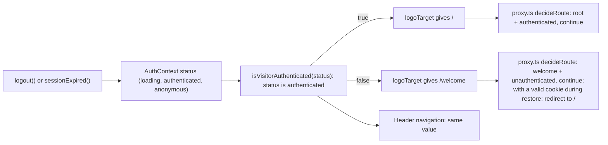

### B13. V8: Welcome page structure, copy, and visual rules (Requirements 38.1, 38.2, 38.10, 38.15 to 38.21, 27.10)

**V8 change.** Supersedes the V6 `WelcomeContent` description (B2 row, B7-V6 responsive note). `/welcome` stays public, a Server Component, with no API call (R38.1). No backend file is involved.

**Files (one component per file, each far below 300 lines; the new and rewritten files are all under `web/`).**

| File | Type | Content |
|---|---|---|
| `app/welcome/page.tsx` | Server | Exports `metadata` (title "Welcome to Kano", description `WELCOME_COPY.metaDescription`) and renders `WelcomeContent` inside `<main>`. Renders no Header or Footer (the layout does, R18.13). |
| `components/welcome/WelcomeContent.tsx` | Server | Rewritten. Composes, in this order, `WelcomeHero`, `BoardPreview`, `FeaturesSection`, `WelcomeCta` (R38.15 parts b to e). |
| `components/welcome/WelcomeHero.tsx` | Server | `<section aria-labelledby="welcome-hero-title">`: eyebrow, the only `h1`, subheadline, `<WelcomeActions placement="hero" />`. |
| `components/welcome/BoardPreview.tsx` | Server | Decorative preview (below). Uses `PreviewColumn.tsx` and `PreviewCard.tsx`. |
| `components/welcome/PreviewColumn.tsx`, `PreviewCard.tsx` | Server | One component each. |
| `components/welcome/FeaturesSection.tsx`, `FeatureCard.tsx` | Server | `<section aria-labelledby="welcome-features-title">` with an `h2`, one sentence, and four `FeatureCard`s. |
| `components/welcome/WelcomeCta.tsx` | Server | `<section aria-labelledby="welcome-cta-title">` with an `h2`, one sentence, and `<WelcomeActions placement="cta" />`. |
| `components/welcome/WelcomeActions.tsx` | **Client** | The only Client Component of the page. Prop `placement: "hero" or "cta"`. Hero: one primary `BaseButton` "Get started". CTA: primary "Create account" and secondary "Log in". Each `onClick` calls `setWelcomeSeenCookie()` (from `lib/authCookie.ts`, V6 helper) and then `router.push(target)`. **V8 refinement (R38.2):** these three section actions are `BaseButton`s. The Header "Log in" and "Register" are anchor links (`Link`) in `Header.tsx` and are not part of this component. |
| `lib/welcomeContent.ts` | pure | `WELCOME_COPY` (all page texts and link targets), `FEATURES` (icon name, title, description), `PREVIEW_SAMPLE` (all preview texts), `FORBIDDEN_CLAIMS` is not here (see next row). |
| `lib/forbiddenClaims.ts` | pure | `FORBIDDEN_CLAIMS` list of Requirement 38 criterion 19 and `findForbiddenClaims(text): string[]` (Property 60). Matching (V8 refinement, R38.19): the text and each entry are lowercased, every entry except "free" is a plain substring match, and "free" is a whole-word match (`/(^|[^\p{L}\p{N}_])free($|[^\p{L}\p{N}_])/iu`). Substring matching has false positives by design: "operating", "integrating", and "generating" contain "rating", and a number such as "14.9" contains "4.9"; the copy must avoid such words, and a hit is reported, not filtered. Kept outside `components/welcome/` so a source scan of the welcome files does not match the list itself. |

**Sections, copy, and targets (exactly Requirement 38 criteria 16 and 17; `WELCOME_COPY` is the single source).**

| Part | Element | Text | Target / style |
|---|---|---|---|
| (a) Header (shared, `Header.tsx`) | link | "Log in" | `/login`, non-primary classes (V5, unchanged) |
| (a) Header | link | "Register" | `/register`, primary classes (V5, unchanged) |
| (b) Hero | eyebrow badge | "Kanban boards for teams" | `bg-primary-100 text-primary-700 rounded-full text-xs font-medium h-5 px-2.5` |
| (b) Hero | `h1` | "Organize work smoothly, from idea to done" | `text-xl md:text-2xl font-semibold text-ink` (H1 role below 768 px, Display role from 768 px) |
| (b) Hero | subheadline | "Plan work on boards and columns, move cards by drag and drop, and keep your team aligned with comments, notifications, and invitation links." | `text-base text-ink-muted max-w-prose` |
| (b) Hero | button | "Get started" | `/register`, `BaseButton` primary |
| (c) Preview | decorative | sample data only (B13 preview) | none |
| (d) Features | `h2` and sentence | "Everything your team needs to execute" / "Kano keeps boards simple so your team can focus on what to do next." | |
| (d) Features | card 1 | "Drag and drop on mouse and touch" / "Move cards between columns with a mouse or by touch, and Kano keeps the order you chose." | icon `Move` |
| (d) Features | card 2 | "Stay organized at a glance" / "Add labels, due dates, and a status (Not started, In progress, or Done) to every card." | icon `Tag` |
| (d) Features | card 3 | "Collaborate with your team" / "Comment on cards, get notifications about assignments and comments, and invite members or read-only guests with a link." | icon `Users` |
| (d) Features | card 4 | "Find and focus" / "Search the cards of a board, see the cards assigned to you in My Tasks, and let board admins view analytics." | icon `Search` |
| (e) Bottom CTA | `h2` and sentence | "Ready to bring calm to your project planning?" / "Create an account to start your first board, or log in to pick up where you left off." | panel `bg-sunken` |
| (e) Bottom CTA | button | "Create account" | `/register`, primary |
| (e) Bottom CTA | button | "Log in" | `/login`, secondary |
| (f) Footer | shared `Footer.tsx` | unchanged | |

Icons come from `lucide-react` (already a dependency, as used by `BoardView`), `size-5` inside a `size-10 rounded-md bg-primary-50 text-primary-600` square, `aria-hidden="true"`. The four icon names are checked at implementation time.

**Welcome_Cookie (R38.10).** The five actions all set the cookie. The two Header links reach `/login` or `/register`, where `proxy.ts` already sets the cookie when it is absent (`decideRoute` `setWelcomeCookie`, B4-V6), so the Header needs no click handler. The three section buttons set it in `WelcomeActions` before navigating (V6 behavior kept). The logo link does not set it (R18.14).

**Decorative board preview (R38.18).**
- Outer wrapper `div` with `overflow-x-auto` and `tabIndex={-1}` (**V8 refinement:** the horizontal scroller for narrow screens lies outside the hidden subtree and is not a tab stop), then the container `div aria-hidden="true"` that holds all preview markup. The preview content has no focusable element: inside the container only `div`, `span`, and `p` elements, with no `a`, `button`, `input`, `select`, `textarea`, `summary`, `tabindex`, `onClick`, or `draggable`. The `tabindex="-1"` sits on the scroller, which is outside the container, so the "no `[tabindex]` inside the container" test still holds (Open issue 35 resolved).
- Three Columns "To do", "In progress", "Done" (`bg-sunken rounded-lg p-2`, `w-72 shrink-0` below 768 px, `md:w-auto` in a three-column grid from 768 px). Each Column has two or three sample Cards (`bg-surface border border-line rounded-md p-3`) with a title, one or two label chips from the fixed pairs (`bg-label-green-bg text-label-green-fg` and so on), avatar initials circles (`rounded-full`, label token pairs), and a status `BaseBadge`-style chip with the text "Not started", "In progress", or "Done" only (the chip is markup in the preview, not the `StatusBadge` component, to keep the subtree free of logic).
- One Card in the middle Column is shown as being dragged (`rotate-2 border-primary-200 shadow-overlay`; **V8 refinement:** this is the only element of the page that may carry the design-system overlay shadow, R38.20; the first V8 text said "no shadow", superseded) next to a dashed placeholder (`border-2 border-dashed border-primary-200 bg-primary-50 rounded-md`).
- Sample texts are generic task titles ("Draft the project brief", "Design the login page", "Set up the database", and similar) kept in `PREVIEW_SAMPLE`. No ticket ids, counts of people, metrics, or claims. Tailwind classes in these files are written as complete static strings (a lookup object from sample color name to full class string), never built with template strings, so the Tailwind v4 scanner finds them.

**Design-system and Tailwind approach (read-only use of `guidelines/design-system.md` and the existing `web/app/globals.css`).**
- No new token, no `globals.css` change, no `tailwind.config`. The `@theme` block of `globals.css` already resets default palettes and defines `primary-*`, `canvas`, `surface`, `sunken`, `line`, `ink*`, the eight label pairs, `rounded-sm|md|lg|full`, and the type scale, and `@source "../components"` already scans the new component files. `app/welcome/page.tsx` sits in `app/`, which Tailwind v4 scans by default.
- Only tokens and the documented recipes are used (design-system section 0 rule 2). Fonts are Inter weights 400, 500, 600 only (`font-medium`, `font-semibold`, never bold). Surfaces are flat: 1 px `border-line`, no gradient, no blur, and no `shadow-*` except `shadow-overlay` on the one dragged preview Card (R38.20). Everything else on the page is flat. Page background is `canvas` (from `html`), cards `surface`, bottom panel `sunken`. Spacing uses the 4, 8, 12, 16, 24, 32, 48 px steps (`gap-2|3|4`, `p-6`, `py-12`).
- One primary button per region: the Header "Register", the hero "Get started", and the bottom "Create account" are in three separate regions.
- Contrast uses only documented pairs (white on `primary-500` at 4.58:1, `primary-700` on `primary-100`, `ink` and `ink-muted` on `canvas`, `surface`, `sunken`).

**Layout by width (R38.21, R27.1, R27.2, R27.10).**

| Part | Below 768 px | From 768 px |
|---|---|---|
| Hero | single column, centered text, `px-4 py-12`, button `w-full min-h-[44px]` | `max-w-3xl`, centered, button `md:w-auto` |
| Preview | scroller `overflow-x-auto`, three Columns `w-72` (288 px, at least 240 px) side by side inside it, so the page has no horizontal scroll | `md:grid md:grid-cols-3 gap-4`, no scrolling |
| Features | `grid-cols-1 gap-4` | `md:grid-cols-2 gap-4` |
| Bottom CTA | `flex flex-col gap-2`, buttons `w-full min-h-[44px]` | `md:flex-row md:justify-center`, buttons `md:w-auto` |
| Header links and logo | 44 px targets (already in `Header.tsx`) | same |

Root containers use `min-w-0` and `max-w-full`. The only horizontally scrolling element is the preview scroller.

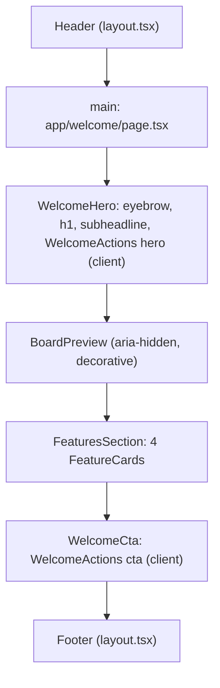

### B14. V8: Board toolbar and the single separator line (Requirements 21.24 to 21.28, 27.10)

**V8 change.** In V6, `BoardView.tsx` rendered the toolbar inline (a `div` with `mb-6`) directly above the Kanban row, with no line between them. `BoardView.tsx` is already near the 300-line limit (Requirement 30.6), so V8 extracts the toolbar.

| File | Change |
|---|---|
| `components/boards/BoardToolbar.tsx` | New Client Component (one component). Props: `boardName`, `role`, `boardId`, `onSearchResults`, `onSearchClear`, `onOpenMembers`, `onOpenAnalytics`. Contains the back link "Boards", the `h1` title, the role `BaseBadge` ("Guest" for a guest), `CardSearchInput`, and, only for the admin, the Members and Analytics `BaseButton`s. Root element: `<div data-testid="board-toolbar" className="flex flex-wrap items-center justify-between gap-3 pb-4 min-w-0">` with the same inner markup as V6. No `border-*` class on it. |
| `components/boards/BoardView.tsx` | Replaces the inline toolbar with `<BoardToolbar ... />`, then renders exactly one `<hr data-testid="board-separator" className="m-0 h-px w-full border-0 bg-line" />`, then `<div data-testid="board-content" className="pt-6 min-w-0">` that holds the search results list or the Kanban row (V6 markup, with its `mb-6` and any border removed). The separator is rendered once, unconditionally inside `BoardView`, so it appears for every role and in the search-results state too. If `BoardView.tsx` still exceeds 300 lines, the search-results `ul` moves to `SearchResultList.tsx`. |

**Why one `hr`.** `hr` has the implicit role `separator` with horizontal orientation (R21.25), is block level so it always starts a new line below the last wrapped toolbar line (R21.26), and `h-px bg-line` (token `line`, `#E1E4EA`) draws exactly 1 px with Tailwind preflight's `border-width` removed by `border-0`. It sits inside the `px-4 sm:px-6` page padding wrapper, so it spans the full toolbar width. `BoardToolbar` and `board-content` carry no `border-t` or `border-b` class, so a second line cannot appear (R21.28). The Kanban row keeps its V6 `overflow-x-auto`, so the page itself does not scroll horizontally (R21.26).

```
BoardRoleProvider
  div.px-4.sm:px-6.py-6.min-w-0
    BoardToolbar      (title, role badge, search, Members and Analytics for admin)   pb-4
    hr#separator      1 px, bg-line, full width
    div.board-content (search results OR Kanban row, AddColumnForm at the end)        pt-6
```

**Role and state coverage (R21.27).** `BoardToolbar` and the `hr` render for admin, member, and guest. In the 403 and 404 states the board page renders `BoardAccessMessage` instead of `BoardView`, so no toolbar, no separator, and no Column exist. The add-column control stays at the end of the Kanban row inside the Kanban columns area, outside `BoardToolbar` (V8 refinement, R21.24: `BoardToolbar` has no add-column prop and renders no add-column form; Open issue 36 resolved). The `Header`'s own `border-b` belongs to the shared Header, not to the board toolbar.

## Data Models

### Conventions

- Primary key of each table is `<singular_name>_id`, type PostgreSQL `UUID`, generated by the application with `uuid.uuid4` (Requirement 2.3). Tables are plural (as listed in Requirement 1.9), so `users.user_id`, `board_memberships.board_membership_id`.
- Every model uses `SoftDeleteMixin`: `created_at`, `updated_at` (set on insert and on every update), `deleted_at` (nullable), `is_deleted` (default false). All timestamps are `timestamptz` in UTC.
- Foreign keys are named `fk_<child_table>_<parent_table>`. Each child/parent pair occurs once, so names are unique.
- Unique constraints are partial indexes `WHERE is_deleted = false`, so soft-deleted rows do not block new rows (Requirement 2.12).
- The SQL column named `order` is a reserved word. SQLAlchemy quotes it automatically; the Python attribute is also `order`.
- Relationships are declared with `lazy="raise"`; services load related rows through explicit queries.

### Mixin and Card model

```python
# app/soft_delete.py
class SoftDeleteMixin:
    created_at = db.Column(db.DateTime(timezone=True), nullable=False, default=utcnow)
    updated_at = db.Column(db.DateTime(timezone=True), nullable=False, default=utcnow, onupdate=utcnow)
    deleted_at = db.Column(db.DateTime(timezone=True), nullable=True)
    is_deleted = db.Column(db.Boolean, nullable=False, default=False, server_default=db.false())

# app/blueprints/cards/schema.py
class Card(SoftDeleteMixin, db.Model):
    __tablename__ = "cards"
    card_id     = db.Column(db.Uuid, primary_key=True, default=uuid.uuid4)
    board_id    = db.Column(db.Uuid, db.ForeignKey("boards.board_id", name="fk_cards_boards"), nullable=False)
    column_id   = db.Column(db.Uuid, db.ForeignKey("columns.column_id", name="fk_cards_columns"), nullable=False)
    title       = db.Column(db.String(200), nullable=False)
    description = db.Column(db.Text, nullable=True)
    due_date    = db.Column(db.Date, nullable=True)
    labels      = db.Column(postgresql.ARRAY(db.String(30)), nullable=False, default=list, server_default="{}")
    assignee_id = db.Column(db.Uuid, db.ForeignKey("users.user_id", name="fk_cards_users"), nullable=True)
    order       = db.Column(db.Float, nullable=False)
    # V6 change:
    status       = db.Column(db.String(20), nullable=False, default="NOT_STARTED", server_default="NOT_STARTED")
    completed_at = db.Column(db.DateTime(timezone=True), nullable=True)
    __table_args__ = (
        db.CheckConstraint("char_length(description) <= 5000", name="ck_cards_description_len"),
        db.CheckConstraint('"order" > 0', name="ck_cards_order_positive"),
        db.CheckConstraint("status IN ('NOT_STARTED', 'IN_PROGRESS', 'DONE')", name="ck_cards_status"),   # V6
        db.Index("ix_cards_column_id_order", "column_id", "order"),
        db.Index("ix_cards_board_id", "board_id"),
        db.Index("ix_cards_assignee_id", "assignee_id"),
    )
```

### Other models (columns and constraints)

| Model / table | Columns | Constraints and indexes |
|---|---|---|
| `User` / `users` | `user_id` UUID PK, `name` varchar(100) not null, `email` varchar(254) not null (always stored lowercase: normalized by `normalize_email` in the Marshmallow `pre_load` of every email-carrying schema), `password_hash` varchar(255) not null, mixin | check `ck_users_email_lowercase` (`email = lower(email)`); partial unique index `uq_users_email_active` on `email` where `is_deleted = false` (the column is already normalized, so no `lower(email)` expression index is needed) |
| `Board` / `boards` | `board_id` UUID PK, `name` varchar(100) not null, `created_by` UUID not null, **V6:** `member_invite_token` varchar(128) null, `guest_invite_token` varchar(128) null, mixin | FK `fk_boards_users` (created_by to users.user_id); index `ix_boards_created_by`; **V6:** unique constraints `uq_boards_member_invite_token` and `uq_boards_guest_invite_token` (many NULLs allowed, so Boards that existed before V6 stay valid until their tokens are created lazily) |
| `BoardMembership` / `board_memberships` | `board_membership_id` UUID PK, `board_id`, `user_id`, `role` varchar(10) not null, mixin | FKs `fk_board_memberships_boards`, `fk_board_memberships_users`; check `ck_board_memberships_role` (**V6 change:** `admin`, `member`, or `guest`; V5 allowed only `admin` and `member`; the partial unique index below is unchanged for all three roles); partial unique index `uq_board_memberships_board_user_active` on (`board_id`, `user_id`) where `is_deleted = false`; indexes `ix_board_memberships_user_id`, `ix_board_memberships_board_id` |
| `Column` / `columns` | `column_id` UUID PK, `board_id`, `name` varchar(100) not null, `order` float not null, mixin | FK `fk_columns_boards`; check `order > 0`; index `ix_columns_board_id_order` on (`board_id`, `order`) |
| `Card` / `cards` | see model above | FKs `fk_cards_boards`, `fk_cards_columns`, `fk_cards_users` |
| `Comment` / `comments` | `comment_id` UUID PK, `card_id`, `author_id`, `content` text not null (1 to 2000 enforced by schema and `ck_comments_content_len`), mixin | FKs `fk_comments_cards`, `fk_comments_users`; index `ix_comments_card_id_created_at` |
| `Notification` / `notifications` | `notification_id` UUID PK, `recipient_id`, `card_id`, `board_id`, `type` varchar(10) not null, `message` varchar(255) not null, `is_read` boolean not null default false, mixin | FKs `fk_notifications_users`, `fk_notifications_cards`, `fk_notifications_boards`; check `ck_notifications_type` (`assignment` or `comment`); indexes `ix_notifications_recipient_created` on (`recipient_id`, `created_at` desc), `ix_notifications_recipient_unread` on `recipient_id` where `is_read = false` |

Indexes required by Requirement 29.3 are present: membership `user_id` and `board_id`, column `board_id`, card `column_id` and assignee, comment `card_id`, notification recipient, and the `order` columns inside composite indexes. All composite and filter indexes also include rows where `is_deleted = true`, which is acceptable at the expected data volume.

### ER diagram

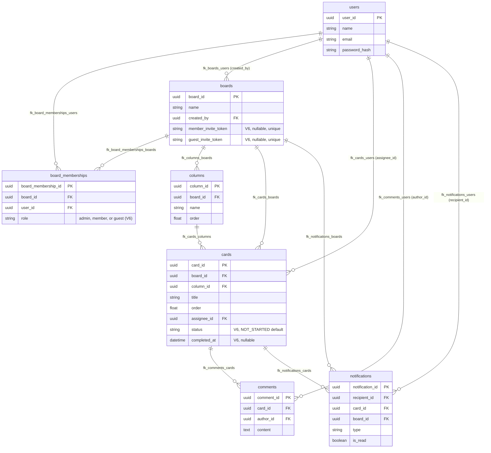

Every table also carries `created_at`, `updated_at`, `deleted_at`, and `is_deleted` (omitted from the diagram for space). **V6 change:** the diagram still shows 7 tables and no relationship was added; only columns changed.

### V6 schema changes and migration (Requirements 2.15 to 2.17, 3.8 to 3.10; design only, no script is committed)

| Table | Change | Notes for the manual Migration_Step |
|---|---|---|
| `boards` | add `member_invite_token`, `guest_invite_token` (varchar(128), nullable) and their two unique constraints | Autogenerate emits these. Existing rows keep NULL and get tokens lazily (A14) |
| `cards` | add `status` varchar(20) not null with `server_default 'NOT_STARTED'`, add `completed_at` timestamptz null, add check `ck_cards_status` | The server default lets `ADD COLUMN ... NOT NULL` succeed on existing rows. **Alembic autogenerate does not detect check constraints**, so the user adds `op.create_check_constraint("ck_cards_status", "cards", "status IN ('NOT_STARTED','IN_PROGRESS','DONE')")` by hand |
| `board_memberships` | replace `ck_board_memberships_role` with a check that allows `admin`, `member`, `guest` | Also not detected by autogenerate: the user adds `op.drop_constraint("ck_board_memberships_role", "board_memberships")` then `op.create_check_constraint(...)` by hand, and does the reverse in `downgrade()` |

The user then runs `flask db upgrade` on the development database and on the test database. The 7-table check (Requirement 1.9, 3.5) is asserted by a backend test that lists the tables. The optional backfill below is run by the user only if cards sitting in a Column named `Done` should count as completed; it is not an automated task:

```sql
UPDATE cards c SET status = 'DONE', completed_at = c.updated_at
FROM columns col
WHERE col.column_id = c.column_id AND lower(col.name) = 'done'
  AND c.is_deleted = false AND col.is_deleted = false;
```

### Marshmallow schema list (Requirement 4.9)

| Package | Schemas |
|---|---|
| auth | `RegisterSchema`, `LoginSchema` |
| users | `UserSchema` (output), `UserUpdateSchema` (V6: `name`, `password`, `current_password`; `email` always rejected) |
| boards | `BoardCreateSchema`, `BoardUpdateSchema`, `BoardSchema`, `BoardDetailSchema`, `MemberAddSchema`, `MemberSchema`; **V6:** `InviteLinksSchema`, `InviteRoleSchema` (path role `member` or `guest`), `InviteTokenSchema` (format `^[A-Za-z0-9_-]{43,128}$`), `InviteInfoSchema`, `AcceptResultSchema` |
| columns | `ColumnCreateSchema`, `ColumnUpdateSchema`, `ColumnReorderSchema`, `ColumnSchema` |
| cards | `CardCreateSchema` (V6: `status` rejected), `CardUpdateSchema` (V6: `status` exact enum), `CardPositionSchema`, `CardQuerySchema`, `CardSchema` and `CardSearchSchema` (V6: add `status`, `completed_at`) |
| comments | `CommentCreateSchema`, `CommentUpdateSchema`, `CommentSchema` |
| notifications | `NotificationQuerySchema`, `NotificationSchema`, `NotificationPageSchema` |
| analytics | `AnalyticsSchema` |

Name fields strip whitespace and reject blank values. All input schemas set `unknown = RAISE`.

## Correctness Properties

*A property is a characteristic or behavior that should hold true across all valid executions of a system-essentially, a formal statement about what the system should do. Properties serve as the bridge between human-readable specifications and machine-verifiable correctness guarantees.*

**Redundancy review.** The prework produced about 40 candidate properties. Redundancy was removed as follows:

- Envelope shape (4.1, 4.2, 4.5, 4.8) and status mapping (4.6, 4.7) are separate because one checks body shape and the other the status line.
- Role checks for boards, members, columns, cards, comments, analytics (8.6, 8.7, 9.9, 9.10, 9.12, 10.7, 11.15, 12.8, 14.7, 28.10, 28.11) are merged into one permission-matrix property.
- Name, title, content, and password boundary checks (6.1, 6.3, 8.8, 10.6, 11.4, 12.5, 4.10) are merged into one server-validation property. Client-side validators (19.2, 19.7, 20.3, 21.3, 21.7, 23.3, 23.9, 26.3) are merged into one mirror property.
- Soft-delete exclusion (2.8, 12.2, 14.6, 13.5) is one property. Cascades (2.7, 2.9 to 2.11) are one property and atomicity (2.13, 8.10) is a second because it needs fault injection.
- Password exposure (6.8, 7.1, 28.1) is one property.
- Search semantics (11.11 to 11.13, 28.4) is one property.
- Ordering formulas (10.1, 11.1, 22.2 to 22.5) are split into server allocation and client drop computation because they live in different languages.
- Comment owner-only on the server (12.7) and the control visibility on the client (23.11, 23.14) stay separate.

### Property 1: Envelope shape

*For any* request to any endpoint (valid or invalid, authenticated or not), the response body is a JSON object with exactly one top-level key, either `data` or `error`; the key is `data` iff the status is 2xx; an `error` value is a non-empty string of at most 500 characters; and a 500 response contains no stack trace, SQL text, or database details.

**Validates: Requirements 4.1, 4.2, 4.5, 4.8, 4.11, 5.4**

### Property 2: Status code by outcome

*For any* request, the status is 201 for a successful creating POST (register, boards, members, columns, cards, comments), 200 for every other success (including every DELETE, whose body `data` is a JSON object), and for a failure it is the code mapped by failure type: validation 400, JWT 401, permission 403, missing, soft-deleted, or malformed-UUID path id 404, unsupported method 405, unique conflict 409, unexpected 500.

**Validates: Requirements 4.3, 4.4, 4.6, 4.7, 4.12, 4.13, 4.14, 4.18**

### Property 3: Serialization format

*For any* UUID and any timestamp serialized by any response schema, the UUID is a lowercase hyphenated string of 36 characters and the timestamp is an ISO 8601 UTC string ending in `Z` or `+00:00`.

**Validates: Requirements 4.15**

### Property 4: CORS origin filtering

*For any* request origin, the response carries the allow-origin header iff the origin is in the configured allowed list.

**Validates: Requirements 4.16, 4.17**

### Property 5: Configuration fails fast

*For any* non-empty subset of the required environment variables (`DATABASE_URL`, `JWT_SECRET_KEY`, `JWT_ACCESS_TOKEN_EXPIRES`, `JWT_REFRESH_TOKEN_EXPIRES`, `CORS_ORIGINS`) that is missing or empty, `Config.from_env()` raises an error whose message names each missing variable and contains none of the provided variable values.

**Validates: Requirements 1.13, 28.6**

### Property 6: Soft-deleted rows never appear

*For any* set of Boards, Columns, Cards, Comments, Memberships, Users, and Notifications with arbitrary `is_deleted` flags, every list, detail, search, count, analytics, and notification query returns only rows (and counts only rows) where `is_deleted` is false, and a request for a soft-deleted resource returns 404.

**Validates: Requirements 2.8, 8.9, 12.2, 12.9, 13.5, 14.6**

### Property 7: Soft delete is a cascade that preserves data

*For any* Board, Column, or Card tree, deleting the parent sets `is_deleted = true` and the same `deleted_at` on the parent and all descendants named in the cascade table (Board: memberships, columns, cards, comments; Column: cards and their comments; Card: comments), leaves every other column value and every unrelated row unchanged, and a soft-deleted row is never physically removed.

**Validates: Requirements 2.7, 2.9, 2.10, 2.11, 8.5, 10.3, 11.6**

### Property 8: Cascade atomicity

*For any* cascading delete or Board creation in which a database step fails part-way, every affected row is unchanged afterward and the response is 500 in the envelope.

**Validates: Requirements 2.13, 8.10**

### Property 9: Uniqueness ignores soft-deleted rows

*For any* sequence of create and soft-delete operations on Users and Board_Memberships, creating a User with an email or a membership for a (board, user) pair succeeds iff no non-deleted row with that key exists (the User key is the lowercased email, so emails differing only in letter case collide), and a duplicate returns 409 and changes nothing; and *for any* email string used in register or PATCH `/api/users/me`, the stored email equals the trimmed, lowercased input, and an add-member request finds the User whatever the letter case of the request email.

**Validates: Requirements 2.12, 6.1, 6.2, 7.2, 7.4, 9.1, 9.4**

*V6 change:* the PATCH `/api/users/me` clause of this property is superseded. The email can no longer be changed after registration (Property 54), so uniqueness is only exercised by registration and by add-member matching.

### Property 10: Password handling

*For any* valid registration, the stored `password_hash` differs from the submitted password and verifies against it, and *for any* response from any endpoint no field named `password` or `password_hash` appears at any depth.

**Validates: Requirements 6.1, 6.8, 7.1, 28.1**

### Property 11: Register then login round trip

*For any* valid name, email, and password, registering and then logging in with the same credentials (any letter case in the email) returns 200 with an access token and a refresh token whose `sub` equals the user's `user_id`, with `expires_in` equal to the configured access lifetime and `refresh_expires_in` equal to the configured refresh lifetime; and *for any* login with an unknown email, a wrong password, or a soft-deleted user's email, the response is 401 with an identical message and no token. Token types and lifetimes are covered by Properties 36 and 37.

**Validates: Requirements 6.4, 6.5, 6.6**

### Property 12: Server input validation

*For any* string value of any validated field (names 1 to 100, board and column names non-blank, card title 1 to 200, description at most 5000, labels at most 10 items of 1 to 30 characters, comment content 1 to 2000 with a non-whitespace character, password 8 to 128, email at most 254 and well formed, due date ISO 8601), the request is accepted iff the value lies inside the rule, and a rejected request returns 400 naming each invalid field and leaves stored data unchanged.

**Validates: Requirements 4.9, 4.10, 6.3, 7.5, 8.8, 9.2, 10.6, 11.4, 12.5**

### Property 13: Role and membership enforcement

*For any* user, Board, and endpoint that requires membership or a role, the outcome matches the permission matrix: a non-member receives 403, a member who is not the admin receives 403 on admin-only endpoints (Board update and delete, member add and remove, analytics), a removed member receives 403, an authorized caller succeeds, and *for any* 403 response all data is unchanged and the response body contains no data of the target resource.

**Validates: Requirements 8.6, 8.7, 9.9, 9.10, 9.12, 10.7, 11.15, 12.8, 14.7, 28.10, 28.11**

*V6 change:* "member" in this property means a Board_Member with role `admin` or `member`. The `guest` row of the matrix is Property 47.

### Property 14: Board creation makes the creator admin

*For any* authenticated user and valid Board name, creating the Board makes the creator the only member with role `admin`, and the Board appears in that user's `GET /api/boards` with `my_role = "admin"`, ordered by `created_at` descending, while a user with no membership never sees it.

**Validates: Requirements 8.1, 8.2**

### Property 15: Server order allocation

*For any* Board with Columns (or Column with Cards) and any sequence of creations, each new item receives an Order_Value strictly greater than every non-deleted sibling's value, the first item receives 1.0, and `GET /api/boards/<id>` lists Columns and each Column's Cards in non-decreasing Order_Value.

**Validates: Requirements 8.3, 10.1, 11.1, 21.1**

### Property 16: Position and reorder persistence

*For any* Card in a Board, any Column of the same Board, and any finite order greater than 0, PATCH position stores that Column and order, and a subsequent GET of the Board shows the Card in that Column at the sorted position; *for any* Column of another Board, a soft-deleted Column, a non-UUID `column_id`, or an order that is not greater than 0, the request returns 400 and the Card is unchanged. The same holds for Column reorder.

**Validates: Requirements 10.4, 10.5, 10.8, 11.7, 11.8, 11.9, 22.11**

### Property 17: Partial update

*For any* Card (or User) and any subset of updatable fields supplied in a PATCH, exactly the supplied fields change, all other fields keep their previous values, and `updated_at` does not decrease.

**Validates: Requirements 7.2, 11.3**

*V6 change:* the updatable User fields are now `name` and `password` only (the email is excluded, Property 54), and the updatable Card fields now include `status`; a status change also moves `completed_at` by the rule of Property 44, which is the only allowed change to a field that was not supplied.

### Property 18: Assignee must be a member and removal clears assignment

*For any* Card and any assignee, creating or updating a Card with an assignee who is not a non-deleted member of the Card's Board returns 400 and changes nothing; and removing a member sets the assignee to empty on every non-deleted Card of that Board assigned to them, in the same transaction.

**Validates: Requirements 11.5, 9.11**

### Property 19: Search and My Tasks semantics

*For any* set of Cards across Boards and any query text (including `%`, `_`, `\`, `'`, `;`, `--`), `GET /api/cards?q=<text>` returns exactly the non-deleted Cards of Boards where the caller is a member whose title or description contains the text case-insensitively, `board_id` restricts the result to that Board (403 for a non-member), and `GET /api/cards?assignee=me` returns exactly the caller's non-deleted assigned Cards on non-deleted Boards.

**Validates: Requirements 11.10, 11.11, 11.12, 11.13, 28.4**

### Property 20: Comment ownership

*For any* Comment and any user, PATCH and DELETE succeed iff the user is the Comment's author (so a Board_Admin who is not the author receives 403), and a failed attempt leaves the Comment unchanged.

**Validates: Requirements 12.3, 12.4, 12.7**

### Property 21: Notification recipients

*For any* author, assignee (possibly none), and admin, `comment_recipients(author, assignee, admin)` contains no duplicates, never contains the author, contains the assignee iff the assignee exists and differs from the author, and contains the admin iff the admin differs from the author; and *for any* Card create or update, an `assignment` notification is created iff the new assignee differs from the current user and from the previous assignee.

**Validates: Requirements 13.1, 13.2, 13.3**

### Property 22: Notification pagination

*For any* user with N non-deleted notifications and any valid `page` and `per_page` (at most 100), the response contains `min(per_page, max(0, N - (page - 1) * per_page))` items newest first, `total = N`, and `unread_count` equal to the number of unread notifications, even for a page beyond the last; *for any* `page` or `per_page` that is not an integer from 1 to 2147483647 or a `per_page` above 100, the response is 400 with no notifications; and *for any* user, only that user's notifications are returned.

**Validates: Requirements 13.5, 13.6, 13.7, 13.8**

### Property 23: Mark-read idempotence

*For any* notification, applying the read operation once or repeatedly by its recipient yields 200 with `is_read = true`, and applying it by any other user yields 403 with `is_read` unchanged.

**Validates: Requirements 13.9, 13.10**

### Property 24: Analytics equals a naive model

*For any* Board with Columns, Cards, Comments, and Members (including soft-deleted rows, columns without Cards, and no Column named Done), the analytics response equals a plain in-memory computation: per-column counts (0 for empty), completed cards in a Column named `Done` (case-insensitive) with `updated_at` between Monday 00:00 UTC of the current week and now, and per-member assigned Card and Comment counts. `start_of_week_utc(t)` is a Monday at 00:00:00 UTC, is at most `t`, and is less than 7 days before `t`.

**Validates: Requirements 14.1, 14.2, 14.3, 14.4, 14.6**

*V6 change:* the "completed" clause (Column named `Done` and `updated_at`) is superseded by Property 46 (`status = DONE` and `completed_at`). The cards-per-column, week-boundary, and soft-delete clauses stay as written.

### Property 25: Constant query count for board detail

*For any* Board with a fixed number of Columns and any number of Cards from 0 to 500, `GET /api/boards/<id>` executes the same number of SQL statements, at most 5.

**Validates: Requirements 29.2**

### Property 26: API client behavior

*For any* path and payload, `apiRequest` returns the `data` field of a 2xx envelope; sends `Authorization: Bearer <access token>` iff an access token is available; and *for any* non-2xx status with an `error` string it throws `ApiError(statusCode, error)`, while *for any* non-2xx response with a body that is not an envelope it throws `ApiError(statusCode, "Unexpected server response")`.

**Validates: Requirements 16.1, 16.5, 16.6, 16.7**

### Property 27: Error handler mapping

*For any* `ApiError` with status in {400, 401, 403, 404, 409, 500}, `handleError` shows exactly one error toast and the six messages are pairwise distinct; *for any* other status or any non-ApiError value it shows exactly one generic toast.

**Validates: Requirements 16.11, 16.12**

### Property 28: Route guard decision

*For any* path, access token state (absent, expired, valid), refresh token state (absent, expired, valid), and current time, `guardDecision` returns `allow` for a protected path with a valid access token, `refresh` for a protected path with no valid access token and a valid refresh token, `redirect-login` for a protected path with neither, `redirect-home` for `/login` or `/register` when either token is valid, and `allow` for `/login` or `/register` otherwise.

**Validates: Requirements 17.7, 17.8, 17.9**

*V6 change:* `guardDecision` is replaced by `decideRoute`, which also takes the Welcome_Cookie and covers `/`, `/welcome`, and `/invite/<token>`. The five V5 rows above remain true for `/login`, `/register`, and ordinary protected paths. The full V6 property is Property 53.

### Property 29: Client validators mirror server rules

*For any* string, the client validators for name, email, password, board name, column name, card title, comment text, and profile fields accept it iff the corresponding server rule in Property 12 accepts it, and a rejected form sends no request.

**Validates: Requirements 19.2, 19.7, 20.3, 21.3, 21.7, 23.3, 23.9, 26.3**

*V6 change:* the profile validators are now `validateName`, `validateNewPassword` (8 to 128), `validateCurrentPassword` (non-empty), and `validatePasswordSection`, and the email validator is no longer used by the profile page. They are part of this property.

### Property 30: Client drop order computation

*For any* target column's cards (distinct positive orders, sorted ascending, excluding the dragged card) and any drop index, `computeDropOrder` returns 1.0 for an empty column, half of the first order for index 0, last order plus 1 for the end, and the midpoint of the two neighbors otherwise; the result is finite and positive, and inserting the dragged card with that order yields a sorted list in which the card sits at the drop index.

**Validates: Requirements 22.2, 22.3, 22.4, 22.5, 22.9**

### Property 31: Optimistic move and revert

*For any* board state, card, target column, and valid order, `moveCardInState` places the card in the target column with the new order immediately, and a failed request followed by `restoreCardInState` returns a state equal to the original (original column and original order, same sorted position); *for any* drop outside a column or at the card's own position, the state is unchanged and no request is sent.

**Validates: Requirements 22.6, 22.7, 22.8**

### Property 32: Notification badge and unread count

*For any* unread count n, `formatBadge(n)` is empty for 0, the decimal string for 1 to 99, and `"99+"` for 100 or more; and *for any* unread count and successful read of an unread notification, the new count is `max(0, n - 1)`, while a failed read leaves the count unchanged.

**Validates: Requirements 24.2, 24.3, 24.6, 24.7**

### Property 33: Search debounce

*For any* sequence of keystrokes with fake timers where each gap is under 300 ms, at most one search request is sent, after 300 ms since the last keystroke and carrying the final text; clearing the input sends no request.

**Validates: Requirements 21.9, 21.10**

### Property 34: Owned-comment controls and My Tasks grouping

*For any* list of Comments and current user, edit and delete controls are rendered exactly for Comments whose author is the current user (including when the current user is the Board_Admin); and *for any* list of Cards, `groupByBoard` produces one group per distinct `board_id`, each Card appears in exactly one group, and no Card is lost.

**Validates: Requirements 23.11, 23.14, 25.1**

### Property 35: Changed-fields diff

*For any* original card and edited form values, `diffCardFields` returns exactly the fields whose values differ, and an unchanged form produces an empty diff.

**Validates: Requirements 23.2**

*V6 change:* `diffCardFields` also compares `status`, so a form whose only change is the status produces exactly `{ status }` (Requirement 23.18).

### Property 36: Token types and lifetimes

*For any* registered user and any configured positive lifetimes `A` (access) and `R` (refresh), login returns an access token with `type = "access"` and `exp - iat = A`, and a refresh token with `type = "refresh"` and `exp - iat = R`, both with `sub` equal to the user's `user_id`; with the default configuration `A = 3600` and `R = 604800`, and the login response has `expires_in = A` and `refresh_expires_in = R`.

**Validates: Requirements 6.4, 6.5**

### Property 37: Token type enforcement

*For any* protected endpoint other than `POST /api/auth/refresh` and any valid refresh token, the response is 401 and nothing changes; and *for any* valid access token sent to `POST /api/auth/refresh`, and *for any* missing, malformed, wrongly signed, or expired token sent there, the response is 401 and no token is issued.

**Validates: Requirements 6.11, 6.12, 6.14, 4.6**

### Property 38: Refresh yields a working access token

*For any* registered user holding a valid refresh token, `POST /api/auth/refresh` returns 200 with an access token with `type = "access"`, the same `sub`, `expires_in = 3600` in the default configuration, and no refresh token; the new access token is accepted by `GET /api/users/me` and returns that user's profile; and *for any* refresh token whose subject is a soft-deleted or nonexistent user, the response is 401.

**Validates: Requirements 6.10, 6.13**

### Property 39: Failed refresh clears the session, shared refresh runs once

*For any* number `n >= 1` of concurrent protected requests made in the browser runtime that all receive 401, the apiClient sends exactly one `POST /api/auth/refresh`; when it returns 200 each original request is retried exactly once with the new access token and the access cookie is updated; when it returns 401 both cookies and the AuthContext state are cleared, the user is redirected to `/login`, and each original request rejects with `ApiError(401, ...)`; and *for any* 401 from `/api/auth/login`, `/api/auth/register`, or `/api/auth/refresh`, no refresh is attempted.

**Validates: Requirements 16.14, 16.15, 16.16, 16.17, 17.4**

### Property 40: Server-side apiClient never renews

*For any* path and any 401 response received while the apiClient runs in a Server Component (no `window`), with or without a refresh cookie present, the apiClient sends no `POST /api/auth/refresh`, writes and deletes no cookie, and throws `ApiError` with `statusCode` 401; and *for any* login response with arbitrary positive `expires_in` and `refresh_expires_in`, the access cookie `Max-Age` equals `expires_in` and the refresh cookie `Max-Age` equals `refresh_expires_in`.

**Validates: Requirements 16.18, 17.2**

### Property 41: Touch drop index from the touch point

*For any* list of card vertical midpoints sorted ascending (the target Column's Cards without the dragged Card) and any touch y coordinate, `computeDropIndex` returns the number of midpoints smaller than y, which lies between 0 and the list length, and feeding that index to `computeDropOrder` gives the same result as a mouse drop at that index (1.0 for an empty Column, half the first order at index 0, last order plus 1 at the end, the midpoint of the two neighbors otherwise).

**Validates: Requirements 22.2, 22.3, 22.4, 22.5, 22.15**

### Property 42: Touch gesture state machine

*For any* sequence of touch events (start, move, timer, scroll, end, cancel) with timestamps and coordinates, `touchGestureStep` reaches the dragging phase iff a timer event arrives at least 300 ms after the start with no move farther than 10 px from the start point, no scroll, no end, and no cancel in between; *for any* sequence that leaves the pressing phase another way, the final phase is cancelled and the hook sends no position request; and *for any* dragging sequence that ends outside a Column, on the Card's own position, or with a cancel, no request is sent and the Card state equals the initial state.

**Validates: Requirements 22.12, 22.13, 22.14, 22.16**

### Property 43: Deleted or unknown token subject yields 401

*For any* protected endpoint (including GET and PATCH `/api/users/me`) and any valid access token whose subject belongs to a soft-deleted or nonexistent user, the response is 401 and no data changes; and *for any* valid access token of a non-deleted user, the same request is not rejected for that reason.

**Validates: Requirements 6.9, 7.6**

### Property 44: Status and completed_at transition rule

*For any* initial status, any sequence of PATCH operations that supply or omit `status`, and any increasing sequence of timestamps, `apply_status_change` sets `completed_at` to the current time when the status changes to `DONE` from another value, sets it to null when the status changes from `DONE` to another value, and leaves it unchanged when the status is unchanged (including `DONE` to `DONE`) or not supplied; after every step `completed_at` is not null iff the status is `DONE`; and a card that was never changed keeps `NOT_STARTED` and null.

**Validates: Requirements 11.18, 11.19, 11.24**

### Property 45: Status validation and position independence

*For any* string, null, or case variant supplied as `status` in PATCH `/api/cards/<id>`, the request is accepted iff the value is exactly `NOT_STARTED`, `IN_PROGRESS`, or `DONE`, and a rejected request returns 400 and leaves the Card unchanged; *for any* POST `/api/columns/<id>/cards` body that contains a `status` field the response is 400 and no Card is created, and a created Card has `NOT_STARTED` and null `completed_at`; and *for any* position request, including a move into a Column named `Done` (any letter case), the Card's `status` and `completed_at` are unchanged.

**Validates: Requirements 11.4, 11.17, 11.21**

### Property 46: Analytics equals a naive model (V6 definition)

*For any* Board with Columns, Cards (any status, any `completed_at`, any Column name including `Done`), Comments, and Memberships of all three roles with arbitrary soft-delete flags, the analytics response equals a plain in-memory computation: per-Column counts of non-deleted Cards, `completed_this_week` equal to the number of non-deleted Cards with `status = DONE` and `completed_at` from `start_of_week_utc(now)` (inclusive) to `now` (inclusive) whatever their Column, and member activity listing exactly the active memberships with role `admin` or `member` with their assigned Card and Comment counts; a `DONE` Card at Monday 00:00:00 UTC is counted, one second earlier is not, and a Card in a Column named `Done` with another status is not counted.

**Validates: Requirements 14.1, 14.2, 14.3, 14.4, 14.6, 14.10**

### Property 47: Guest never writes (role by endpoint matrix)

*For any* role in {admin, member, guest, none} and any endpoint of the matrix in A4-V6, the outcome equals the matrix cell: a guest receives 403 on every write endpoint (Board update and delete, member add and remove, Column and Card writes, Comment writes, analytics, invite-links, regenerate) and the stored data is unchanged, a guest succeeds on the read endpoints (Board detail, members, comments, search), and `role_allows(role, level)` is true iff the rank of the role is at least the rank of the level.

**Validates: Requirements 8.11, 8.12, 9.13, 9.14, 10.10, 11.23, 12.10, 12.11, 14.10, 28.14, 37.14**

### Property 48: Assignee must be admin or member, guests are never notified

*For any* Board whose memberships have arbitrary roles and any user as assignee in a Card create or update, the request is accepted iff the user has an active membership with role `admin` or `member`, a rejected request returns 400 and leaves the Card unchanged, and no Notification row exists for any user whose only active membership on the Board has the role `guest`; accepting an invitation creates no Notification.

**Validates: Requirements 11.5, 11.22, 13.12**

### Property 49: Invite tokens are well formed, unique, and regeneration invalidates

*For any* set of created Boards, every Invite_Token matches `^[A-Za-z0-9_-]{43,128}$` and no token value occurs twice across all Boards and both roles; *for any* sequence of regenerate calls, a token is valid (GET `/api/invites/<token>` returns 200 with that role) iff it is the current token of its column, the replaced token returns 404, the token of the other role and all memberships are unchanged, and a token of a soft-deleted Board returns 404; and *for any* string that does not match the format, lookup returns 404.

**Validates: Requirements 37.2, 37.3, 37.6, 37.9, 37.10, 37.21**

### Property 50: Accept decision never lowers a role

*For any* existing role in {none, guest, member, admin} and token role in {member, guest}, `resolve_accept` returns the token role with action `create` iff the existing role is none, returns `member` with action `upgrade` iff the existing role is guest and the token role is member, and otherwise returns the existing role with action `none`; the resulting rank is never lower than the existing rank, and an admin always stays admin.

**Validates: Requirements 37.11, 37.12**

### Property 51: Accept is idempotent and keeps one active membership

*For any* user, Board, token role, and repeated or concurrent accept calls, every call returns 200 with the role from `resolve_accept`, the user ends with exactly one active membership on the Board, an existing soft-deleted membership row of the pair is left unchanged while a new active row is created, and no accept consumes a token.

**Validates: Requirements 37.11, 37.12, 37.13, 37.21, 2.12**

### Property 52: Safe `next` parameter

*For any* string, `safeNext` returns the string iff it equals `/invite/` followed by 1 to 128 characters from `A-Z`, `a-z`, `0-9`, `_`, `-`, and returns null for every other value, including absolute URLs, protocol-relative URLs, strings with backslashes, extra slashes, query strings, fragments, percent sequences, whitespace, and paths outside `/invite/`; and the redirect target after login is `safeNext(next) ?? "/"`, so it is always `/` or an invite path of the same origin.

**Validates: Requirements 19.8, 19.11, 28.15**

### Property 53: Route decision with welcome cookie and invite paths

*For any* pathname (`/`, `/welcome`, `/login`, `/register`, `/invite/<token>`, a malformed invite path, other protected path), authentication state (authenticated, refreshable, unauthenticated), and Welcome_Cookie flag, `decideRoute` returns exactly the outcome of the table in B4-V6: `/` redirects an unauthenticated visitor to `/welcome` iff the cookie is absent and to `/login` otherwise, and continues for an authenticated user whatever the cookie; `/welcome` redirects authenticated and refreshable users to `/` and is public otherwise; `/login` and `/register` are public and request the cookie only when absent; `/invite/<token>` redirects an unauthenticated visitor to `/login?next=<encoded path>` with or without the cookie and never to `/welcome`, and continues or refreshes for authenticated and refreshable users; any other protected path redirects an unauthenticated visitor to `/login`.

**Validates: Requirements 17.7, 17.8, 17.9, 17.12, 17.13, 37.20, 38.5, 38.6, 38.7, 38.8, 38.9, 38.10, 38.11, 38.12**

### Property 54: Profile update never changes the email and needs the current password

*For any* User and any PATCH `/api/users/me` body: a body with an `email` key (any value) returns 400 naming `email` and changes nothing; a body with `password` succeeds iff `current_password` matches the stored password and the new password has 8 to 128 characters; a wrong or missing `current_password` returns 400 (never 403) naming `current_password` and leaves the name unchanged even when the body also contains a valid name; after a successful change the old password no longer logs in and the new one does; the stored email always equals the registered lowercase email; and no response or log record contains a password, `current_password`, or hash.

**Validates: Requirements 7.2, 7.3, 7.4, 7.5, 7.8, 2.12**

### Property 55: Guest UI has no edit controls and starts no drag

*For any* board (any Columns and Cards) rendered with role `guest`, the output contains none of: add column, add card, column rename or delete, card delete, member panel, analytics link, invite links, comment form, status or assignee inputs enabled; every card has no `draggable` attribute and `useDragAndDrop({ enabled: false })` starts no drag, leaves the state unchanged, and sends no position request for any mouse or touch event sequence; and *for any* role in {admin, member} these controls are present.

**Validates: Requirements 21.20, 22.18, 23.21, 27.8, 37.17**

### Property 56: Status labels, badges, and moves

*For any* `CardStatus`, `STATUS_LABEL` returns "Not started", "In progress", or "Done" and the three labels and the three variants are pairwise distinct, so board, modal, and My Tasks show the same text; and *for any* board state, Card, target Column, and valid order, `moveCardInState` returns a state in which the moved Card's `status`, `completed_at`, and every field other than `column_id` and `order` equal the original.

**Validates: Requirements 21.22, 21.23, 22.19, 23.17, 25.2, 25.7**

### Property 57: Invite tokens never reach the logs

*For any* log message containing a request path of the form `/api/invites/<token>` or `/invite/<token>` with any token of 20 or more URL-safe characters, `redact_invite_tokens(message)` returns a string that does not contain the token and keeps the rest of the message; and *for any* string without such a path the output equals the input.

**Validates: Requirements 28.13**

### Property 58: E2E sources contain no literal credentials

*For any* generated Playwright source text, `findCredentialLiterals` reports a finding iff the text contains an e-mail address string literal or a string literal passed to a password or email input fill, and reports none for sources that read credentials only through `requireCredentials()` and values derived from it; and the real files under `web/e2e/` produce no findings.

**Validates: Requirements 33.10, 33.12**

### Property 59: Logo target depends only on authentication

*For any* AuthContext status in {`loading`, `authenticated`, `anonymous`}, `isVisitorAuthenticated(status)` is true iff the status is `authenticated`, so it is false during session restoration, after a failed restoration (including a 5xx or network failure that keeps the cookies), and after a logout; `logoTarget(isVisitorAuthenticated(status))` is `/` when it is true and `/welcome` otherwise; the result is always one of these two values and is never `/login`; the Header navigation uses the same `isVisitorAuthenticated(status)` value, so the logo target is `/` iff the user controls are shown; and *for any* sequence of statuses (restore, login, logout, session expiry), the target after each step equals the function applied to the status after that step alone, with no input for cookies, tokens, the Welcome_Cookie, or the current path.

*V8 change (refinement):* the first V8 form of this property quantified over a user value and access and refresh tokens (true when a User or any non-empty token is present). That form is superseded by Requirement 18.15 as refined; it let the logo and the navigation disagree during restoration.

**Validates: Requirements 18.14, 18.15, 17.14**

### Property 60: Forbidden-claims scan

*For any* text built from words that contain none of the forbidden strings, and any one forbidden string of Requirement 38 criterion 19 other than "free" inserted at any position in any letter case, `findForbiddenClaims` reports that string even when it sits inside a longer word (case-insensitive substring match, so "operating", "integrating", and "generating" report "rating"); *for any* text that contains the word "free" only inside a longer word (for example "freedom"), it does not report "free", and it reports "free" when it stands as a whole word (also next to punctuation, in any letter case); *for any* text without a forbidden string it returns an empty list; and the whole Welcome_Page text (`WELCOME_COPY`, `FEATURES`, `PREVIEW_SAMPLE`, every `aria-label`, `alt`, and `title`, and the page description) returns an empty list.

**Validates: Requirements 38.18, 38.19**

## Error Handling

| Situation | Behavior | Requirement |
|---|---|---|
| **V6** PATCH `/api/users/me` with `email`, with `password` but wrong or missing `current_password`, or with an empty body | 400 naming the field, User unchanged (never 403, name not saved) | 7.3 to 7.5 |
| **V6** Guest sends any write request | 403 generic message, data unchanged | 8.12, 37.14 |
| **V6** Card create body contains `status`, or PATCH `status` is not an exact enum value | 400 naming `status`, Card unchanged | 11.4, 11.17 |
| **V6** Assignee is a guest, removed member, or non-participant | 400, Card unchanged | 11.5, 11.22 |
| **V6** Invite token malformed, unknown, replaced, or Board soft deleted | 404, no membership, no Board data | 37.10 |
| **V6** Invite request without a valid access token | 401 (before the token lookup) | 37.23 |
| **V6** Regenerate with a role other than `member` or `guest` | 400, tokens unchanged | 37.7 |
| **V6** Concurrent accept hits the partial unique index | rollback, re-read, 200 with the existing role (no 409) | 37.11 to 37.13 |
| **V6** Invite page cannot copy to the clipboard | error toast, URL stays visible as selectable text | 37.15 |
| **V6** Regenerate request fails | old link stays displayed, `useErrorHandler` toast | 37.16 |
| **V6** Invite page: token 404 | not-found message with link to `/`, no Join button | 37.19 |
| **V6** Card creation fails | no card, no modal, toast | 21.19 |
| **V6** Profile 400 naming `current_password` | field error on the current-password input, user unchanged | 26.4 |
| **V6** Refresh at the proxy fails for an invite path | 401: cookies deleted, redirect to `/login?next=...`; network error or 5xx: `/login?expired=1` without `next` | 17.8 |
| Invalid body or query | 400, message names each invalid field, no write | 4.9, 4.10 |
| Missing, malformed, expired JWT; deleted or unknown token user | 401 envelope | 4.13, 6.9 |
| Role or membership failure | 403, no resource data in body | 4.14, 28.11 |
| Missing, soft-deleted, or non-UUID resource id | 404 | 4.12, 8.9 |
| Unknown path or method | 404 or 405, envelope | 4.18 |
| Unique violation | 409; FK or NOT NULL violation 400; no DB details | 2.14, 4.7 |
| Database unreachable or schema not applied | 500 generic; exception logged; process keeps serving | 3.6, 3.7, 34.10 |
| Unhandled exception | rollback, log, 500 generic | 4.11 |
| Cascade or create failure mid-transaction | rollback everything, 500 | 2.13, 8.10 |
| Missing env variable at startup | process fails naming the variable | 1.13, 28.6 |
| Frontend network error or timeout over 10 s | `ApiError(0, ...)`; toast through `useErrorHandler` | 16.8 |
| Frontend 401 on a protected request in the browser | one shared refresh, retry once; if refresh or retry returns 401, clear both cookies and state, redirect `/login` | 16.13 to 16.17 |
| Frontend 401 in a Server Component | no refresh, no cookie write; `ApiError(401)` is thrown and the page calls `redirect("/login?expired=1")` | 16.18 |
| Access token of a soft-deleted or nonexistent user, on any protected endpoint including `/api/users/me` | 401 envelope from the user lookup callback | 6.9, 7.6 |
| Touch drag interrupted (moved over 10 px, scrolled, or ended before 300 ms; ended outside a Column; `touchcancel`) | no drag, no state change, no request | 22.14, 22.16 |
| Refresh endpoint 401 (wrong type, expired, deleted user) | 401 envelope, no token issued | 6.11 to 6.14 |
| Middleware refresh fails | 401: delete both cookies, redirect `/login`; network error or 5xx: redirect `/login?expired=1` | 17.7, 17.8 |
| Failed optimistic move | restore original state, one toast | 22.7 |
| Polling failure | keep previous state, no toast | 24.9 |
| Server Component load failure (not 401) | `ErrorPanel` with retry | 20.8, 25.5 |
| Board 403 or 404 | access-denied or not-found message with link to `/` | 21.15 |

## Testing Strategy

### Approach

Both unit tests and property-based tests are used. Property tests cover universal properties from the Correctness Properties section. Unit and example tests cover specific examples, edge cases, integration points, and smoke checks. Property-based testing applies here because the feature contains pure logic (ordering, validation, recipients, pagination, week boundary, reducers, guards) and service-level behavior over a large input space. It does not apply to Tailwind layout (Requirement 27), deployment (34), repository hygiene (35), and documentation (36); those use example tests, Playwright viewport checks, and checklists.

Libraries: **Hypothesis** for Python and **fast-check** for TypeScript. Property-based testing is not implemented from scratch. Every property test:

- runs at least 100 iterations (`@settings(max_examples=100, deadline=None)`; `fc.assert(..., { numRuns: 100 })`),
- implements exactly one Correctness Property,
- carries a tag comment: `# Feature: kano, Property <n>: <property text>`.

### Backend (pytest, run from `app/`)

| Layer | Content |
|---|---|
| Config | `pytest.ini` (markers `perf`, `unit`, `e2e`), `tests/conftest.py` |
| Unit, no DB | `ordering.py`, `start_of_week_utc`, `comment_recipients`, Marshmallow schema boundaries (Board and Column names of 0, 1, 100, 101; Card title 200, 201; password 7, 8), config validation (both JWT expiry variables), serializers; mostly property tests (1 to 5, 12, 21, 24 partial) |
| Auth tokens | login returns access (`type=access`, 3600 s) and refresh (`type=refresh`, 604800 s) tokens with `sub = user_id`, plus `expires_in = 3600` and `refresh_expires_in = 604800` in the response data; GET and PATCH `/api/users/me` and one more protected endpoint return 401 for an access token of a soft-deleted user (Property 43); refresh returns 200 and the new token works on `GET /api/users/me`; 401 for an expired, missing, or access-type token on refresh, for a refresh token of a soft-deleted user, and for a refresh token on `GET /api/users/me` and every other protected endpoint (parametrized); tokens are created with short test lifetimes or a patched clock instead of waiting (Properties 36 to 38 and 43, requirement 31.11) |
| Soft-deleted user fixtures | No endpoint deletes a User (Requirement 7.7), so a `make_deleted_user(email)` fixture inserts a `User` row with `is_deleted = true` and `deleted_at` set directly through the test session. Requirements 6.6, 6.9, 6.13, and 31.11 and Properties 9, 11, 38, and 43 use it. It also seeds soft-deleted rows for the uniqueness test (Property 9) |
| Service and e2e, DB | Flask test client against the separate PostgreSQL test database; covers all 8 packages with at least one success and one error path each; asserts envelope shape and status on every request; properties 6 to 25 where DB-backed |
| Comments | tests for 201 success, 400 missing content, 400 empty content, 401 unauthenticated, 403 non-owner including the Board_Admin |
| Role enforcement | parametrized matrix of non-member, member, admin over Board, Column, Card, Comment, member, update, delete, analytics endpoints |
| Cascades | soft delete Board, Column, Card sets flags on children and later GETs return 404 |
| Performance | marker `perf`: seeds 20 Columns and 500 Cards, 100 consecutive `GET /api/boards/<id>` calls, p95 under 500 ms, query count via SQLAlchemy `before_cursor_execute` listener; same for search and `assignee=me` over 2000 Cards; a failure prints the measured p95 in ms |

Test database safety (Requirement 31.10):

- `conftest.py` reads `TEST_DATABASE_URL`, refuses to run if it equals `DATABASE_URL` or its database name does not end with `_test`, and connects once at session start.
- If it cannot connect, or the expected 7 tables are missing, `pytest.exit("Test database <name> unavailable or schema not applied")` stops the run. The schema in the test database comes from the manual `flask db upgrade` run against it, not from `db.create_all()`.
- Isolation (Requirement 31.7): after each test an autouse fixture runs `TRUNCATE ... RESTART IDENTITY CASCADE` on the 7 tables, so tests are order independent and re-runnable. Fixtures create their own users, boards, and tokens through factory functions.
- Hypothesis database-backed tests use a function-scoped fixture reset inside the test body (`@given` plus manual truncate) because function-scoped fixtures are not reset between examples.

### Frontend unit tests (`npm test`, run once, no watch)

Runner: Vitest with jsdom and React Testing Library (`vitest --run` for `npm test`; the config can be Jest if the scaffold prefers it). Network is mocked with `vi.fn()` on `fetch`; no Kano_API is needed (Requirement 32.9).

| Subject | Tests |
|---|---|
| `BaseButton` | each variant has a distinct class, click fires `onClick` once, disabled ignores clicks and sets `aria-disabled` |
| `BaseModal` | absent when closed, present when open, Escape closes, backdrop closes, content click does not close, focus moves inside, focus returns |
| `RegisterForm` | empty name, malformed email, 7-character password each show a field error and send no request; 8-character password submits |
| `LoginForm` | empty email and empty password blocked; valid form submits |
| `CommentList` | controls visible only for owned comments |
| `NotificationBell` | shows 1 and 99, hides at 0 (plus Property 32) |
| `apiClient` | Authorization header present or omitted; returns `data`; ApiError for 400, 401 (no refresh token), 403, 404, 409, 500 (Property 26) |
| `apiClient` refresh | 401 triggers one refresh and one retry with the new token; concurrent 401s share one refresh; refresh 401 clears both cookies and state and redirects; a 401 from login does not refresh (Property 39, requirement 32.12) |
| `useDragAndDrop` (mouse) | failing request restores card and calls handler once; card moves before the request resolves (Properties 30, 31) |
| `useDragAndDrop` (touch, Requirement 32.13) | RTL `fireEvent.touchStart` / `touchMove` / `touchEnd` / `touchCancel` with `vi.useFakeTimers()` and `document.elementFromPoint` mocked to return a Column element: 300 ms hold without movement starts a drag and `touchmove` is default-prevented; move over 10 px, end, or cancel before 300 ms starts no drag and sends no request; touch end over a Column moves the card before the mocked request resolves; a rejected request restores the card and shows one toast; touch end outside a Column, on the own position, or `touchcancel` sends nothing (Properties 41, 42) |
| `apiClient` server runtime (Requirement 32.14) | with `window` undefined: a 401 throws `ApiError(401)`, no refresh request, no cookie write (Property 40) |
| `AuthProvider.login` (Requirement 32.14) | cookie `Max-Age` values come from `expires_in` and `refresh_expires_in`, tested with values other than 3600 and 604800 (Property 40) |
| Pure libs | `order.ts`, `authCookie.ts` (`guardDecision`, cookie constants), `validation.ts`, `format.ts`, `diffCardFields`, `groupByBoard` via fast-check (Properties 27 to 35) |

### Playwright E2E (`npx playwright test`, run from `web/`)

- `playwright.config.ts` reads `E2E_BASE_URL`. If it is missing or not an absolute http(s) URL, the config throws before any test starts and the message names `E2E_BASE_URL` (Requirement 33.2). `use.baseURL = E2E_BASE_URL`, `expect.timeout = 10_000`, `timeout = 60_000`, `retries = 2` at most, `reporter = [["html", { open: "never", outputFolder: "playwright-report" }]]`.
- No `waitForTimeout` anywhere; only auto-waiting locators and web-first assertions (`expect(locator).toBeVisible()`, `toHaveURL`).
- Auth specs (4 scenarios): valid login redirects to `/`; invalid credentials show the error and stay on `/login`; unauthenticated visit to `/` redirects to `/login`; logout redirects to `/login` and a following visit to `/` redirects again.
- Kanban journey (serial, one test with 8 `test.step` blocks): 1 register a unique user (`e2e+<timestamp>@example.com`), 2 login, 3 create Board, 4 add 2 Columns, 5 create Card in the first, 6 drag it to the second (`locator.dragTo`, which dispatches HTML5 drag events in Chromium), 7 reload and confirm the Card is in the second Column, 8 add a Comment then edit it and confirm the new text. `test.describe.configure({ mode: "serial" })` skips remaining steps after a failure.
- The HTML report from a passing run is committed (`web/playwright-report/`) and viewed with `npx playwright show-report`.
- Playwright covers the mouse drag only. A long-press touch drag cannot be simulated reliably in Playwright, so the touch drag is verified manually in browser DevTools device mode at 375 px (Requirements 27.8, 34.8) and by the React Testing Library tests above.
- Mobile viewport checks (375 px) use a Playwright project with `devices["iPhone SE"]`-like viewport and assert no horizontal overflow outside the Kanban container.

### Testing Strategy: V6 additions (Requirements 31.12 to 31.17, 32.15 to 32.19, 33.3, 33.4, 33.10 to 33.14, 35.1, 35.2)

The V5 strategy above stays in force. V6 adds the following. Property tests use Hypothesis (Python) and fast-check (TypeScript), at least 100 iterations, one test per property, tagged `Feature: kano, Property <n>: <text>`. Tests that need the new columns are blocked until the V6 manual Migration_Step is done on the test database.

**Backend (pytest).**

| Area | Tests | Properties |
|---|---|---|
| Users (31.12) | PATCH name boundaries 0, 1, 100, 101; password boundaries 7, 8, 128, 129 with correct `current_password`, then login with the new password; 400 naming `current_password` for a wrong or missing value with the name unchanged; 400 for any body with `email` (any value, including the current email); responses and captured logs contain no password or hash | 54, 17 |
| Cards (31.13) | default `NOT_STARTED`; 400 for `status` on create; 400 for `done`, `""`, null, unknown on PATCH; `completed_at` rules incl. `DONE` to `DONE`; `status` and `completed_at` in board detail, search, and My Tasks; position change (including into a Column named `Done`) leaves both unchanged; `apply_status_change` as a pure property and a stateful Hypothesis test over PATCH sequences | 44, 45 |
| Analytics (31.14) | boundary Monday 00:00:00 UTC counted and one second earlier not; `DONE` in a Column not named `Done` counted; Column named `Done` with other status not counted; soft-deleted `DONE` not counted; guests excluded from member activity; compared with a naive model | 46 |
| Guest role (31.15) | parametrized endpoint by role matrix from A4-V6 (every write endpoint of Requirement 37.14 gives 403 for a guest with the data unchanged, every guest read endpoint gives 200); guest assignee gives 400; analytics and invite-links give 403 for a guest; no notification for a guest; `role_allows` as a pure property | 47, 48 |
| Invitations (31.16) | tokens created with the Board and lazily for NULL Boards; token format and uniqueness; invite-links and regenerate for the admin, 403 for member, guest, non-participant; regenerate invalidates the old token (404) and leaves the other role's token; accept creates `member` and `guest` memberships; guest upgraded by the member token; no downgrade; repeated accept idempotent; accept after a soft-deleted membership creates a new active row; 404 for an unknown token and for a soft-deleted Board; 401 without a token; a concurrent-accept test (two threads) ends with one active row; no new table (the 7 tables listed from `information_schema`); log capture contains no token (`redact_invite_tokens`) | 49, 50, 51, 57 |
| Schema (2.15 to 2.17) | check constraints `ck_cards_status` and the three-role `ck_board_memberships_role` reject bad values; unique token constraints allow many NULLs | integration examples |
| Property tests (31.17) | `completed_at` state machine over generated status sequences, `resolve_accept` over all role pairs, `role_allows` | 44, 50, 47 |

**Frontend unit tests (Vitest and React Testing Library, network mocked).**

| Area | Tests | Properties |
|---|---|---|
| Profile (32.15) | email is read-only text with no email input; name 0 and 101 characters show an error without a request; password section with one input filled shows an error without a request; new password of 7 characters errors and 8 characters is sent with `current_password`; a 400 naming `current_password` shows the error on that input; the request body never contains `email` | 29 |
| CardDetailModal (32.16) | status control with the three options and current status preselected; a status-only change sends PATCH with only `status`; the board card and My Tasks row show the new badge; a failing PATCH keeps the modal open and the previous status; the guest view is read-only with no save, delete, or comment form | 56, 55 |
| New-card flow (32.17) | modal opens after 201; no modal after a failure; closing keeps the title-only card | state-diagram examples |
| Invitation UI (32.18) | `MemberPanel` shows both links with copy buttons only for the admin; regenerate asks for confirmation and replaces the link only after 200; the invite page shows board name and role and joins through POST accept; 404 shows the not-found message without Join; the guest board view hides every control of Requirement 21.20 and starts no drag; copy failure shows the error toast and keeps the URL | 55 |
| Route and `next` (32.19) | `decideRoute` over every combination of path class, auth state, and cookie flag (fast-check over generated tokens for invite paths); `safeNext` over generated strings (valid invite paths accepted; absolute and protocol-relative URLs, backslashes, extra slashes, other paths rejected) | 52, 53 |
| Pure libs | `status.ts` labels, `roles.ts`, `inviteRoles.acceptOutcome` parity with `resolve_accept` over all pairs, `moveCardInState` preserves status | 50, 56 |
| Credentials scan (33.12) | `findCredentialLiterals` over generated sources, plus a test that scans every file in `web/e2e/` and fails on a finding (same style as the `waitForTimeout` check) | 58 |

**Playwright (V6 changes to the V5 plan above).**

- **Credentials and loading order (Requirements 33.10, 33.11).** `playwright.config.ts` loads `web/.env.test` with dotenv before reading any variable: `loadEnv({ path: path.resolve(__dirname, ".env.test"), override: false })`. dotenv never overwrites a variable that already exists in the process environment, so a value set in the shell or CI wins over the file. After loading, the config validates `E2E_BASE_URL` (absolute http or https URL) and throws an error naming the variable before any test starts (Requirement 33.2, unchanged). `E2E_USER_EMAIL` and `E2E_USER_PASSWORD` are read only through `e2e/support/credentials.ts`: `requireCredentials()` throws `Missing required environment variable: <NAME>` (never the value) when one is missing or empty, so the test that needs it fails at once with that message. The helper also builds the wrong password at run time (`password + "-wrong-" + Date.now()`) and the unique registration email by plus-addressing the local part of `E2E_USER_EMAIL` with a run stamp, so no e-mail or password literal appears in `web/e2e/`.
- **Files.** `web/.env.test.example` is committed with placeholders for `E2E_BASE_URL`, `E2E_USER_EMAIL`, `E2E_USER_PASSWORD`. `web/.env.test` is git-ignored. `.gitignore` keeps ignoring `.env*` and adds the exception `!.env.test.example` after it (and `!.env.example`); a check runs `git check-ignore web/.env.test` (must be ignored) and `git check-ignore web/.env.test.example` (must not be). (V7 change: this check is not automated in task 33.1. It was run once by hand, and the repository hygiene script of task 23.7 automates it later. `web/.gitignore` gets the same `!.env.test.example` exception.) This `.gitignore` edit is an implementation change for the tasks step. The login-based tests need an account for `E2E_USER_EMAIL` that already exists on the target database, which the user creates manually before the run (Requirement 33.14).
- **Welcome cookie helper.** `e2e/support/welcome.ts` exports `setWelcomeSeen(context, baseURL)` that adds the `kano_welcome_seen=1` cookie, used by every scenario that visits `/` while unauthenticated (Requirement 33.3).
- **New scenarios.** (1) Welcome: a fresh context visits `/` and lands on `/welcome`, sees the "Log in" and "Create account" buttons, "Log in" leads to `/login` and `context.cookies()` contains `kano_welcome_seen`, "Create account" leads to `/register`, and a second visit to `/` lands on `/login` (Requirement 33.13). (2) Status: open a card, choose "In progress", save, see the badge on the board; set "Done" and see "Done" in `/my-tasks`. (3) New card: add a card by title, the modal opens with the title, fill the description, Save. (4) Invite join: the pre-existing user creates a Board and reads the member and guest links in the member panel; a second browser context registers a generated user and opens the member link, joins, and sees edit controls; a third context joins through the guest link and sees the "Guest" badge and no add-column control. (5) Profile: `/profile` shows the email as text equal to `E2E_USER_EMAIL` and has no email input. The V5 auth scenarios call `setWelcomeSeen` first and use the helper credentials.
- **Unchanged.** Auto-waiting only, no `waitForTimeout`, 10 s assertion timeout, 60 s test timeout, at most 2 retries, HTML report, serial Kanban journey (its step 1 now registers a generated email with the password from `E2E_USER_PASSWORD`).

### Testing Strategy: V8 additions (Requirements 32.20 to 32.22, 33.13, 33.15, 33.16)

The V5 and V6 strategy stays in force. V8 is frontend only, so there are no pytest changes and no dependency on a migration. Property tests use fast-check, at least 100 runs, one test per property, tagged `Feature: kano, Property <n>: <text>`. Network is mocked in unit tests (R32.9). Credentials in `web/e2e/` come only from `requireCredentials()` (Property 58 still applies to the new specs).

**Unit tests (Vitest and React Testing Library).**

| Area | Tests | Properties |
|---|---|---|
| `logoTarget` (32.20) | fast-check over each AuthContext status (`loading`, `authenticated`, `anonymous`) and over random status sequences for `isVisitorAuthenticated(status)` and `logoTarget`; true only for `authenticated`; target never `/login`; the function takes no cookie, token, or user input (V8 refinement; the first V8 test generated user and token values, superseded) | 59 |
| Header logo (32.20) | Render `Header` inside a test `AuthContext` provider. Assert: anonymous gives `href="/welcome"` with the cookie `kano_welcome_seen` present and absent; anonymous on the `/login` and `/register` pages (mocked `usePathname`) gives `/welcome`; status `authenticated` gives `/`; **V8 refinement (R32.20):** a visitor with only a refresh cookie gets `/welcome` while the status is `loading` or `anonymous` (including a 5xx restore failure that keeps the cookies) and `/` once the restoration succeeds (the test advances the mocked `GET /api/users/me` from pending to 200); in every status the logo target and the navigation (Log in and Register anchors versus My Tasks, bell, and user menu) match the same authentication state; after calling `logout()` the same rendered link changes to `/welcome`; the link name is "Kano" and its `href` is never `/login`; a click calls no `fetch` and no write to `document.cookie` (spy on the cookie setter). (Supersedes the first V8 case "refresh token only gives `/`".) | 59 |
| One Header and one Footer (32.20) | Render `RootLayout` around stub children for the welcome, login, register, dashboard, board, My Tasks, and profile stand-ins and assert one `banner` and one `contentinfo` role each. A static test reads `app/**/page.tsx` and `components/**` and fails if a file other than `layout.tsx` renders `<Header` or `<Footer`. |  |
| Welcome_Page (32.21) | Render `WelcomeContent` (and the Header from the layout shell). Assert: the sections appear in the order hero, preview, features, bottom CTA (`compareDocumentPosition`); Header "Log in" is an anchor (`a[href="/login"]`) and "Register" an anchor (`a[href="/register"]`), neither rendered through `BaseButton` (V8 refinement, R38.2: the test checks they are `a` elements and have no `BaseButton` marker class or `button` role), while "Get started", the bottom "Create account", and the bottom "Log in" are `BaseButton`s; hero has the eyebrow, one `h1`, the subheadline, and the "Get started" button to `/register` (click calls `router.push("/register")` and sets the cookie); four feature cards with the exact titles and descriptions of R38.17; bottom "Create account" to `/register` and "Log in" to `/login`; `BoardPreview` content container has `aria-hidden="true"` and `container.querySelectorAll("a[href], button, input, select, textarea, summary, [tabindex]")` is empty; the horizontal scroller is the parent of that container (not inside it) and has `tabindex="-1"`; exactly one element of the preview carries `shadow-overlay` (the dragged Card) and no other element of the page has a `shadow-*` class; `fetch` is never called; no `blockquote`, `q`, `cite`, star character, or element with `role="img"` and a rating label. | 60 |
| Forbidden claims (32.21, R38.19) | `findForbiddenClaims` over `WELCOME_COPY`, `FEATURES`, `PREVIEW_SAMPLE`, the page `metadata.description`, and over the DOM: all text nodes plus every `aria-label`, `alt`, and `title` attribute, case-insensitive substring matching for every entry except "free", which is a whole-word match (R38.19). A fixed example test shows the false positives of the rule ("operating", "integrating", and "generating" report "rating"; "freedom" does not report "free"). A source-text test also scans `components/welcome/**`, `app/welcome/page.tsx`, and `lib/welcomeContent.ts` for the strings. The forbidden list itself lives in `lib/forbiddenClaims.ts`, outside the scanned files. | 60 |
| Board separator (32.22) | Render `BoardView` with a `BoardDetail` fixture for roles `admin`, `member`, and `guest` (`apiRequest` mocked). Assert: `getAllByRole("separator")` has length 1; it follows `[data-testid="board-toolbar"]` and precedes `[data-testid="board-content"]` in document order and also with the search-results state shown; the toolbar, the content wrapper, and their parents inside `BoardView` have no class that starts with `border-t` or `border-b` and the toolbar has no `border` class; the separator class list has `h-px` and `bg-line`. The add-column form (V8 refinement, R21.24) is not a descendant of `[data-testid="board-toolbar"]` and is the last item of the Kanban row inside `[data-testid="board-content"]` for admin and member, and absent for guest. Render `BoardAccessMessage` (the 403 and 404 states) and assert zero separators. jsdom has no layout, so overlap and thickness are checked in Playwright. | |

**Playwright (additions to the V6 scenarios; every scenario that is unauthenticated and visits `/` keeps using `setWelcomeSeen`, except the welcome scenario).**

- **Welcome scenario (R33.13, amended).** Fresh context, no cookies. `goto("/")` ends on `/welcome`. Section-scoped locators: Header `page.getByRole("banner")` with links "Log in" and "Register"; hero `page.getByRole("region", { name: "Organize work smoothly, from idea to done" })` with the button "Get started"; bottom `page.getByRole("region", { name: "Ready to bring calm to your project planning?" })` with the buttons "Create account" and "Log in". Click the Header "Log in": URL `/login` and `context.cookies()` contains `kano_welcome_seen`. Then `goto("/")` ends on `/login`. In a second step, `goto("/welcome")` (always served to an anonymous visitor) and click the bottom "Create account": URL `/register`. The scoping avoids the ambiguity of two "Log in" controls.
- **Logo scenarios (R33.15).** (1) Anonymous: `goto("/login")` (the proxy sets the cookie), click `page.getByRole("banner").getByRole("link", { name: "Kano" })`, `expect(page).toHaveURL(/\/welcome$/)`. (2) The same on `/register`. (3) Logged in with `requireCredentials()`: create a Board through the UI (unique name), open it, click the logo, `expect(page).toHaveURL(/\/$/)`, and assert the URL contains neither `/welcome` nor `/login` and the Dashboard heading is visible.
- **Layout scenarios (R33.16).** Run at `{ width: 375, height: 812 }` and `{ width: 1920, height: 1080 }` through `page.setViewportSize`. Welcome: `document.documentElement.scrollWidth <= clientWidth` (read with `page.evaluate`, polled with `expect.poll`), and at 375 px `boundingBox()` width and height at least 44 for the logo link, "Log in", "Register", hero "Get started", bottom "Create account", and bottom "Log in". Board page (logged-in user with a Board and two Columns): exactly one visible `getByRole("separator")`; a helper `expectNoOverlap(locators)` checks pairwise that the bounding boxes of the toolbar controls (back link, title, search input, Members, Analytics) do not intersect; the separator box top is at least the largest bottom of the toolbar controls and at most the top of the first Column; the separator height is 1 px (`boundingBox().height` equals 1 within 0.5); and the page `scrollWidth` does not exceed the viewport (the Kanban container may scroll). The guest view is covered by the unit tests, because it needs a second account.
- **Unchanged.** Auto-waiting only, no `waitForTimeout`, 10 s assertions, 60 s tests, at most 2 retries, HTML report, serial Kanban journey, and the credentials scan (Property 58) over the new spec files. A V8 run must still end with all tests passed (R33.8).

**Not property-tested (examples only).** The look of the Welcome_Page and the toolbar (design-system conformance), icon names, and Tailwind classes. These use the example and Playwright checks above and a manual review at 375 px and 1920 px (task 33.3 style checklist).

## Part D: Deployment, Guidelines, and Documentation Design

### D1. Deployment (Requirement 34)

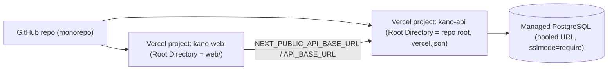

**Backend project (Vercel).** A root-level `vercel.json` routes every path to the WSGI entry:

```json
{
  "builds": [{ "src": "app/wsgi.py", "use": "@vercel/python" }],
  "routes": [{ "src": "/(.*)", "dest": "app/wsgi.py" }]
}
```

`app/wsgi.py` exposes `app = create_app()`. A root `.vercelignore` excludes `web/`, `app/venv/`, and `.kiro/`. The project root is the repository root (not `app/`) so that the package `app` is importable. Dependencies come from `app/requirements.txt`.

**Frontend project (Vercel).** Root Directory `web/`, framework preset Next.js, build `npm run build`.

**Environment variables.**

| Project | Variable | Value |
|---|---|---|
| kano-api | `DATABASE_URL` | production PostgreSQL URL (pooled, `sslmode=require`) |
| kano-api | `JWT_SECRET_KEY` | long random secret |
| kano-api | `JWT_ACCESS_TOKEN_EXPIRES` | `3600` |
| kano-api | `JWT_REFRESH_TOKEN_EXPIRES` | `604800` |
| kano-api | `CORS_ORIGINS` | exact public URL of kano-web (no trailing slash) |
| kano-web | `NEXT_PUBLIC_API_BASE_URL` | public URL of kano-api |
| kano-web | `API_BASE_URL` | public URL of kano-api |

`app/.env.example` lists `DATABASE_URL`, `JWT_SECRET_KEY`, `JWT_ACCESS_TOKEN_EXPIRES=3600`, `JWT_REFRESH_TOKEN_EXPIRES=604800`, `CORS_ORIGINS`, `TEST_DATABASE_URL` with placeholders. `web/.env.example` lists exactly `NEXT_PUBLIC_API_BASE_URL` and `API_BASE_URL`. `.gitignore` excludes every `.env*` except `.env.example`, `__pycache__/`, `.next/`, `node_modules/`, `app/venv/`. **V6 change:** the Playwright suite no longer reads `E2E_BASE_URL` from the shell only. It reads `E2E_BASE_URL`, `E2E_USER_EMAIL`, and `E2E_USER_PASSWORD` from the git-ignored `web/.env.test` (shell values win), and `.gitignore` also excludes `.env.test` while keeping `.env.test.example` tracked (`web/.env.test.example` lists the three names with placeholders).

**V6 deployment notes (Requirements 34, 35).** No new backend or frontend environment variable is needed for V6 (`.env.example` files are unchanged). Nothing is deployed yet, so there is no production migration step for V6: the first production deployment runs `flask db upgrade` once on the full migration history, which already contains the V6 columns, and the optional backfill is not needed on an empty database. The deployment verification list gains: GET `/api/boards/<id>/invite-links` as the admin, GET and POST accept with a second account, and one card PATCH with `status`. `next.config.ts` sets `Referrer-Policy: no-referrer` and `Cache-Control: no-store` for `/invite/:path*` on the Vercel frontend. `web/.env.test` is never uploaded (git-ignored and not part of the Vercel build).

**MANUAL migration steps (user-owned).**

1. Local: from `app/` with the venv active, `flask db init`, `flask db migrate -m "initial schema"`, `flask db upgrade` against the local PostgreSQL database.
2. Test database: `flask db upgrade` with `DATABASE_URL` pointed at the `*_test` database.
3. Production: `flask db upgrade` with `DATABASE_URL` pointed at the production database, run from a local shell, before verification (Requirement 34.3). Until it runs, database endpoints return the generic 500 envelope (Requirement 34.10).

**Verification order.** After deployment: Postman `GET /api/health` (200), `POST /api/auth/register` (201), `POST /api/auth/login` (200 with `access_token` and `refresh_token`), then one request per Blueprint_Package; then browser walk-through at 1280 px and 375 px (the 375 px card drag is done by touch in browser DevTools device mode, because Playwright does not run it); then Playwright against the Vercel URL. A CORS failure marks the verification failed until `CORS_ORIGINS` is corrected and the API redeployed.

**Serverless risks (flagged).**

- Cold starts and pooling: each Vercel invocation may open new connections, so the engine uses `NullPool` when `VERCEL` is set, and `DATABASE_URL` must point at a provider-side pooler (for example a pooled connection string). Do not use a direct connection string with a pool in a serverless function.
- Python 3.14 and `psycopg2-binary`: the local venv is Python 3.14. A binary wheel for 3.14 may not exist for every platform, and the Vercel Python runtime may not offer 3.14. Verify before deployment; the fallback is to pin the runtime to a supported version (for example through `.python-version`) and, if no wheel exists, use `psycopg2` built from source or `psycopg[binary]` (this would need a requirements change, since psycopg2-binary was specified).
- `/api/health` within 500 ms (Requirement 5.1) can fail on a cold start. The route has no database access, so the delay is only runtime start-up.
- **Optional Railway alternative (Requirement 34.2):** start command `gunicorn "app.wsgi:app" --bind 0.0.0.0:$PORT --workers 2`, same four environment variables, a Railway PostgreSQL plugin for `DATABASE_URL`, and the generated Railway public URL used as the value of the frontend `NEXT_PUBLIC_API_BASE_URL` and `API_BASE_URL`. Railway keeps a long-lived process, so the normal pool is used (`VERCEL` is not set).

### D2. Guidelines design (Requirement 30; files are NOT created by this design)

`guidelines/` at the repository root holds `frontend.md`, `backend.md`, `database.md`. No copy lives in `.kiro/steering/`. Each guideline is one entry in this fixed 3-part format:

```
### G-<area>-<nn>: <short title>
- Rule: one sentence.
- Rationale: 1 to 3 sentences.
- Kano Example: path to a concrete Kano file, component, or endpoint.
```

| File | Planned topics (no overlap between files) |
|---|---|
| `backend.md` | blueprint package layout and import rules (D3, D4), thin routes and service ownership, Response_Envelope and status mapping, Marshmallow validation at the boundary, permissions through `permissions.py`, 300-line split rule, PEP 8 naming, secrets and CORS from environment |
| `database.md` | `<table>_id` UUID keys, named `fk_<child>_<parent>` constraints, SoftDeleteMixin and active-only queries, partial unique indexes, FLOAT order columns, indexes, cascade transactions, migrations are manual |
| `frontend.md` | App Router Server versus Client split, one directory per API resource, one component per file, shared components and `BaseButton` only, `apiClient` only for HTTP, `useErrorHandler` for failures, Tailwind mobile-first and 44 px targets, no `dangerouslySetInnerHTML` |

How code generation references them: every implementation task in `tasks.md` names the guideline entries it must follow (for example "follow G-DB-03"), the implementer reads the three files before generating code, and a review pass checks the output against the entries. Violations found are recorded in the violation report (file, guideline id, fix). One before/after comparison document compares guideline-violation counts of the same output produced without and with the guidelines.

### D3. Documentation design (Requirement 36)

`README.md` at the root contains the sections Overview, AI Workflow Summary (seven subsections of at least three sentences each, one each for the project brief, Kiro specifications, Guidelines, review against the Guidelines, violations, Antigravity, and Claude Code tests and documentation, with links to `guidelines/`, the violation report, and the before/after comparison), Features, Technologies (the AI tools Kiro, Antigravity, and Claude Code are listed next to the other technologies), Local Run Steps (9 numbered steps in the required order, `flask db upgrade` marked manual), Test Steps, Screenshots, and a Security note on the non-httpOnly access and refresh cookies, the XSS exposure of both tokens (including the higher impact of the 7-day refresh token), the stateless refresh token limitation (no revocation on logout), and the mitigations (short access expiry, refresh expiry, React escaping, no `dangerouslySetInnerHTML`).

**V6 change to D3 (Requirement 36.13).** The README Features list gains card status, board invitation links with the guest role, and the welcome page. Test Steps document `web/.env.test` created from `web/.env.test.example` with `E2E_BASE_URL`, `E2E_USER_EMAIL`, and `E2E_USER_PASSWORD`, and the need for a pre-existing account. Local Run Steps state that the V6 schema changes need `flask db migrate` and `flask db upgrade` as a manual Migration_Step, including the hand-added check constraints. The Security note adds the invite-token exposure (Open issue 22).

## Traceability Matrix

Every requirement maps to at least one design element. Part references point to sections of this document.

| Req | Title | Backend route / module | Frontend page / component / module | Tests |
|---|---|---|---|---|
| 1 | Backend structure | `app/__init__.py`, `config.py`, `extensions.py`, `errors.py`, `permissions.py`, `wsgi.py`, `blueprints/*` (A1, Architecture) | none | smoke, Property 5 |
| 2 | Models and soft delete | all `schema.py`, `soft_delete.py`, lowercase email normalization (A3, A5, Data Models) | none | Properties 6 to 9 |
| 3 | Manual migrations | `Migrate` in factory, generic 500 handler (A1, A2, D1) | none | 500-handler examples |
| 4 | Envelope and errors | `errors.py`, endpoints 1 to 29 and 3a (A2, A11) | none | Properties 1 to 4, 37 |
| 5 | Health | `GET /api/health` in `health.py` | none | examples |
| 6 | Authentication | `POST /api/auth/register`, `POST /api/auth/login`, `POST /api/auth/refresh` (A3) | none | Properties 10, 11, 12, 36, 37, 38, 43 |
| 7 | Users | `GET/PATCH /api/users/me`, no delete endpoint, seed-data fixture for soft-deleted users (A3, Testing Strategy) | none | Properties 9, 10, 17, 43 |
| 8 | Boards | `/api/boards`, `/api/boards/<id>` (A9) | none | Properties 8, 13, 14, 15 |
| 9 | Members | `/api/boards/<id>/members`, `/api/boards/<id>/members/<user_id>` | none | Properties 9, 13, 18 |
| 10 | Columns | `/api/boards/<id>/columns`, `/api/columns/<id>`, `/api/boards/<id>/columns/reorder` | none | Properties 15, 16 |
| 11 | Cards | `/api/columns/<id>/cards`, `/api/cards/<id>`, `/api/cards/<id>/position`, `GET /api/cards` (A10) | none | Properties 15 to 19 |
| 12 | Comments | `/api/cards/<id>/comments`, `/api/comments/<id>` | none | Property 20 |
| 13 | Notifications | `GET /api/notifications`, `PATCH /api/notifications/<id>/read` (A7) | none | Properties 21 to 23 |
| 14 | Analytics | `GET /api/boards/<id>/analytics` (A8) | none | Property 24 |
| 15 | Frontend structure | none | `web/` tree, `globals.css`, `.env.example`, `apiClient` env check (B1) | build smoke |
| 16 | API client and toasts | none | `lib/apiClient.ts`, `lib/refreshSession.ts`, `lib/errors.ts`, `lib/toast.ts`, `hooks/useErrorHandler.ts` (B5) | Properties 26, 27, 39, 40 |
| 17 | Auth state and cookies | none | `AuthProvider`, `hooks/useAuth.ts`, `lib/authCookie.ts`, `lib/refreshSession.ts`, `lib/serverAuth.ts`, `middleware.ts` (B4) | Properties 28, 39, 40 |
| 18 | Shared components | none | `BaseButton`, `BaseBadge`, `BaseModal`, `Header`, `Footer` (B3) | RTL examples |
| 19 | Register and Login pages | consumes endpoints 2, 3 | `/register`, `/login`, `RegisterForm`, `LoginForm` | Property 29, RTL |
| 20 | Dashboard | consumes endpoints 6, 7 | `/` page, `BoardList`, `CreateBoardModal` | Property 29, E2E |
| 21 | Board Detail | consumes endpoints 8, 11 to 17, 22, 29 | `/boards/[id]`, `BoardView`, `KanbanColumn`, `ColumnHeader`, `AddColumnForm`, `AddCardForm`, `CardSearchInput`, `MemberPanel`, `AnalyticsView`, `BoardAccessMessage`, `hooks/useDebouncedValue.ts` (B6) | Properties 29, 33 |
| 22 | Drag and drop | consumes endpoint 21 | `hooks/useDragAndDrop.ts` (mouse and touch paths), `lib/order.ts` (B6) | Properties 30, 31, 41, 42 |
| 23 | Card detail and comments | consumes endpoints 19, 20, 23 to 26 | `CardDetailModal`, `CommentList`, `CommentItem`, `CommentForm` (B7) | Properties 34, 35 |
| 24 | Notifications UI | consumes endpoints 27, 28 | `hooks/useNotifications.ts`, `NotificationBell`, `NotificationList`, `lib/format.ts` (B8) | Property 32 |
| 25 | My Tasks | consumes endpoint 22 | `/my-tasks`, `MyTasksList` | Property 34 |
| 26 | Profile | consumes endpoints 4, 5 | `/profile`, `ProfileForm` | Property 29 |
| 27 | Responsive layout | none | Tailwind strategy and touch drag row (B9), `BaseModal`, `KanbanColumn` | Playwright viewport checks, touch unit tests (Properties 41, 42), manual DevTools device mode |
| 28 | Security | `permissions.py`, `config.py`, log filter, LIKE escaping, token type enforcement (A3, A12) | access and refresh cookie options, no `dangerouslySetInnerHTML` | Properties 10, 13, 19, 37 |
| 29 | Performance | board query plan (A9), indexes (Data Models) | none | Property 25, perf tests |
| 30 | Maintainability and guidelines | split rule (Architecture) | one component per file | D2, lint script |
| 31 | Backend tests | `app/tests/` (auth token tests, criterion 31.11) | none | Testing Strategy, Properties 36 to 38 |
| 32 | Frontend unit tests | none | `web/__tests__/` (apiClient refresh tests, criterion 32.12; touch tests, 32.13; server-side apiClient and cookie lifetime tests, 32.14) | Testing Strategy, Properties 39, 40, 41, 42 |
| 33 | E2E tests | none | `web/e2e/`, `playwright.config.ts` | Testing Strategy |
| 34 | Deployment | `vercel.json`, `wsgi.py`, config incl. `JWT_ACCESS_TOKEN_EXPIRES`, `JWT_REFRESH_TOKEN_EXPIRES` (D1) | Vercel project `web/` (D1) | verification checklist |
| 35 | Repository hygiene | `.gitignore`, `.env.example` | `web/.env.example` | checklist |
| 36 | Documentation | none | `README.md` incl. seven AI Workflow subsections (with Antigravity), both-token XSS note and stateless refresh limitation (D3, V6 note) | checklist |
| 37 | Board invitation links and guest role (V6) | endpoints 30 to 33, A4-V6, A12-V6, A14, `boards/service/invite_service.py`, `accept.py`, `invite_routes.py` | `/invite/[token]`, `InviteJoinCard`, `InviteLinksPanel`, `InviteLinkRow`, `MemberList`, `BoardRoleContext`, `lib/inviteRoles.ts`, `lib/nextParam.ts`, `next.config.ts` headers (B4-V6, B6-V6) | Properties 47, 49, 50, 51, 52, 55, 57 |
| 38 | Welcome page (V6) | none | `/welcome`, `WelcomeContent`, `WelcomeActions`, `lib/decideRoute.ts`, `proxy.ts`, welcome cookie helpers (B2, B4-V6) | Property 53, E2E welcome scenario |

#### V6 amendments to existing rows

| Req | V6 design coverage |
|---|---|
| 2 | Data Models (Card `status`, `completed_at`; Board tokens; three-role check), ER diagram, V6 migration table |
| 3 | V6 manual migration note (Overview), "V6 schema changes and migration", D1 notes |
| 7 | A3 (PATCH `/api/users/me`), endpoint row 5, B11, Properties 54 |
| 8, 9 | A4-V6 (guest read access, writes 403), A14 (tokens created with the Board), rows 8, 12, Property 47 |
| 10 | A4-V6 matrix (columns writer-only), Property 47 |
| 11 | A13 (status), A10 note, A4-V6 (`assert_assignee_is_writer`), Properties 44, 45, 48 |
| 12, 13 | A4-V6 (comment writer helpers, owner check), A7 note, Property 48 |
| 14 | A8 (V6 query), Property 46 |
| 17, 19 | B4-V6 (`decideRoute`, `safeNext`, `withNext`), Properties 52, 53 |
| 20 | B2 note (role badge incl. guest) |
| 21 | B6-V6 (role gating, new-card flow, status badge), Properties 55, 56 |
| 22 | B6-V6 (`useDragAndDrop({ enabled })`), Properties 55, 56 |
| 23 | B7-V6 (status control, guest read-only), Properties 35, 55, 56 |
| 25 | B7-V6 (`StatusBadge` in My Tasks, Done kept), Property 56 |
| 26 | B11 (read-only email, change-password section), Property 29 |
| 27 | B9 V6 responsive note (welcome, invite, guest badge) |
| 28 | A12-V6 (token entropy, redaction, open redirect, role checks), Properties 47, 52, 57 |
| 31, 32 | Testing Strategy: V6 additions (backend and frontend tables) |
| 33, 35 | Testing Strategy: V6 Playwright bullets, `.env.test` and `.gitignore` notes (D1), Property 58 |

#### V8 amendments to existing rows

| Req | V8 design coverage |
|---|---|
| 17 (criterion 14) | B12 (relation to `proxy.ts` and `decideRoute`, which are unchanged; restore-time `/welcome` then redirect to `/`; 5xx restore failure), B4-V6 V8 note, Property 59 |
| 18 (criteria 14, 15) | B12 (`logoTarget`, `isVisitorAuthenticated(status)` only, one shared check for logo and navigation, recompute on every status change), B3 V8 note, Property 59, unit tests (Header logo), Playwright logo scenarios |
| 21 (criteria 24 to 28) | B14 (`BoardToolbar` without the add-column control, one `hr` in `BoardView`, role and state coverage, responsive), unit tests (Board separator and add-column placement), Playwright layout scenarios; Open issue 36 (resolved) |
| 27 (criterion 10) | B13 layout table (44 px targets, no horizontal scroll), B14 (separator and toolbar widths), Playwright layout scenarios |
| 32 (criteria 20 to 22) | Testing Strategy: V8 additions (unit tests table), Properties 59 and 60 |
| 33 (criteria 13, 15, 16) | Testing Strategy: V8 additions (Playwright welcome, logo, and layout scenarios) |
| 36 (criterion 14) | D3: the README describes the Welcome_Page and board toolbar look in words only and neither this document nor the README names, links, or embeds the visual reference files |
| 38 (criteria 1, 2, 10, 15 to 21) | B13 (files, sections, copy, preview, design-system use, layout by width), B2 V8 note, B3 (Header anchors), D17, Property 60 (substring and whole-word "free" rule); Open issues 34, 35, 37, 38 (resolved) |
| 32 (criteria 20 to 22), refined | Unit tests table in Testing Strategy: V8 additions: status-only logo cases (R32.20), anchors versus `BaseButton`, scroller `tabindex="-1"`, single `shadow-overlay` (R32.21), add-column outside the toolbar (R32.22) |

## Open issues

These are gaps or conflicts found while designing and revising. Items marked "assumption" were chosen by the assistant in V4 and can be overridden.

1. **404 before 403 discloses existence (Requirements 4.6, 8.6).** A missing Board gives 404 and an existing Board gives 403 to a non-member. Design follows the requirements. Alternative is returning 404 for non-members; not chosen.
2. **Glossary versus Requirement 13.** The Notification glossary says comment notifications also go to users who commented on the Card. Criteria 13.2 and 13.3 name only the assignee and the Board_Admin. Design follows the criteria.
3. **Completed this week uses `updated_at` (Requirement 14.2).** Any edit of a Card in `Done` moves it into the current week. There is no `completed_at` column. Design follows the requirement. **Resolved in V6:** `cards.status` and `cards.completed_at` replace the Column-name rule (A8, A13, D14). New consequence: see item 30.
4. **Resource directories (Requirement 15.4).** The list omits columns and analytics. Their components sit in `components/boards/`, which stretches "only files for that resource". Alternative: add `columns` and `analytics` directories.
5. **Touch drag verification (Requirements 22.12 to 22.17, 27.8, 33.4, 34.8). Resolved in V5 by adding touch support.** The hook now handles touch by a 300 ms long-press. Automated E2E covers the mouse drag through Playwright. The touch drag is verified manually in browser DevTools device mode and covered by React Testing Library unit tests (Requirement 32.13), because Playwright cannot simulate a long-press touch drag reliably. The mobile-viewport Playwright project therefore does not repeat the drag step.
6. **FLOAT precision.** Repeated midpoints eventually produce equal values. Requirement 22.9 rejects only non-positive values. Recommendation: also treat a computed order equal to a neighbor as invalid and show the generic error. Rebalancing is not designed.
7. **Extra shared modules.** The design adds `soft_delete.py`, `ordering.py`, and `health.py`, and extra columns `cards.board_id`, `notifications.board_id`. Requirement 1.5 lists only six shared modules and Requirement 2.2 lists no extra columns. These additions do not conflict but should be confirmed.
8. **Primary key naming versus plural tables (Requirement 2.3).** Tables are plural (Requirement 1.9) while keys are singular (`user_id`, `board_membership_id`). Design uses singular keys.
9. **Next.js file convention.** The user asked for `middleware.ts`. If the scaffolded Next.js version renames this convention to `proxy.ts`, use that name with identical logic. Check at scaffold time. **Resolved in V6:** the repository uses `web/proxy.ts`; this document keeps the old name in V5 text and the V6 notes say `proxy.ts`.
10. **Python 3.14 on Vercel and psycopg2-binary** (see D1 risks). Verify the runtime and wheel availability before relying on them.
11. **Health latency on cold start (Requirement 5.1).** The 500 ms limit may be missed on a Vercel cold start. Consider measuring on a warm instance.
12. **Test database schema.** Requirement 31.10 means the test database needs its own manual `flask db upgrade`; this is an extra manual step beyond Requirement 3.3, which only names the local database.
13. **Stateless refresh tokens cannot be revoked, and are not rotated (assumption, Requirement 6.15).** Logout only clears the cookies, so a copied refresh token stays valid for up to 7 days, and a refresh does not issue a new refresh token. Because there is no rotation, the middleware and the browser can refresh at the same time without invalidating each other. Alternative: store refresh token ids (`jti`) in a table or Redis, revoke on logout, and rotate on every refresh. That needs a new model and a requirements change.
14. **Refresh cookie lifetime (Requirement 17.2). Resolved in V5.** The login response now carries `refresh_expires_in`, and both cookie lifetimes come from response values (`expires_in`, `refresh_expires_in`). No frontend constant remains.
15. **Middleware refresh on network error or 5xx (assumption, Requirement 17.7).** The middleware treats an unreachable or failing API during refresh like a failed refresh and redirects to `/login?expired=1`, which also deletes both cookies, so a short outage logs the user out. Alternative: keep the cookies and show an error page. Not chosen to avoid a redirect loop between `/login` and `/`.
16. **Larger XSS impact (Requirement 28.8).** Both tokens sit in non-httpOnly cookies, and the refresh token lives 7 days, so an XSS exploit can steal a long-lived credential that cannot be revoked (item 13). The README documents this. Making the refresh cookie httpOnly would require a Next.js route handler that proxies login and refresh, which is a larger change not designed here.
17. **Wrong token type defaults to 422 in Flask-JWT-Extended.** The design maps it to 401 in the `invalid_token_loader`. A backend test asserts this for both directions because the mapping depends on the library's callback behavior.
18. **No edge auto-scroll during a touch drag (Requirements 22.13, 27.3).** While a touch drag is active, page scrolling is blocked, so a Card can only be dropped on a Column that is already visible. Reaching a Column off screen needs the board container to scroll when the finger nears its edge. This is not required and not designed. Workaround: scroll first, then drag. Alternative: add `requestAnimationFrame` edge scrolling to the hook.
19. **Soft-deleted users exist only as test seed data (Requirement 7.7).** No endpoint creates the state that Requirements 6.6, 6.9, 6.13, and 31.11 test. The behavior is therefore only reachable through direct database writes, which production code never does. Tests insert the rows directly (Testing Strategy, soft-deleted user fixtures).
20. **Browser-native drag on touch (Requirement 22.1 versus 22.12).** Some mobile browsers fire HTML5 `dragstart` on a long-press of a `draggable` element. The hook cancels the native event once the touch path is active (B6), but behavior differs between browsers, so it is verified manually in device mode and on a real phone before release.

### V6 open issues

21. **Regenerating an invite link does not remove existing members (Requirement 37.6).** A member or guest who joined through the old link keeps the membership. The admin removes unwanted people through the member panel. Alternative: a "revoke members who joined with this link" option, which needs a per-membership record of the joining token and is not designed.
22. **Invite tokens appear in URLs (Requirements 28.13, 37).** The token is in the browser address bar, in the Referer header of any outgoing request from the invite page, in browser history, and in the path of the API call GET `/api/invites/<token>`. Mitigations designed: `Referrer-Policy: no-referrer` and `Cache-Control: no-store` on `/invite/:path*`, no third-party scripts on that page, log redaction in the application (A12-V6). Vercel's own request logs and any proxy log still record the path and cannot be redacted by the application. Alternative: send the token in a POST body, which would change Requirement 37's endpoint shapes.
23. **The welcome cookie is not httpOnly (Requirement 38.4).** The browser must set it from the Welcome_Page buttons and the proxy reads it. A visitor can forge or delete it, which only changes whether `/` shows `/welcome` or `/login` and exposes no data.
24. **Completed-at backfill and migration review (Requirements 3.8 to 3.10).** Cards sitting in a Column named `Done` before V6 are not counted as completed unless the user runs the optional backfill SQL. Also, Alembic autogenerate does not detect the new `ck_cards_status` check and the changed `ck_board_memberships_role` check, so the user must add them by hand to the generated migration. If this is forgotten, the application works but the database accepts invalid statuses and rejects the `guest` role only if the old role check is still there (an insert with `guest` fails with a 400 through the integrity handler). The V6 schema test catches both cases.
25. **Password verification on PATCH `/api/users/me` has no rate limit.** An attacker who already holds a valid access token can try passwords against `current_password`. The risk is limited (the token holder is already authenticated and the response is a plain 400), but no throttling is designed. Alternative: Flask-Limiter on this route, which adds a dependency not listed in Requirement 1.11.
26. **Invite tokens never expire and have no use limit (Requirement 37.21).** Anyone who obtains a link can join until the admin regenerates it. 256-bit tokens cannot be guessed, so enumeration is not a concern, and no rate limit on the invite endpoints is designed.
27. **A user who was a member, was removed, and rejoins as a guest cannot edit or delete their own old comments (Requirements 12.7, 12.11).** The writer check runs before the owner check. This follows the requirements.
28. **`decideRoute` replaces `guardDecision` (Requirement 17.12).** The V5 function and Property 28 are kept in the text as history. The implementation task should delete `guardDecision` and move its tests to `decideRoute`, so no second decision function exists.
29. **Directory per resource (Requirement 15.4).** The V6 components `WelcomeContent`, `WelcomeActions` sit in `components/welcome/` and the invitation components in `components/boards/`, because there is no `welcome` or `invites` API resource. This stretches "only files for that resource", as with columns and analytics (item 4).
30. **A card can be `DONE` while sitting in any Column, and a Card in the Column named `Done` can be `NOT_STARTED` (Requirements 11.21, 21.23).** The two concepts are independent by design, so the board can show a "Not started" badge in the `Done` Column. The UI does not warn about it.
31. **The `status` filter is absent (Requirement 25.7).** My Tasks keeps `DONE` cards in the list with a badge and offers no filter. Alternative: a "hide done" toggle, not required.
32. **Network error or 5xx during the proxy refresh drops `next` (Requirement 17.8).** The redirect goes to `/login?expired=1`, so an invitee whose refresh failed because of an outage must open the invite link again after logging in. Keeping `next` would risk a redirect loop and was not chosen (item 15).

### V8 open issues

33. **The logo link and the Header navigation use different authentication tests (Requirements 18.15, 18.5).** The logo uses "User held, or any token present" (`isVisitorAuthenticated`). The Header navigation (My Tasks, bell, user menu, Log in, Register) keeps `status === "authenticated"`. While the session is restored (`status` is `loading` with a cookie) the logo already points to `/` while the navigation shows the anonymous links. A stale cookie (present but expired, with no valid refresh cookie) also gives the target `/`, which `proxy.ts` then redirects to `/welcome` or `/login`, until the failed session restoration clears the cookies and the target flips to `/welcome`. Alternative: use `isVisitorAuthenticated` for the navigation too, or check the `exp` claim. Not chosen because R18.15 says "present".
    **Resolved in V8 refinement.** R18.15 now requires one shared check on the AuthContext `status` only, no cookie. The logo and the navigation use `isVisitorAuthenticated(status)` (B12, Property 59). During restoration the logo is `/welcome` and `proxy.ts` redirects to `/` when a valid cookie exists; the stale-cookie case no longer reaches `/` through the logo.
34. **Header links versus BaseButton (Requirement 38.2 versus 38.16, 32.21, 33.13).** R38.2 says all five actions are rendered through BaseButton, but R38.16, R32.21, and R33.13 call the two Header items links. The design keeps the Header "Log in" and "Register" as `Link` elements (as in V5) and uses `BaseButton` for the three section buttons. Recommendation: reword R38.2 to "the three section actions through BaseButton and the two Header actions as links".
    **Resolved in V8 refinement.** R38.2 was reworded as recommended. Header "Log in" and "Register" are anchor links, the three section actions are `BaseButton` (B3, B13).
35. **Preview scroller and keyboard focus (Requirements 38.18, 38.21).** The preview must scroll horizontally below 768 px. Some browsers make a scrollable element a keyboard tab stop. The scroller is therefore outside the `aria-hidden` container, so the container has no focusable element, but a keyboard user may still land on an unlabeled scroll region in those browsers. Alternative: allow `tabindex="-1"` on the scroller or drop the scrolling and shrink the Columns, which conflicts with the 240 px minimum.
    **Resolved in V8 refinement.** The scroller has `tabindex="-1"` and lies outside the `aria-hidden` container, which has no focusable element (B13).
36. **Add-column control placement (Requirement 21.24).** R21.24 lists the add-column control in the toolbar, but in the implemented board the add-column form is the last item of the Kanban row. The design keeps that placement (moving it is a behavior change that `improvements2` does not ask for). Recommendation: delete the words "and the add-column control where present" from R21.24.
    **Resolved in V8 refinement.** R21.24 now keeps the add-column control at the end of the Kanban row, outside the toolbar (B14).
37. **Shadow on the dragged preview card (Requirement 38.20 versus design system 4.6).** The design system gives a dragged card `shadow-overlay`, while R38.20 forbids a drop shadow on the Welcome_Page. The design omits the shadow on the preview card and uses `rotate-2 border-primary-200` only.
    **Resolved in V8 refinement.** R38.20 allows `shadow-overlay` on the one dragged preview Card only; everything else stays flat (B13).
38. **Forbidden string matching (Requirement 38.19).** The list says "compared case-insensitively" and marks only "free" as a whole word. Matching the other entries as substrings means that words such as "operating" or "integrating" (contain "rating") fail the scan, and "14.9" (contains "4.9") too. The design matches substrings except for "free", and the copy of R38.16 and R38.17 has no such word. Recommendation: state in R38.19 that all entries except "free" are substring matches.
    **Resolved in V8 refinement.** R38.19 states the rule. `findForbiddenClaims` implements it and Property 60 covers it, including the false-positive words (B13).
