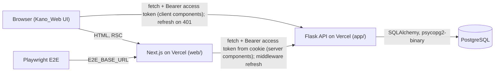
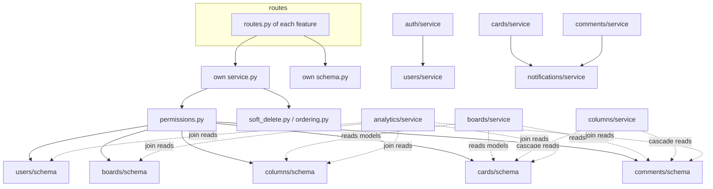
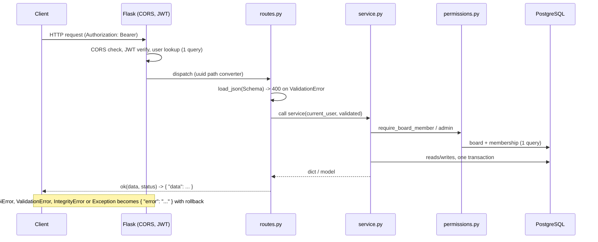
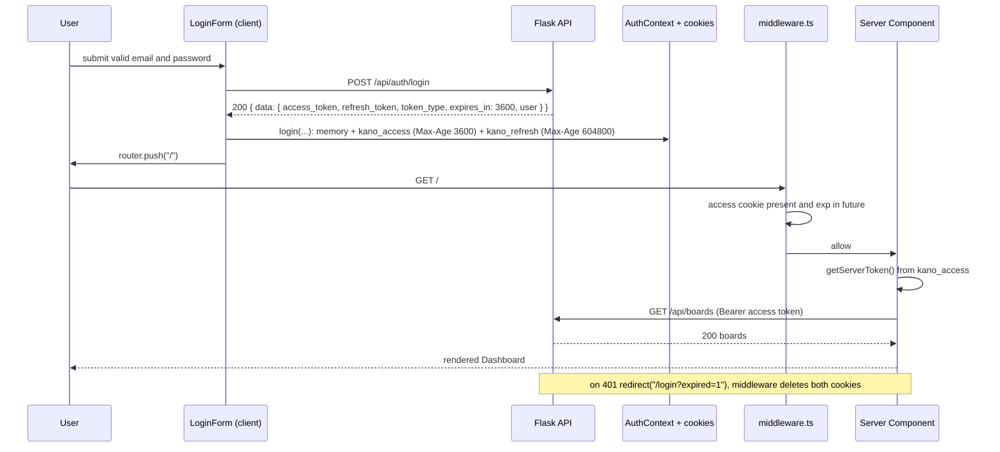
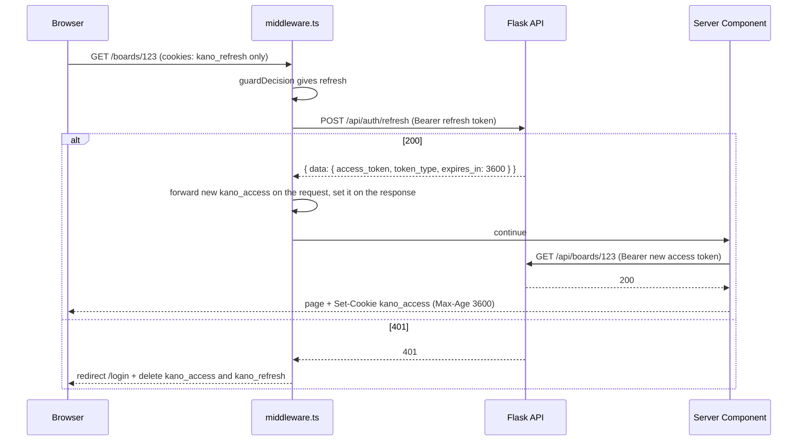
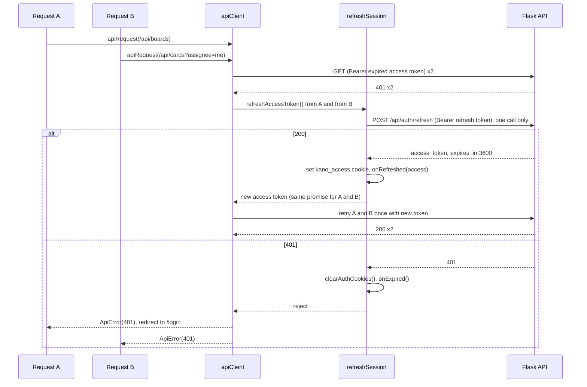
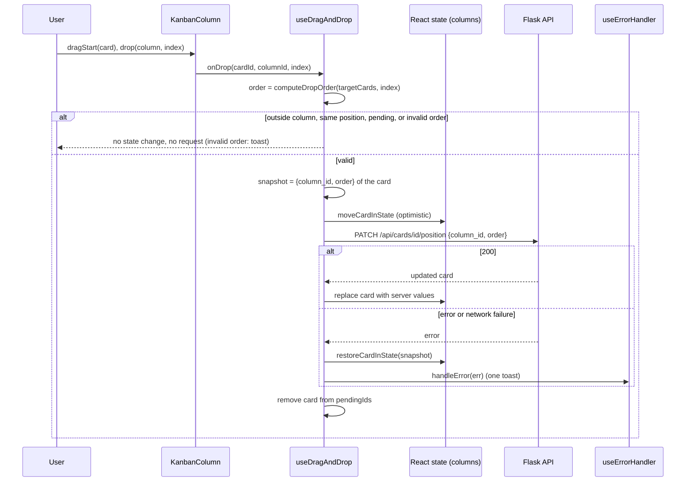
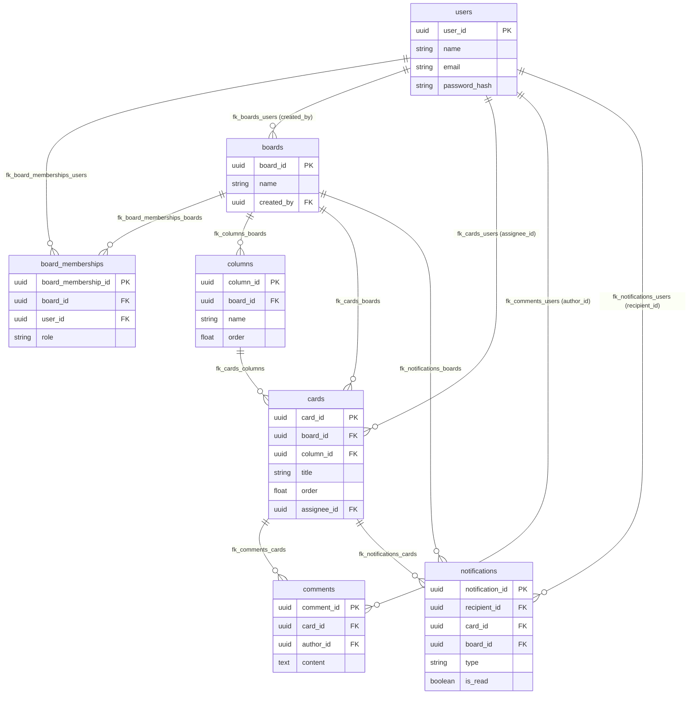
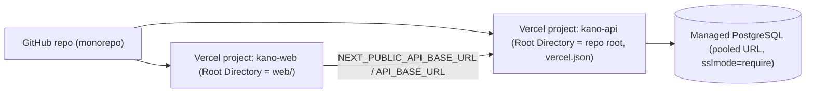

# Design Document

**Version:** V4 (revised against requirements V4; initial design was V3)

## Overview

Kano is a Trello-like task manager. This document designs a single combined spec: a Flask REST API in `app/` (Part A), a Next.js App Router frontend in `web/` (Part B), the test suites (Part C), and deployment and documentation (Part D). Sections are ordered backend first, then frontend, then testing and deployment, as the user asked.

Key design decisions:

| # | Decision | Rationale |
|---|----------|-----------|
| D1 | Per-feature Blueprint_Packages `app/blueprints/<feature>/{routes,service,schema}.py`. `schema.py` holds Marshmallow schemas and the SQLAlchemy model(s). | Required by Requirement 1. Keeps one feature per file set. |
| D2 | `routes.py` parses and validates input and calls `service.py`. `service.py` holds business and data-access logic and raises `ApiError`. Routes never touch the session. | Thin routes make the envelope and status handling uniform. |
| D3 | Cross-feature rule: models are imported only from the other feature's `schema.py`. `service.py` may call another feature's `service.py`. `routes.py` is never imported across features. Cross-feature relationships and FKs use string names. | Requirement 1.7 and 1.8. Prevents circular imports. |
| D4 | `boards/service.py` reads `Column` and `Card` (and `Comment` for cascades) directly from their `schema.py` files. | Requirement-ambiguity decision. Avoids a boards, columns, cards service cycle. |
| D5 | Shared lookups and role checks live in `app/permissions.py`, the only shared module that imports several `schema.py` files. It never imports a `service.py`. | Requirement 1.6 and 28.10. One place enforces 404-then-403 ordering. |
| D6 | Status code lives only on the HTTP status line. Body is `{ "data": ... }` or `{ "error": "..." }`. | Requirement 4 (V3, option A). |
| D7 | Soft delete everywhere through a `SoftDeleteMixin`. Services use explicit `select(...).where(is_deleted is false)` queries. Relationships are `lazy="raise"` so no soft-deleted child can leak through lazy loading. | Requirement 2.8. Also gives fixed query counts (Requirement 29.2). |
| D8 | FLOAT ordering is computed on the server for create and on the client for drop. Pure functions in `app/ordering.py` and `web/lib/order.ts` hold the logic. | Requirements 10, 11, 22. Pure functions are property-testable. |
| D9 | Two JWT types, both sent as `Authorization: Bearer`: an access token (`type=access`, 3600 s) for every protected endpoint and a refresh token (`type=refresh`, 604800 s) accepted only by `POST /api/auth/refresh`. Each is mirrored into its own non-httpOnly cookie so Server Components and the middleware can read them. Refresh tokens are stateless: no rotation, no server-side revocation (assumption, see Open issues). | Requirements 6, 16, 17, 28.7. XSS trade-off for both tokens is documented in Requirement 28.8. |
| D10 | Two Vercel projects. The backend project root is the repository root with a root `vercel.json` that routes to `app/wsgi.py`. The frontend project root is `web/`. | The package is named `app` and must be importable. See the deployment risk notes. |
| D11 | Denormalized `board_id` on `cards` and `notifications`. | Keeps search, permission checks, and notification navigation to one join, and keeps `notifications` independent of `cards` code. A card cannot change Board (Requirement 11.8), so the value is immutable. |

Pure logic (ordering, validation boundaries, recipient computation, pagination, week boundaries, optimistic-move reducers, route-guard decisions, badge formatting) is isolated in side-effect-free functions so it can be tested with property-based tests. See Correctness Properties.

### Manual migration dependency

> **MANUAL STEP (user-owned, Requirement 3):** `flask db init`, `flask db migrate`, `flask db upgrade`, in that order, from `app/` against the local PostgreSQL database. Production and the test database get `flask db upgrade` as separate manual runs. No automated task generates or commits migration scripts.

Parts of this design that depend on that step: every endpoint that reads or writes the database (all except `GET /api/health`), all service and end-to-end pytest tests, the performance checks (Requirement 29), the production verification (Requirement 34), and the Playwright suite. Pure-function unit tests, schema tests, and all frontend unit tests do not depend on it.

## Architecture

### System context



### Backend folder layout (flat; `app/` is the backend root)

```
app/
|-- __init__.py          create_app(config_overrides=None)
|-- config.py            Config.from_env(): validates env vars, fails fast
|-- extensions.py        db (SQLAlchemy), migrate (Migrate), jwt (JWTManager)
|-- errors.py            ApiError family, error handlers, ok()/fail() envelope helpers
|-- permissions.py       get_board_or_404, require_board_member, require_board_admin, ...
|-- soft_delete.py       SoftDeleteMixin, active(), soft_delete_where(), utcnow()   (additional shared module)
|-- ordering.py          next_last_order, midpoint_order, before_first_order       (additional shared module)
|-- health.py            GET /api/health, no database access                        (additional shared module)
|-- wsgi.py              entry point exposing `app`
|-- requirements.txt     pinned (name==version)
|-- .env.example
|-- blueprints/
|   |-- auth/            routes.py, service.py, schema.py   (no model)
|   |-- users/           routes.py, service.py, schema.py   (User)
|   |-- boards/          routes.py, service.py, schema.py   (Board, BoardMembership)
|   |-- columns/         routes.py, service.py, schema.py   (Column)
|   |-- cards/           routes.py, service.py, schema.py   (Card)
|   |-- comments/        routes.py, service.py, schema.py   (Comment)
|   |-- notifications/   routes.py, service.py, schema.py   (Notification)
|   `-- analytics/       routes.py, service.py, schema.py   (no model)
|-- tests/               pytest (unit + e2e)
|-- migrations/          generated manually by the user
`-- venv/                already exists; not recreated
```

There is no `app/routes/`, `app/services/`, or `app/models/` directory. `GET /api/health` is registered by `create_app` from one extra shared module, `app/health.py`, which has no database access.

Because `app/` itself is the Python package `app` (it contains `__init__.py`), all internal imports are absolute (`from app.extensions import db`). `wsgi.py` inserts the repository root into `sys.path` before importing, so both `flask run` from `app/` and Vercel work.

### Model ownership

| Blueprint_Package | Owns model(s) | Table(s) |
|---|---|---|
| users | User | `users` |
| boards | Board, BoardMembership | `boards`, `board_memberships` |
| columns | Column | `columns` |
| cards | Card | `cards` |
| comments | Comment | `comments` |
| notifications | Notification | `notifications` |
| auth | none | none |
| analytics | none | none |

### Module dependency direction (acyclic)



Rules that keep the graph acyclic:

1. No `schema.py` imports any other module of another feature. Cross-feature relationships and FKs use string names (for example `db.ForeignKey("columns.column_id", name="fk_cards_columns")`, `db.relationship("Column", lazy="raise")`).
2. `permissions.py` imports `schema.py` files only and never a `service.py`. Therefore `cards/service` and `comments/service` get Column, Card, and membership lookups from `permissions.py` and do not import `columns/schema` or `boards/schema` directly.
3. Service-to-service calls exist only in three places: `auth` to `users`, `cards` to `notifications`, `comments` to `notifications`.
4. `routes.py` imports only its own `service.py` and `schema.py` plus `errors.py`.
5. `create_app` imports every model-defining `schema.py` (users, boards, columns, cards, comments, notifications) before `Migrate.init_app`, so `flask db migrate` detects all 7 tables (Requirement 1.9).

### File size and split rule (Requirement 30.6, 30.7)

Every Python and TSX file stays at or below 300 lines. Splits are decided now where growth is likely:

| File | Planned split when over 300 lines |
|---|---|
| `blueprints/boards/service.py` | `boards/service/` package: `board_service.py`, `member_service.py`, `cascade.py`, with `__init__.py` re-exporting so `from app.blueprints.boards import service` still works |
| `blueprints/cards/service.py` | `cards/service/`: `card_service.py`, `position_service.py`, `search_service.py` |
| `blueprints/boards/schema.py` | `boards/schema/`: `models.py`, `board_schemas.py`, `member_schemas.py` |
| `blueprints/cards/routes.py` | `cards/routes/`: `card_routes.py`, `search_routes.py` |

The package `__init__.py` keeps `routes`, `service`, and `schema` importable under those names.

### Request lifecycle



## Components and Interfaces

## Part A: Backend

### A1. Application factory and configuration (Requirements 1.5, 1.12, 1.13, 28.5, 28.6, 4.16, 4.17)

`Config.from_env()` reads these variables through python-dotenv and raises `ConfigError("Missing required environment variable: NAME")` for any that is missing or empty. The message names the variable and never prints values.

| Variable | Used for | Required at startup |
|---|---|---|
| `DATABASE_URL` | SQLAlchemy URI (`postgresql+psycopg2://...`) | yes |
| `JWT_SECRET_KEY` | signing secret for both access and refresh tokens | yes |
| `JWT_ACCESS_TOKEN_EXPIRES` | access token lifetime in seconds, positive integer; `.env.example` placeholder `3600` | yes |
| `JWT_REFRESH_TOKEN_EXPIRES` | refresh token lifetime in seconds, positive integer; `.env.example` placeholder `604800` | yes |
| `CORS_ORIGINS` | comma-separated allowed origins | yes |
| `TEST_DATABASE_URL` | pytest only; must differ from `DATABASE_URL` | tests only |

`create_app(config_overrides=None)`:

1. Build `Config`. Tests pass overrides that point `DATABASE_URL` at `TEST_DATABASE_URL`.
2. Set `JWT_ACCESS_TOKEN_EXPIRES` and `JWT_REFRESH_TOKEN_EXPIRES` on `app.config` as `timedelta(seconds=...)` (Flask-JWT-Extended reads them as defaults), then `db.init_app`, `jwt.init_app`, import all model-defining `schema.py` files, then `migrate.init_app(app, db)`.
3. Engine options: when the environment variable `VERCEL` is set, use `poolclass=NullPool` (no pooled connections in a serverless function). Otherwise `pool_size=5`, `pool_pre_ping=True`.
4. `CORS(app, resources={r"/api/*": {"origins": cfg.cors_origins, "allow_headers": ["Authorization", "Content-Type"]}})` with `supports_credentials=False`. flask-cors omits the allow-origin header for an origin not in the list (Requirement 4.17).
5. Register error handlers and JWT callbacks from `errors.py`, register the health blueprint and the 8 feature blueprints under `/api`.
6. Never log request bodies or `Authorization` headers. A logging filter drops records that contain `password` or `Bearer` text (Requirement 28.2).

### A2. Error handling and Response_Envelope (`errors.py`, Requirement 4)

```python
def ok(data, status=200):            # -> flask Response {"data": data}
def fail(message, status):           # -> flask Response {"error": message[:500]}
class ApiError(Exception):           # status, message
class BadRequest(ApiError): ...      # 400
class Unauthorized(ApiError): ...    # 401
class Forbidden(ApiError): ...       # 403
class NotFound(ApiError): ...        # 404
class Conflict(ApiError): ...        # 409
```

| Source | Handler result |
|---|---|
| `ApiError` | its status and message |
| `marshmallow.ValidationError` | 400, message lists each invalid field name (`"name: Length must be between 1 and 100"`) |
| `werkzeug` `NotFound` / `MethodNotAllowed` (unknown path, bad method, non-UUID path id) | 404 / 405 with `{ "error": "..." }` |
| `sqlalchemy.exc.IntegrityError` | rollback, then by `pgcode`: `23505` gives 409, `23503` and `23502` give 400, anything else 500; message is generic, no SQL text |
| `OperationalError`, `ProgrammingError` (missing table, DB down) | rollback, log, 500 generic (Requirement 3.6, 3.7) |
| any other `Exception` | rollback, `logger.exception`, 500 `"Internal server error"` |
| JWT callbacks (`unauthorized_loader`, `invalid_token_loader` (also fires for a wrong token type), `expired_token_loader`, `revoked`, `user_lookup_error_loader`) | 401 envelope |

`load_json(schema)` in `errors.py` reads `request.get_json(silent=True)`, rejects a non-object body with 400, and calls `schema.load(data)`. All schemas use `unknown = RAISE`, so a `password` key in `PATCH /api/users/me` fails with 400 (Requirement 7.3). Query strings use the same pattern through `schema.load(request.args)`.

Success status is chosen in `routes.py`: `ok(data, 201)` for the six creating POSTs, `ok(data)` otherwise. DELETE routes return `ok({"<resource>_id": "<uuid>"})`.

Serialization: `UuidField` outputs `str(uuid)` (lowercase, 36 characters). `UtcDateTime` outputs `value.astimezone(timezone.utc).isoformat().replace("+00:00", "Z")`.

### A3. Authentication and users (Requirements 6, 7, 28.1)

- Password hashing: `werkzeug.security.generate_password_hash(password)` (salted, adaptive scrypt). Verification uses `check_password_hash`. A dummy hash check is run when the email is unknown so both login failures take similar time.
- Emails are trimmed and lowercased on write and on lookup, so the unique index is effectively case-insensitive (Requirements 6.2, 7.4).
- Two token types (Requirements 6.4, 6.5, 6.10 to 6.15). Both are signed with `JWT_SECRET_KEY` and carry `sub = str(user.user_id)` (a string because current PyJWT rejects non-string subjects). Flask-JWT-Extended sets the `type` claim itself:

  | Token | Created by | `type` | Lifetime | Accepted by |
  |---|---|---|---|---|
  | access | `create_access_token(identity=str(user_id))` | `access` | `JWT_ACCESS_TOKEN_EXPIRES` (3600 s) | every protected endpoint (`@jwt_required()`) |
  | refresh | `create_refresh_token(identity=str(user_id))` | `refresh` | `JWT_REFRESH_TOKEN_EXPIRES` (604800 s) | only `POST /api/auth/refresh` (`@jwt_required(refresh=True)`) |

- Type enforcement: `@jwt_required()` (default) rejects a refresh token and `@jwt_required(refresh=True)` rejects an access token. Flask-JWT-Extended raises its wrong-token error in both cases (it would answer 422 by default). The `invalid_token_loader` registered in `errors.py` maps it to 401 in the envelope (Requirement 4.6). A test asserts the 401 for each direction, so a library default change is caught.
- `jwt.user_lookup_loader` loads the non-deleted User by id once per request and caches it on `flask.g`. A missing or soft-deleted user returns `None`, which the lookup-error callback turns into 401 (Requirement 6.9). This is query 1 of every protected request.
- `POST /api/auth/refresh` (`auth/service.refresh(identity)`): `@jwt_required(refresh=True)`, then loads the non-deleted User by `get_jwt_identity()` and raises `Unauthorized` if missing (Requirement 6.13), then returns `create_access_token(...)`. It does not issue a new refresh token (no rotation), and it keeps no server state (Requirement 6.15).
- `GET/PATCH /api/users/me` use the cached user. PATCH updates only supplied fields, checks email uniqueness case-insensitively, and returns 404 if the user no longer exists (Requirement 7.7).
- The login response is `{ "data": { "access_token": "<jwt>", "refresh_token": "<jwt>", "token_type": "Bearer", "expires_in": 3600, "user": { ... } } }`. `expires_in` is `JWT_ACCESS_TOKEN_EXPIRES` in seconds. The refresh response is `{ "data": { "access_token": "<jwt>", "token_type": "Bearer", "expires_in": 3600 } }`. Register returns the user profile only and no tokens.
- Logout is client-only. Because refresh tokens are stateless, a stolen refresh token stays usable until it expires (assumption, see Open issues).

### A4. Permissions helpers (`permissions.py`, Requirements 1.6, 28.10, 28.11)

```python
def get_board_or_404(board_id) -> Board
def require_board_member(board_id, user_id) -> tuple[Board, BoardMembership]   # 404 then 403
def require_board_admin(board_id, user_id) -> tuple[Board, BoardMembership]    # 404, 403 non-member, 403 non-admin
def get_column_for_member(column_id, user_id) -> tuple[Column, Board, BoardMembership]
def get_card_for_member(card_id, user_id)   -> tuple[Card, Board, BoardMembership]
def get_comment_for_member(comment_id, user_id) -> tuple[Comment, Card, BoardMembership]
def assert_assignee_is_member(board_id, assignee_id) -> None                   # 400
```

Each helper does one joined query that selects the resource with its Board and the caller's active membership (`board_memberships.is_deleted = false`). Order of checks: resource missing or soft deleted gives 404, then missing membership gives 403, then role gives 403. A 403 response body contains only a generic message, never resource data (Requirement 28.11). Every `service.py` that enforces membership or role calls these helpers (Requirement 1.6).

### A5. Soft delete and cascade (`soft_delete.py`, Requirement 2)

```python
class SoftDeleteMixin:        # created_at, updated_at, deleted_at, is_deleted
def utcnow() -> datetime      # timezone-aware UTC
def active(model)             # model.is_deleted.is_(False)
def soft_delete_where(session, model, *conditions, deleted_at) -> int
```

Cascade rules, all inside one `db.session` transaction with a single `deleted_at = utcnow()` captured once and reused (Requirements 2.9 to 2.11):

| Deleted | Also soft deleted |
|---|---|
| Board | Board_Memberships, Columns, Cards, Comments of that Board (Notifications are kept) |
| Column | Cards of the Column, Comments of those Cards |
| Card | Comments of the Card |
| Board_Membership | no row cascade; assignee cleared on the member's Cards of that Board in the same transaction (Requirement 9.11) |

Each cascade runs bulk `UPDATE ... SET is_deleted = true, deleted_at = :ts WHERE <parent ids> AND is_deleted = false`. The commit happens once at the end of the service function. Any exception triggers `db.session.rollback()` in the handler, leaving every row unchanged (Requirement 2.13, 8.10). Comment ids of a Column cascade use a subquery on `cards.column_id`.

### A6. FLOAT order strategy (`ordering.py`, Requirements 10.1, 10.4, 11.1, 11.7, 22)

```python
def next_last_order(current_max: float | None) -> float:   # None -> 1.0, else max + 1.0
def midpoint_order(prev: float, nxt: float) -> float:      # (prev + nxt) / 2
def before_first_order(first: float) -> float:             # first / 2
```

Create uses `SELECT max(order)` over active rows of the parent (Board for columns, Column for cards). Reorder and position endpoints store the order supplied by the client after schema validation (`order` is a float greater than 0, finite). Ties are broken by `created_at` in every ordered query. The same three formulas are implemented on the client in `web/lib/order.ts`.

### A7. Notifications creation rules (`notifications/service.py`, Requirement 13)

`create_notification(recipient_id, type, card, message)` inserts one row. Pure function `comment_recipients(author_id, assignee_id, admin_id) -> list[UUID]` returns the de-duplicated set of `{assignee_id, admin_id}` minus `author_id` minus `None`. Callers:

| Trigger | Caller | Recipients |
|---|---|---|
| Card created with assignee, or PATCH changes assignee | `cards/service` | new assignee, unless it is the current user (type `assignment`) |
| Comment added | `comments/service` | `comment_recipients(author, card.assignee_id, board admin)`, type `comment` |

The message is `Assigned to you: "<title>"` or `<author name> commented on "<title>"`. The title is shortened with `...` so the message never exceeds 255 characters. The notification row is inserted in the same transaction as the triggering write. Listing: `page` and `per_page` are validated by `NotificationQuerySchema` (integers from 1 to 2147483647, `per_page` at most 100, defaults 1 and 20). The query is `ORDER BY created_at DESC, notification_id DESC LIMIT per_page OFFSET (page-1)*per_page`. `total` and `unread_count` come from two `count()` queries on active rows of the recipient. A page past the last returns an empty list with the unchanged `total` and `unread_count`. Marking read is idempotent.

### A8. Analytics queries (`analytics/service.py`, Requirement 14)

All use SQLAlchemy joins and aggregation, with every joined table filtered on `is_deleted = false`.

```python
# cards per column, 0 for empty columns -> outer join
select(Column.column_id, Column.name, func.count(Card.card_id))
  .select_from(Column).outerjoin(Card, and_(Card.column_id == Column.column_id, Card.is_deleted.is_(False)))
  .where(Column.board_id == board_id, Column.is_deleted.is_(False))
  .group_by(Column.column_id, Column.name).order_by(Column.order)

# completed this week
week_start = start_of_week_utc(now)   # Monday 00:00:00 UTC, pure function
select(func.count(Card.card_id)).join(Column, Column.column_id == Card.column_id)
  .where(Card.board_id == board_id, Card.is_deleted.is_(False), Column.is_deleted.is_(False),
         func.lower(Column.name) == "done", Card.updated_at >= week_start, Card.updated_at <= now)

# member activity: assigned cards and written comments per active member (two aggregates left-joined to memberships)
```

If no Column is named `Done`, the completed count is 0 (Requirement 14.3). Only the Board_Admin may call it (403 otherwise, 404 if the Board is missing).

### A9. Board detail query plan (Requirements 8.3, 11.16, 29.1, 29.2)

`GET /api/boards/<id>` runs exactly four queries regardless of Card count: (1) JWT user lookup, (2) Board joined with the caller's membership, (3) active Columns ordered by `order`, (4) active Cards of the Board ordered by `order`, `created_at`, with the assignee loaded through `joinedload`. Columns and Cards are grouped in Python. The response includes `my_role`. Members and admins see all Cards (Requirement 11.16 adds no extra filter).

### A10. Card search and My Tasks (`GET /api/cards`, Requirement 11.10 to 11.14)

`CardQuerySchema` accepts `assignee` (only `me`), `q` (1 to 100 characters), `board_id` (UUID). Valid combinations: `assignee=me`, or `q` with optional `board_id`. Anything else is 400. `q` is escaped for LIKE (`\`, `%`, `_`) and used as `Card.title.ilike(pattern, escape="\\") | Card.description.ilike(pattern, escape="\\")`, so SQL and LIKE metacharacters are literal (Requirement 28.4). Rows join `Column`, `Board`, and the caller's active `BoardMembership`, and return `board_id`, `board_name`, `column_name`. With `board_id`, the membership is checked first (403 for a non-member).

### A11. Endpoint table

Legend: Auth `-` = none, `JWT` = any authenticated user holding a valid access token (a refresh token gets 401), `Refresh` = a valid refresh token only (an access token gets 401), `Member` / `Admin` / `Owner` / `Recipient` = per-resource role (server-verified). Success 201 for the six creating POSTs, 200 for everything else; DELETE returns 200 with a data object. Errors list the statuses beyond the always-possible 500 (and 401 for JWT endpoints).

| # | Method | Path | Auth / role | Request schema | Success | Error statuses | Requirement |
|---|---|---|---|---|---|---|---|
| 1 | GET | `/api/health` | - | none | 200 `{status:"ok"}` | 405, 500 | 5 |
| 2 | POST | `/api/auth/register` | - | `RegisterSchema` (name 1-100, email <=254, password 8-128) | 201 user profile | 400, 409 | 6.1-6.3 |
| 3 | POST | `/api/auth/login` | - | `LoginSchema` (email, password) | 200 `{access_token, refresh_token, token_type, expires_in, user}` | 400, 401 | 6.4-6.9 |
| 3a | POST | `/api/auth/refresh` | Refresh | none (token in `Authorization` header) | 200 `{access_token, token_type, expires_in}` | 401 | 6.10-6.15 |
| 4 | GET | `/api/users/me` | JWT | none | 200 profile | 401, 404 | 7.1, 7.6, 7.7 |
| 5 | PATCH | `/api/users/me` | JWT | `UserUpdateSchema` (name, email; `password` rejected) | 200 profile | 400, 401, 404, 409 | 7.2-7.5 |
| 6 | POST | `/api/boards` | JWT | `BoardCreateSchema` (name 1-100, not blank) | 201 board with `my_role` | 400 | 8.1, 8.8, 8.10 |
| 7 | GET | `/api/boards` | JWT | none | 200 list, `created_at` desc | none | 8.2 |
| 8 | GET | `/api/boards/<uuid:id>` | Member | none | 200 board, columns, cards | 403, 404 | 8.3, 8.6, 8.9, 11.16 |
| 9 | PATCH | `/api/boards/<uuid:id>` | Admin | `BoardUpdateSchema` | 200 board | 400, 403, 404 | 8.4, 8.7 |
| 10 | DELETE | `/api/boards/<uuid:id>` | Admin | none | 200 `{board_id}` | 403, 404 | 8.5, 2.9 |
| 11 | POST | `/api/boards/<uuid:id>/members` | Admin | `MemberAddSchema` (email) | 201 member | 400, 403, 404, 409 | 9.1-9.4, 9.9, 9.10 |
| 12 | GET | `/api/boards/<uuid:id>/members` | Member | none | 200 list, creation asc | 403, 404 | 9.5, 9.10 |
| 13 | DELETE | `/api/boards/<uuid:id>/members/<uuid:user_id>` | Admin | none | 200 `{user_id}` | 400 (self), 403, 404 | 9.6-9.8, 9.11, 9.12 |
| 14 | POST | `/api/boards/<uuid:id>/columns` | Member | `ColumnCreateSchema` | 201 column | 400, 403, 404 | 10.1, 10.6, 10.7 |
| 15 | PATCH | `/api/columns/<uuid:id>` | Member | `ColumnUpdateSchema` | 200 column | 400, 403, 404 | 10.2 |
| 16 | DELETE | `/api/columns/<uuid:id>` | Member | none | 200 `{column_id}` | 403, 404 | 10.3, 2.10 |
| 17 | PATCH | `/api/boards/<uuid:id>/columns/reorder` | Member | `ColumnReorderSchema` (`column_id` UUID, `order` float > 0) | 200 column | 400, 403, 404 | 10.4, 10.5, 10.8 |
| 18 | POST | `/api/columns/<uuid:id>/cards` | Member | `CardCreateSchema` | 201 card | 400, 403, 404 | 11.1, 11.2, 11.4, 11.5 |
| 19 | PATCH | `/api/cards/<uuid:id>` | Member | `CardUpdateSchema` (partial) | 200 card | 400, 403, 404 | 11.3-11.5 |
| 20 | DELETE | `/api/cards/<uuid:id>` | Member | none | 200 `{card_id}` | 403, 404 | 11.6, 2.11 |
| 21 | PATCH | `/api/cards/<uuid:id>/position` | Member | `CardPositionSchema` (`column_id`, `order`) | 200 card | 400, 403, 404 | 11.7-11.9 |
| 22 | GET | `/api/cards?assignee=me` and `/api/cards?q=&board_id=` | JWT | `CardQuerySchema` | 200 list | 400, 403 | 11.10-11.14 |
| 23 | POST | `/api/cards/<uuid:id>/comments` | Member | `CommentCreateSchema` (content 1-2000, non-blank) | 201 comment | 400, 403, 404 | 12.1, 12.5, 12.8, 13.2, 13.3 |
| 24 | GET | `/api/cards/<uuid:id>/comments` | Member | none | 200 list, creation asc | 403, 404 | 12.2, 12.8 |
| 25 | PATCH | `/api/comments/<uuid:id>` | Owner | `CommentUpdateSchema` | 200 comment | 400, 403, 404 | 12.3, 12.7 |
| 26 | DELETE | `/api/comments/<uuid:id>` | Owner | none | 200 `{comment_id}` | 403, 404 | 12.4, 12.7 |
| 27 | GET | `/api/notifications` | JWT | `NotificationQuerySchema` (`page`, `per_page`) | 200 `{items,page,per_page,total,unread_count}` | 400 | 13.4-13.8 |
| 28 | PATCH | `/api/notifications/<uuid:id>/read` | Recipient | none | 200 notification | 403, 404 | 13.9-13.11 |
| 29 | GET | `/api/boards/<uuid:id>/analytics` | Admin | none | 200 analytics | 403, 404 | 14 |

Error status mapping follows Requirement 4.6 exactly. Routes with a `<uuid:...>` converter return 404 for a malformed id because the URL rule does not match.

JSON shapes (fields only):

| Resource | Fields |
|---|---|
| user | `user_id`, `name`, `email`, `created_at` |
| board | `board_id`, `name`, `my_role`, `created_at`, `updated_at` |
| board detail | board + `columns: [{column_id, name, order, cards: [card]}]` |
| member | `user_id`, `name`, `email`, `role` |
| column | `column_id`, `board_id`, `name`, `order` |
| card | `card_id`, `board_id`, `column_id`, `title`, `description`, `due_date`, `labels`, `assignee: {user_id, name} or null`, `order`, `created_at`, `updated_at` |
| card search result | card + `board_name`, `column_name` |
| comment | `comment_id`, `card_id`, `content`, `author: {user_id, name}`, `created_at`, `updated_at` |
| notification | `notification_id`, `type`, `message`, `card_id`, `board_id`, `is_read`, `created_at` |
| analytics | `cards_per_column: [{column_id, name, count}]`, `completed_this_week`, `member_activity: [{user_id, name, assigned_cards, comments}]` |

### A12. Security summary (Requirement 28)

Passwords only as salted adaptive hashes; secrets only from environment; all queries parameterized through SQLAlchemy with LIKE escaping; server-side membership and role checks in `permissions.py` on every endpoint; CORS restricted to configured origins; log filter for secrets; frontend never uses `dangerouslySetInnerHTML`. The non-httpOnly cookies are a deliberate trade-off (D9): any XSS can read both the access token and the 7-day refresh token, which raises the impact compared with a single short token. Mitigations: short access token expiry (3600 s), refresh token expiry (604800 s), React output escaping, no `dangerouslySetInnerHTML` (documented in the README).

## Part B: Frontend

### B1. File tree (`web/`, App Router, no `src/`)

```
web/
|-- middleware.ts                  route guard (see B4)
|-- app/
|   |-- layout.tsx                 Server: reads both cookies, renders AuthProvider, Toaster, Header, Footer (one each per page)
|   |-- globals.css                Tailwind entry (@source lines for components/ and hooks/)
|   |-- (boards)/page.tsx          "/"  Dashboard (Server Component)
|   |-- (boards)/boards/[id]/page.tsx   Board Detail (Server Component)
|   |-- (cards)/my-tasks/page.tsx  My Tasks (Server Component fetching, client list)
|   |-- (users)/profile/page.tsx   Profile (Client form inside a thin server page)
|   |-- (auth)/login/page.tsx
|   `-- (auth)/register/page.tsx
|-- components/
|   |-- Header.tsx  Footer.tsx  NotificationBell.tsx
|   |-- shared/   BaseButton.tsx  BaseBadge.tsx  BaseModal.tsx  ConfirmDialog.tsx  ErrorPanel.tsx
|   |-- auth/     LoginForm.tsx  RegisterForm.tsx  AuthProvider.tsx
|   |-- boards/   BoardList.tsx  CreateBoardModal.tsx  BoardView.tsx  KanbanColumn.tsx  ColumnHeader.tsx
|   |             AddColumnForm.tsx  CardSearchInput.tsx  MemberPanel.tsx  AnalyticsView.tsx  BoardAccessMessage.tsx
|   |-- cards/    CardItem.tsx  AddCardForm.tsx  CardDetailModal.tsx  MyTasksList.tsx
|   |-- comments/ CommentList.tsx  CommentItem.tsx  CommentForm.tsx
|   |-- notifications/ NotificationList.tsx
|   `-- users/    ProfileForm.tsx  UserMenu.tsx
|-- hooks/   useDragAndDrop.ts  useNotifications.ts  useErrorHandler.ts  useDebouncedValue.ts  useAuth.ts
|-- lib/     apiClient.ts  refreshSession.ts  errors.ts  toast.ts  authCookie.ts  authContext.ts  serverAuth.ts
|            order.ts  validation.ts  types.ts  format.ts
|-- __tests__/ (Jest or Vitest + React Testing Library)
|-- e2e/       (Playwright specs, playwright.config.ts at web/)
|-- .env.example   NEXT_PUBLIC_API_BASE_URL, API_BASE_URL
`-- package.json   tailwind, react-hot-toast, test scripts
```

Directories under `components/` follow API resources (auth, boards, cards, comments, notifications, users) per Requirement 15.4. Column and analytics UI sit in `components/boards/` because there is no separate resource directory for them in the requirement (see Open issues). Each file defines exactly one component or module.

### B2. Pages: Server versus Client split

| Route | Component type | Data | Notes |
|---|---|---|---|
| `/register` | Server page, `RegisterForm` Client | POST `/api/auth/register` | Controlled inputs, client validation (`lib/validation.ts`), 409 shows email error, success redirects to `/login` with toast |
| `/login` | Server page, `LoginForm` Client | POST `/api/auth/login` | On 200 calls `AuthContext.login({ access_token, refresh_token, expires_in, user })`, router push `/`; 401 shows one generic message and clears password |
| `/` | Server | GET `/api/boards` with the access cookie token | Renders `BoardList` (role `BaseBadge`), `CreateBoardModal` (Client) opened from `BaseButton`; empty state; load error shows `ErrorPanel` with retry (`router.refresh()`) |
| `/boards/[id]` | Server fetch, `BoardView` Client | GET `/api/boards/<id>` | 403 or 404 renders `BoardAccessMessage` with link to `/`; otherwise `BoardView` owns columns state, drag and drop, search |
| `/my-tasks` | Server fetch, `MyTasksList` Client | GET `/api/cards?assignee=me` | Groups by `board_name`; empty and error states; Server error also fires toast through a small client effect |
| `/profile` | `ProfileForm` Client | PATCH `/api/users/me` | Pre-filled from `AuthContext`; no password field |

Unauthenticated access to protected pages is blocked in `middleware.ts` before rendering. A 401 inside a Server Component (the middleware has already refreshed an expired access token, so this means the API rejected the token) calls `redirect("/login?expired=1")`.

### B3. Shared components (`components/shared/`)

| Component | Props | Behavior |
|---|---|---|
| `BaseButton` | `variant?: "primary" or "secondary" or "destructive"` (default `primary`), `disabled`, `type`, `onClick`, native button props | Distinct Tailwind class set per variant; when disabled sets `disabled` and `aria-disabled`, and `onClick` is not invoked; min size 44 x 44 px |
| `BaseBadge` | `variant: "gray" or "blue" or "green" or "red" or "yellow"`, `children` | One class map per variant, so every page renders the same colors |
| `BaseModal` | `open`, `onClose`, `title`, `children` | Portal; renders nothing when closed; Escape and backdrop click call `onClose`; content clicks stop propagation; focuses first focusable (else container) on open; traps Tab; restores previous focus on close; `role="dialog"`, `aria-modal`; mobile: `max-h-[100dvh] overflow-y-auto`, width inside viewport |
| `ConfirmDialog` | `open`, `message`, `onConfirm`, `onCancel`, `busy` | `BaseModal` wrapper used for delete confirmations |
| `ErrorPanel` | `message`, `onRetry?` | Error text with a `BaseButton` retry |

Every button in pages and feature components uses `BaseButton` (Requirement 18.6). `Header` contains the app link, `NotificationBell`, `UserMenu` (profile link, logout) and links to `/my-tasks`; it shows only login and register links for anonymous visitors.

### B4. Auth, cookie, and route guard

- Two cookies, both path `/`, `SameSite=Lax`, not httpOnly, `Secure` on HTTPS:

  | Cookie | Holds | Lifetime (`Max-Age`) | Source of the lifetime |
  |---|---|---|---|
  | `kano_access` | access token | 3600 s | `expires_in` from the login or refresh response |
  | `kano_refresh` | refresh token | 604800 s | constant `REFRESH_COOKIE_MAX_AGE = 604800` (the login response carries no refresh expiry) |

  `lib/authCookie.ts` exposes `setAccessCookie(token, expiresIn)`, `setRefreshCookie(token)`, `getAccessToken()`, `getRefreshToken()`, `clearAuthCookies()` (clears both), the constants `ACCESS_COOKIE`, `REFRESH_COOKIE`, `REFRESH_COOKIE_MAX_AGE`, and the pure functions `decodeJwtExp(token): number | null` and `guardDecision(...)`. The lifetime is no longer derived from the JWT payload, which resolves the earlier open issue about reading `exp`. If `JWT_REFRESH_TOKEN_EXPIRES` is changed from its default, `REFRESH_COOKIE_MAX_AGE` must be changed too (assumption, see Open issues). The cookie max-age is a browser convenience only. The API remains the authority on token validity.
- `AuthProvider` receives `initialAccessToken` and `initialRefreshToken` from the root layout (Server reads both cookies). On mount, if either cookie exists it calls GET `/api/users/me` through `apiRequest`. When only the refresh token exists, `apiRequest` refreshes first (see B5). Success sets the user and both tokens. A 401 that survives the refresh flow clears both cookies and all auth state and redirects to `/login`. A network error or 5xx keeps both cookies, leaves the user unset, and calls `useErrorHandler`. It exposes `login({ access_token, refresh_token, expires_in, user })`, `logout()` (clears both cookies and state, then `router.push("/login")`, no API call), `updateUser(user)` (replaces only the user object), `setAccessToken(token)` (used after a refresh), and `status`. It registers its session callbacks with `lib/refreshSession.ts` (see B5).
- `middleware.ts` (matcher excludes `_next`, static files, `favicon.ico`) reads both cookies and computes `guardDecision({ pathname, accessExp, refreshExp, now })` (pure, in `lib/authCookie.ts`). A token is "valid" when its cookie is present and `exp > now` (the signature is verified by the API, not the middleware). The result is one of:

  | Situation | Decision |
  |---|---|
  | Protected path, access token valid | `allow` |
  | Protected path, access token missing or expired, refresh token valid | `refresh` |
  | Protected path, no valid access token and no valid refresh token | `redirect-login` |
  | `/login` or `/register`, access token valid or refresh token valid | `redirect-home` |
  | `/login` or `/register`, otherwise | `allow` |

  On `refresh` the middleware sends `POST ${API_BASE_URL}/api/auth/refresh` with `Authorization: Bearer <refresh>`. On 200 it forwards the new access token to the same request by calling `request.cookies.set("kano_access", token)` and `NextResponse.next({ request: { headers: request.headers } })`, so Server Components in this request read the new value, and it also sets `kano_access` on the response (`Max-Age` = `expires_in`) so the browser stores it. Server Components cannot set cookies, which is why this step lives in the middleware. On 401 it redirects to `/login` and deletes both cookies. On a network error or 5xx it treats the refresh as failed and redirects to `/login?expired=1` (see Open issues). A request to `/login?expired=1` is always allowed and deletes both cookies, which prevents a redirect loop when the API rejected a token that still looks valid.
- Server Components get the access token through `lib/serverAuth.ts`: `getServerToken()` using `cookies()` from `next/headers` and pass it to `apiRequest(..., { token })` (Requirement 17.10). Server-side `apiRequest` never refreshes.



Server-side refresh in the middleware (access cookie expired or missing, refresh cookie valid):



### B5. API client and errors (Requirement 16)

```ts
// lib/errors.ts
export class ApiError extends Error { constructor(public statusCode: number, message: string) { super(message); } }

// lib/apiClient.ts
export async function apiRequest<T>(path: string, opts?: { method?: string; body?: unknown;
  token?: string | null; signal?: AbortSignal; query?: Record<string, string> }): Promise<T>
```

Behavior:

1. Base URL: `typeof window === "undefined" ? process.env.API_BASE_URL : process.env.NEXT_PUBLIC_API_BASE_URL`. `NEXT_PUBLIC_API_BASE_URL` is referenced literally so Next.js can inline it. Missing or empty gives `ApiError(0, "API base URL is not configured (<VAR>)")` without any request (Requirements 15.7, 16.4).
2. Token: `opts.token` when given, otherwise `getAccessToken()` on the client. Adds `Authorization: Bearer <access token>` only when a token exists; always `Content-Type: application/json` for bodies. On the client, when no access token exists but a refresh token does, the request first awaits `refreshAccessToken()` (below).
3. 10-second timeout through `AbortController`; network error or timeout gives `ApiError(0, "Could not reach the server")`.
4. 2xx: parse JSON and return `body.data as T`.
5. Non-2xx with a body that has a string `error`: `ApiError(response.status, body.error)`. Otherwise `ApiError(response.status, "Unexpected server response")`.
6. Refresh and retry (client only, Requirements 16.14 to 16.17). When a request that carried an access token gets 401, the path is not `/api/auth/login`, `/api/auth/register`, or `/api/auth/refresh`, a refresh token exists, and the request has not been retried, `apiRequest` awaits `refreshAccessToken()` and repeats the original request once with the new access token. A 401 on the retry, or a failed refresh, calls `sessionExpired()` and throws `ApiError(401, ...)`. Server-side calls (`opts.token` given, `typeof window === "undefined"`) never refresh.

`lib/refreshSession.ts` (client only) keeps the single-flight state:

```ts
let inFlight: Promise<string> | null = null;           // shared by all concurrent 401s
export function registerSessionHooks(h: { onRefreshed(access: string): void; onExpired(): void }): void
export function refreshAccessToken(): Promise<string> {
  if (!inFlight) {
    inFlight = doRefresh().finally(() => { inFlight = null; });
  }
  return inFlight;
}
async function doRefresh(): Promise<string> {
  // POST /api/auth/refresh with Authorization: Bearer <getRefreshToken()>, built with fetch (not apiRequest, so no recursion)
  // 200 -> setAccessCookie(access_token, expires_in); hooks.onRefreshed(access_token); return access_token
  // 401 or no refresh token -> sessionExpired(); throw ApiError(401, "Session expired")
  // network error or 5xx -> throw ApiError(0 or status, ...) without clearing cookies
}
export function sessionExpired(): void   // clearAuthCookies(); hooks.onExpired() (AuthContext clears state, router.push("/login"))
```

A refresh that fails with a network error or 5xx keeps the cookies and surfaces that error through `useErrorHandler`. Only a 401 from the refresh endpoint ends the session.



`lib/toast.ts`: `showSuccess(msg)`, `showError(msg)`, `showLoading(msg)`, each requiring a 1 to 200 character message, calling `toast.success`, `toast.error`, `toast.loading`.

`hooks/useErrorHandler.ts` returns `handleError(err: unknown)`: for `ApiError` with status 400, 401, 403, 404, 409, 500 it shows one error toast with a status-specific message from a constant map; any other status or non-ApiError shows a generic message. For 401 it also calls `clearAuthCookies()` (both cookies), `AuthContext.logout()`-style state clearing of the user, access token, and refresh token, and `router.push("/login")`. A 401 reaching the handler has already survived the refresh flow in `apiRequest`.

### B6. Board Detail, drag and drop, search, members, analytics

`BoardView` (Client) holds `columns` state (columns sorted by `order`, cards sorted by `order`), `searchResults`, and modal state. It composes `CardSearchInput`, `KanbanColumn` (renders `ColumnHeader`, `CardItem`, `AddCardForm`), `AddColumnForm`, `CardDetailModal`, and, only when `my_role === "admin"`, `MemberPanel` and an analytics link to `AnalyticsView` (Requirements 21.12, 21.13).

Mutations call `apiRequest` and update state only after success (Requirements 21.2 to 21.8). Failures go to `handleError` and leave state unchanged.

Search: `CardSearchInput` keeps raw text; `useDebouncedValue(text, 300)` yields the debounced value. An effect sends `GET /api/cards?q=<v>&board_id=<id>` when the debounced value is non-empty, cancels the previous request with `AbortController`, and ignores stale responses. Clearing the input restores the full board without a request. An empty result shows a no-results message.

`lib/order.ts` (pure):

```ts
export function computeDropOrder(targetCards: {card_id: string; order: number}[], dropIndex: number): number
// targetCards excludes the dragged card and is sorted ascending.
// empty -> 1.0 ; dropIndex <= 0 -> first.order / 2 ; dropIndex >= length -> last.order + 1 ;
// else (cards[dropIndex-1].order + cards[dropIndex].order) / 2
export function isValidOrder(x: number): boolean   // Number.isFinite(x) && x > 0
export function moveCardInState(cols, cardId, toColumnId, order): Cols    // pure optimistic update
export function restoreCardInState(cols, snapshot): Cols                   // pure revert
```

`hooks/useDragAndDrop.ts` API: `{ onDragStart, onDragOver, onDrop, pendingIds }`. On drop: compute the order; if the drop is outside any column, or leaves the card at its current column and index, do nothing and send nothing; if `!isValidOrder(order)` do nothing and call `handleError`; if the card id is in `pendingIds`, ignore. Otherwise snapshot `{column_id, order}`, apply `moveCardInState` immediately (well under 100 ms), add to `pendingIds`, and send `PATCH /api/cards/<id>/position`. On error restore with `restoreCardInState` and call `handleError` once. The native HTML5 API is used (`draggable`, `dataTransfer`). Touch devices do not fire HTML5 drag events (see Open issues).



Analytics view: `AnalyticsView` fetches `GET /api/boards/<id>/analytics` when opened and shows cards per column, completed this week, and per-member assigned cards and comments. Errors show an inline message and a toast.

### B7. Card detail modal and comments

`CardDetailModal` (Client) renders inside `BaseModal`, shows title, description, due date, labels, assignee (a select of board members from `MemberPanel` data or GET members), and composes `CommentList` plus `CommentForm`. It sends PATCH with only changed fields, keeps entered values on error, validates the title (1 to 200) before sending, and uses `ConfirmDialog` for card deletion. `CommentList` loads `GET /api/cards/<id>/comments` on open, shows loading, empty, and error states, and renders `CommentItem`. Edit and delete controls appear only when `comment.author.user_id === user.user_id`, including for the Board_Admin (Requirement 23.14). Comment changes update list state only after a successful response.

### B8. Notifications UI

`useNotifications()` returns `{ items, unreadCount, markRead }`. While authenticated it requests `GET /api/notifications?page=1&per_page=20` immediately and every 30 s using `setInterval`, clears the interval on unmount or logout, keeps the previous state silently on a poll error, and `markRead(id)` sends `PATCH /api/notifications/<id>/read`, then marks the item read and sets `unreadCount = max(0, unreadCount - 1)`; on error the item stays unread and `handleError` fires. `NotificationBell` shows `formatBadge(unreadCount)` (`"99+"` above 99, nothing at 0) and toggles `NotificationList` (newest first, unread styled differently, empty state).

### B9. Responsive strategy (Requirement 27)

Mobile-first Tailwind; the minimum design width is 375 px.

| Concern | Rule |
|---|---|
| Page overflow | Layout uses `min-w-0`, `flex-wrap`, and `max-w-full`; only the Kanban container uses `overflow-x-auto` |
| Kanban | Container `flex gap-4 overflow-x-auto`; column `w-72 min-w-[240px] shrink-0` so columns stay at least 240 px below 768 px |
| Modal | `max-h-[100dvh] overflow-y-auto w-[calc(100vw-1rem)] max-w-lg`; close control `sticky top-0` |
| Tap targets | Shared `min-h-[44px] min-w-[44px]` on `BaseButton`, links in `Header`, inputs `min-h-[44px]` |
| Overlap | Stack form controls with `flex-col gap-2` below `md`; no absolute positioning for controls |
| Below 375 px | Page can scroll horizontally; content is not truncated |
| Tailwind scan | v4: `@source "../components"; @source "../hooks";` in `globals.css`. v3: `content` array lists `./app`, `./components`, `./hooks` |

### B10. Typed API models (`lib/types.ts`)

```ts
export type Role = "admin" | "member";
export interface User { user_id: string; name: string; email: string; created_at: string }
export interface LoginResult { access_token: string; refresh_token: string; token_type: "Bearer"; expires_in: number; user: User }
export interface RefreshResult { access_token: string; token_type: "Bearer"; expires_in: number }
export interface AuthState { user: User | null; accessToken: string | null; refreshToken: string | null;
  status: "loading" | "authenticated" | "anonymous" }
export interface AuthContextValue extends AuthState {
  login(r: LoginResult): void; logout(): void; updateUser(u: User): void; setAccessToken(t: string): void }
export interface Card { card_id: string; board_id: string; column_id: string; title: string;
  description: string | null; due_date: string | null; labels: string[];
  assignee: { user_id: string; name: string } | null; order: number; created_at: string; updated_at: string }
export interface Column { column_id: string; board_id: string; name: string; order: number; cards: Card[] }
export interface BoardSummary { board_id: string; name: string; my_role: Role; created_at: string }
export interface BoardDetail extends BoardSummary { columns: Column[] }
export interface Member { user_id: string; name: string; email: string; role: Role }
export interface CardSearchResult extends Card { board_name: string; column_name: string }
export interface Comment { comment_id: string; card_id: string; content: string;
  author: { user_id: string; name: string }; created_at: string; updated_at: string }
export interface AppNotification { notification_id: string; type: "assignment" | "comment"; message: string;
  card_id: string; board_id: string; is_read: boolean; created_at: string }
export interface NotificationPage { items: AppNotification[]; page: number; per_page: number; total: number; unread_count: number }
export interface Analytics { cards_per_column: { column_id: string; name: string; count: number }[];
  completed_this_week: number; member_activity: { user_id: string; name: string; assigned_cards: number; comments: number }[] }
```

## Data Models

### Conventions

- Primary key of each table is `<singular_name>_id`, type PostgreSQL `UUID`, generated by the application with `uuid.uuid4` (Requirement 2.3). Tables are plural (as listed in Requirement 1.9), so `users.user_id`, `board_memberships.board_membership_id`.
- Every model uses `SoftDeleteMixin`: `created_at`, `updated_at` (set on insert and on every update), `deleted_at` (nullable), `is_deleted` (default false). All timestamps are `timestamptz` in UTC.
- Foreign keys are named `fk_<child_table>_<parent_table>`. Each child/parent pair occurs once, so names are unique.
- Unique constraints are partial indexes `WHERE is_deleted = false`, so soft-deleted rows do not block new rows (Requirement 2.12).
- The SQL column named `order` is a reserved word. SQLAlchemy quotes it automatically; the Python attribute is also `order`.
- Relationships are declared with `lazy="raise"`; services load related rows through explicit queries.

### Mixin and Card model

```python
# app/soft_delete.py
class SoftDeleteMixin:
    created_at = db.Column(db.DateTime(timezone=True), nullable=False, default=utcnow)
    updated_at = db.Column(db.DateTime(timezone=True), nullable=False, default=utcnow, onupdate=utcnow)
    deleted_at = db.Column(db.DateTime(timezone=True), nullable=True)
    is_deleted = db.Column(db.Boolean, nullable=False, default=False, server_default=db.false())

# app/blueprints/cards/schema.py
class Card(SoftDeleteMixin, db.Model):
    __tablename__ = "cards"
    card_id     = db.Column(db.Uuid, primary_key=True, default=uuid.uuid4)
    board_id    = db.Column(db.Uuid, db.ForeignKey("boards.board_id", name="fk_cards_boards"), nullable=False)
    column_id   = db.Column(db.Uuid, db.ForeignKey("columns.column_id", name="fk_cards_columns"), nullable=False)
    title       = db.Column(db.String(200), nullable=False)
    description = db.Column(db.Text, nullable=True)
    due_date    = db.Column(db.Date, nullable=True)
    labels      = db.Column(postgresql.ARRAY(db.String(30)), nullable=False, default=list, server_default="{}")
    assignee_id = db.Column(db.Uuid, db.ForeignKey("users.user_id", name="fk_cards_users"), nullable=True)
    order       = db.Column(db.Float, nullable=False)
    __table_args__ = (
        db.CheckConstraint("char_length(description) <= 5000", name="ck_cards_description_len"),
        db.CheckConstraint('"order" > 0', name="ck_cards_order_positive"),
        db.Index("ix_cards_column_id_order", "column_id", "order"),
        db.Index("ix_cards_board_id", "board_id"),
        db.Index("ix_cards_assignee_id", "assignee_id"),
    )
```

### Other models (columns and constraints)

| Model / table | Columns | Constraints and indexes |
|---|---|---|
| `User` / `users` | `user_id` UUID PK, `name` varchar(100) not null, `email` varchar(254) not null (stored lowercase), `password_hash` varchar(255) not null, mixin | partial unique index `uq_users_email_active` on `email` where `is_deleted = false` |
| `Board` / `boards` | `board_id` UUID PK, `name` varchar(100) not null, `created_by` UUID not null, mixin | FK `fk_boards_users` (created_by to users.user_id); index `ix_boards_created_by` |
| `BoardMembership` / `board_memberships` | `board_membership_id` UUID PK, `board_id`, `user_id`, `role` varchar(10) not null, mixin | FKs `fk_board_memberships_boards`, `fk_board_memberships_users`; check `ck_board_memberships_role` (`admin` or `member`); partial unique index `uq_board_memberships_board_user_active` on (`board_id`, `user_id`) where `is_deleted = false`; indexes `ix_board_memberships_user_id`, `ix_board_memberships_board_id` |
| `Column` / `columns` | `column_id` UUID PK, `board_id`, `name` varchar(100) not null, `order` float not null, mixin | FK `fk_columns_boards`; check `order > 0`; index `ix_columns_board_id_order` on (`board_id`, `order`) |
| `Card` / `cards` | see model above | FKs `fk_cards_boards`, `fk_cards_columns`, `fk_cards_users` |
| `Comment` / `comments` | `comment_id` UUID PK, `card_id`, `author_id`, `content` text not null (1 to 2000 enforced by schema and `ck_comments_content_len`), mixin | FKs `fk_comments_cards`, `fk_comments_users`; index `ix_comments_card_id_created_at` |
| `Notification` / `notifications` | `notification_id` UUID PK, `recipient_id`, `card_id`, `board_id`, `type` varchar(10) not null, `message` varchar(255) not null, `is_read` boolean not null default false, mixin | FKs `fk_notifications_users`, `fk_notifications_cards`, `fk_notifications_boards`; check `ck_notifications_type` (`assignment` or `comment`); indexes `ix_notifications_recipient_created` on (`recipient_id`, `created_at` desc), `ix_notifications_recipient_unread` on `recipient_id` where `is_read = false` |

Indexes required by Requirement 29.3 are present: membership `user_id` and `board_id`, column `board_id`, card `column_id` and assignee, comment `card_id`, notification recipient, and the `order` columns inside composite indexes. All composite and filter indexes also include rows where `is_deleted = true`, which is acceptable at the expected data volume.

### ER diagram



Every table also carries `created_at`, `updated_at`, `deleted_at`, and `is_deleted` (omitted from the diagram for space).

### Marshmallow schema list (Requirement 4.9)

| Package | Schemas |
|---|---|
| auth | `RegisterSchema`, `LoginSchema` |
| users | `UserSchema` (output), `UserUpdateSchema` |
| boards | `BoardCreateSchema`, `BoardUpdateSchema`, `BoardSchema`, `BoardDetailSchema`, `MemberAddSchema`, `MemberSchema` |
| columns | `ColumnCreateSchema`, `ColumnUpdateSchema`, `ColumnReorderSchema`, `ColumnSchema` |
| cards | `CardCreateSchema`, `CardUpdateSchema`, `CardPositionSchema`, `CardQuerySchema`, `CardSchema`, `CardSearchSchema` |
| comments | `CommentCreateSchema`, `CommentUpdateSchema`, `CommentSchema` |
| notifications | `NotificationQuerySchema`, `NotificationSchema`, `NotificationPageSchema` |
| analytics | `AnalyticsSchema` |

Name fields strip whitespace and reject blank values. All input schemas set `unknown = RAISE`.

## Correctness Properties

*A property is a characteristic or behavior that should hold true across all valid executions of a system-essentially, a formal statement about what the system should do. Properties serve as the bridge between human-readable specifications and machine-verifiable correctness guarantees.*

**Redundancy review.** The prework produced about 40 candidate properties. Redundancy was removed as follows:

- Envelope shape (4.1, 4.2, 4.5, 4.8) and status mapping (4.6, 4.7) are separate because one checks body shape and the other the status line.
- Role checks for boards, members, columns, cards, comments, analytics (8.6, 8.7, 9.9, 9.10, 9.12, 10.7, 11.15, 12.8, 14.7, 28.10, 28.11) are merged into one permission-matrix property.
- Name, title, content, and password boundary checks (6.1, 6.3, 8.8, 10.6, 11.4, 12.5, 4.10) are merged into one server-validation property. Client-side validators (19.2, 19.7, 20.3, 21.3, 21.7, 23.3, 23.9, 26.3) are merged into one mirror property.
- Soft-delete exclusion (2.8, 12.2, 14.6, 13.5) is one property. Cascades (2.7, 2.9 to 2.11) are one property and atomicity (2.13, 8.10) is a second because it needs fault injection.
- Password exposure (6.8, 7.1, 28.1) is one property.
- Search semantics (11.11 to 11.13, 28.4) is one property.
- Ordering formulas (10.1, 11.1, 22.2 to 22.5) are split into server allocation and client drop computation because they live in different languages.
- Comment owner-only on the server (12.7) and the control visibility on the client (23.11, 23.14) stay separate.

### Property 1: Envelope shape

*For any* request to any endpoint (valid or invalid, authenticated or not), the response body is a JSON object with exactly one top-level key, either `data` or `error`; the key is `data` iff the status is 2xx; an `error` value is a non-empty string of at most 500 characters; and a 500 response contains no stack trace, SQL text, or database details.

**Validates: Requirements 4.1, 4.2, 4.5, 4.8, 4.11, 5.4**

### Property 2: Status code by outcome

*For any* request, the status is 201 for a successful creating POST (register, boards, members, columns, cards, comments), 200 for every other success (including every DELETE, whose body `data` is a JSON object), and for a failure it is the code mapped by failure type: validation 400, JWT 401, permission 403, missing, soft-deleted, or malformed-UUID path id 404, unsupported method 405, unique conflict 409, unexpected 500.

**Validates: Requirements 4.3, 4.4, 4.6, 4.7, 4.12, 4.13, 4.14, 4.18**

### Property 3: Serialization format

*For any* UUID and any timestamp serialized by any response schema, the UUID is a lowercase hyphenated string of 36 characters and the timestamp is an ISO 8601 UTC string ending in `Z` or `+00:00`.

**Validates: Requirements 4.15**

### Property 4: CORS origin filtering

*For any* request origin, the response carries the allow-origin header iff the origin is in the configured allowed list.

**Validates: Requirements 4.16, 4.17**

### Property 5: Configuration fails fast

*For any* non-empty subset of the required environment variables (`DATABASE_URL`, `JWT_SECRET_KEY`, `JWT_ACCESS_TOKEN_EXPIRES`, `JWT_REFRESH_TOKEN_EXPIRES`, `CORS_ORIGINS`) that is missing or empty, `Config.from_env()` raises an error whose message names each missing variable and contains none of the provided variable values.

**Validates: Requirements 1.13, 28.6**

### Property 6: Soft-deleted rows never appear

*For any* set of Boards, Columns, Cards, Comments, Memberships, Users, and Notifications with arbitrary `is_deleted` flags, every list, detail, search, count, analytics, and notification query returns only rows (and counts only rows) where `is_deleted` is false, and a request for a soft-deleted resource returns 404.

**Validates: Requirements 2.8, 8.9, 12.2, 12.9, 13.5, 14.6**

### Property 7: Soft delete is a cascade that preserves data

*For any* Board, Column, or Card tree, deleting the parent sets `is_deleted = true` and the same `deleted_at` on the parent and all descendants named in the cascade table (Board: memberships, columns, cards, comments; Column: cards and their comments; Card: comments), leaves every other column value and every unrelated row unchanged, and a soft-deleted row is never physically removed.

**Validates: Requirements 2.7, 2.9, 2.10, 2.11, 8.5, 10.3, 11.6**

### Property 8: Cascade atomicity

*For any* cascading delete or Board creation in which a database step fails part-way, every affected row is unchanged afterward and the response is 500 in the envelope.

**Validates: Requirements 2.13, 8.10**

### Property 9: Uniqueness ignores soft-deleted rows

*For any* sequence of create and soft-delete operations on Users and Board_Memberships, creating a User with an email (compared case-insensitively) or a membership for a (board, user) pair succeeds iff no non-deleted row with that key exists, and a duplicate returns 409 and changes nothing.

**Validates: Requirements 2.12, 6.2, 7.4, 9.4**

### Property 10: Password handling

*For any* valid registration, the stored `password_hash` differs from the submitted password and verifies against it, and *for any* response from any endpoint no field named `password` or `password_hash` appears at any depth.

**Validates: Requirements 6.1, 6.8, 7.1, 28.1**

### Property 11: Register then login round trip

*For any* valid name, email, and password, registering and then logging in with the same credentials (any letter case in the email) returns 200 with an access token and a refresh token whose `sub` equals the user's `user_id`, with `expires_in` equal to the configured access lifetime; and *for any* login with an unknown email, a wrong password, or a soft-deleted user's email, the response is 401 with an identical message and no token. Token types and lifetimes are covered by Properties 36 and 37.

**Validates: Requirements 6.4, 6.5, 6.6**

### Property 12: Server input validation

*For any* string value of any validated field (names 1 to 100, board and column names non-blank, card title 1 to 200, description at most 5000, labels at most 10 items of 1 to 30 characters, comment content 1 to 2000 with a non-whitespace character, password 8 to 128, email at most 254 and well formed, due date ISO 8601), the request is accepted iff the value lies inside the rule, and a rejected request returns 400 naming each invalid field and leaves stored data unchanged.

**Validates: Requirements 4.9, 4.10, 6.3, 7.5, 8.8, 9.2, 10.6, 11.4, 12.5**

### Property 13: Role and membership enforcement

*For any* user, Board, and endpoint that requires membership or a role, the outcome matches the permission matrix: a non-member receives 403, a member who is not the admin receives 403 on admin-only endpoints (Board update and delete, member add and remove, analytics), a removed member receives 403, an authorized caller succeeds, and *for any* 403 response all data is unchanged and the response body contains no data of the target resource.

**Validates: Requirements 8.6, 8.7, 9.9, 9.10, 9.12, 10.7, 11.15, 12.8, 14.7, 28.10, 28.11**

### Property 14: Board creation makes the creator admin

*For any* authenticated user and valid Board name, creating the Board makes the creator the only member with role `admin`, and the Board appears in that user's `GET /api/boards` with `my_role = "admin"`, ordered by `created_at` descending, while a user with no membership never sees it.

**Validates: Requirements 8.1, 8.2**

### Property 15: Server order allocation

*For any* Board with Columns (or Column with Cards) and any sequence of creations, each new item receives an Order_Value strictly greater than every non-deleted sibling's value, the first item receives 1.0, and `GET /api/boards/<id>` lists Columns and each Column's Cards in non-decreasing Order_Value.

**Validates: Requirements 8.3, 10.1, 11.1, 21.1**

### Property 16: Position and reorder persistence

*For any* Card in a Board, any Column of the same Board, and any finite order greater than 0, PATCH position stores that Column and order, and a subsequent GET of the Board shows the Card in that Column at the sorted position; *for any* Column of another Board, a soft-deleted Column, a non-UUID `column_id`, or an order that is not greater than 0, the request returns 400 and the Card is unchanged. The same holds for Column reorder.

**Validates: Requirements 10.4, 10.5, 10.8, 11.7, 11.8, 11.9, 22.11**

### Property 17: Partial update

*For any* Card (or User) and any subset of updatable fields supplied in a PATCH, exactly the supplied fields change, all other fields keep their previous values, and `updated_at` does not decrease.

**Validates: Requirements 7.2, 11.3**

### Property 18: Assignee must be a member and removal clears assignment

*For any* Card and any assignee, creating or updating a Card with an assignee who is not a non-deleted member of the Card's Board returns 400 and changes nothing; and removing a member sets the assignee to empty on every non-deleted Card of that Board assigned to them, in the same transaction.

**Validates: Requirements 11.5, 9.11**

### Property 19: Search and My Tasks semantics

*For any* set of Cards across Boards and any query text (including `%`, `_`, `\`, `'`, `;`, `--`), `GET /api/cards?q=<text>` returns exactly the non-deleted Cards of Boards where the caller is a member whose title or description contains the text case-insensitively, `board_id` restricts the result to that Board (403 for a non-member), and `GET /api/cards?assignee=me` returns exactly the caller's non-deleted assigned Cards on non-deleted Boards.

**Validates: Requirements 11.10, 11.11, 11.12, 11.13, 28.4**

### Property 20: Comment ownership

*For any* Comment and any user, PATCH and DELETE succeed iff the user is the Comment's author (so a Board_Admin who is not the author receives 403), and a failed attempt leaves the Comment unchanged.

**Validates: Requirements 12.3, 12.4, 12.7**

### Property 21: Notification recipients

*For any* author, assignee (possibly none), and admin, `comment_recipients(author, assignee, admin)` contains no duplicates, never contains the author, contains the assignee iff the assignee exists and differs from the author, and contains the admin iff the admin differs from the author; and *for any* Card create or update, an `assignment` notification is created iff the new assignee differs from the current user and from the previous assignee.

**Validates: Requirements 13.1, 13.2, 13.3**

### Property 22: Notification pagination

*For any* user with N non-deleted notifications and any valid `page` and `per_page` (at most 100), the response contains `min(per_page, max(0, N - (page - 1) * per_page))` items newest first, `total = N`, and `unread_count` equal to the number of unread notifications, even for a page beyond the last; *for any* `page` or `per_page` that is not an integer from 1 to 2147483647 or a `per_page` above 100, the response is 400 with no notifications; and *for any* user, only that user's notifications are returned.

**Validates: Requirements 13.5, 13.6, 13.7, 13.8**

### Property 23: Mark-read idempotence

*For any* notification, applying the read operation once or repeatedly by its recipient yields 200 with `is_read = true`, and applying it by any other user yields 403 with `is_read` unchanged.

**Validates: Requirements 13.9, 13.10**

### Property 24: Analytics equals a naive model

*For any* Board with Columns, Cards, Comments, and Members (including soft-deleted rows, columns without Cards, and no Column named Done), the analytics response equals a plain in-memory computation: per-column counts (0 for empty), completed cards in a Column named `Done` (case-insensitive) with `updated_at` between Monday 00:00 UTC of the current week and now, and per-member assigned Card and Comment counts. `start_of_week_utc(t)` is a Monday at 00:00:00 UTC, is at most `t`, and is less than 7 days before `t`.

**Validates: Requirements 14.1, 14.2, 14.3, 14.4, 14.6**

### Property 25: Constant query count for board detail

*For any* Board with a fixed number of Columns and any number of Cards from 0 to 500, `GET /api/boards/<id>` executes the same number of SQL statements, at most 5.

**Validates: Requirements 29.2**

### Property 26: API client behavior

*For any* path and payload, `apiRequest` returns the `data` field of a 2xx envelope; sends `Authorization: Bearer <access token>` iff an access token is available; and *for any* non-2xx status with an `error` string it throws `ApiError(statusCode, error)`, while *for any* non-2xx response with a body that is not an envelope it throws `ApiError(statusCode, "Unexpected server response")`.

**Validates: Requirements 16.1, 16.5, 16.6, 16.7**

### Property 27: Error handler mapping

*For any* `ApiError` with status in {400, 401, 403, 404, 409, 500}, `handleError` shows exactly one error toast and the six messages are pairwise distinct; *for any* other status or any non-ApiError value it shows exactly one generic toast.

**Validates: Requirements 16.11, 16.12**

### Property 28: Route guard decision

*For any* path, access token state (absent, expired, valid), refresh token state (absent, expired, valid), and current time, `guardDecision` returns `allow` for a protected path with a valid access token, `refresh` for a protected path with no valid access token and a valid refresh token, `redirect-login` for a protected path with neither, `redirect-home` for `/login` or `/register` when either token is valid, and `allow` for `/login` or `/register` otherwise.

**Validates: Requirements 17.7, 17.8, 17.9**

### Property 29: Client validators mirror server rules

*For any* string, the client validators for name, email, password, board name, column name, card title, comment text, and profile fields accept it iff the corresponding server rule in Property 12 accepts it, and a rejected form sends no request.

**Validates: Requirements 19.2, 19.7, 20.3, 21.3, 21.7, 23.3, 23.9, 26.3**

### Property 30: Client drop order computation

*For any* target column's cards (distinct positive orders, sorted ascending, excluding the dragged card) and any drop index, `computeDropOrder` returns 1.0 for an empty column, half of the first order for index 0, last order plus 1 for the end, and the midpoint of the two neighbors otherwise; the result is finite and positive, and inserting the dragged card with that order yields a sorted list in which the card sits at the drop index.

**Validates: Requirements 22.2, 22.3, 22.4, 22.5, 22.9**

### Property 31: Optimistic move and revert

*For any* board state, card, target column, and valid order, `moveCardInState` places the card in the target column with the new order immediately, and a failed request followed by `restoreCardInState` returns a state equal to the original (original column and original order, same sorted position); *for any* drop outside a column or at the card's own position, the state is unchanged and no request is sent.

**Validates: Requirements 22.6, 22.7, 22.8**

### Property 32: Notification badge and unread count

*For any* unread count n, `formatBadge(n)` is empty for 0, the decimal string for 1 to 99, and `"99+"` for 100 or more; and *for any* unread count and successful read of an unread notification, the new count is `max(0, n - 1)`, while a failed read leaves the count unchanged.

**Validates: Requirements 24.2, 24.3, 24.6, 24.7**

### Property 33: Search debounce

*For any* sequence of keystrokes with fake timers where each gap is under 300 ms, at most one search request is sent, after 300 ms since the last keystroke and carrying the final text; clearing the input sends no request.

**Validates: Requirements 21.9, 21.10**

### Property 34: Owned-comment controls and My Tasks grouping

*For any* list of Comments and current user, edit and delete controls are rendered exactly for Comments whose author is the current user (including when the current user is the Board_Admin); and *for any* list of Cards, `groupByBoard` produces one group per distinct `board_id`, each Card appears in exactly one group, and no Card is lost.

**Validates: Requirements 23.11, 23.14, 25.1**

### Property 35: Changed-fields diff

*For any* original card and edited form values, `diffCardFields` returns exactly the fields whose values differ, and an unchanged form produces an empty diff.

**Validates: Requirements 23.2**

### Property 36: Token types and lifetimes

*For any* registered user and any configured positive lifetimes `A` (access) and `R` (refresh), login returns an access token with `type = "access"` and `exp - iat = A`, and a refresh token with `type = "refresh"` and `exp - iat = R`, both with `sub` equal to the user's `user_id`; with the default configuration `A = 3600` and `R = 604800`, and `expires_in` equals `A`.

**Validates: Requirements 6.4, 6.5**

### Property 37: Token type enforcement

*For any* protected endpoint other than `POST /api/auth/refresh` and any valid refresh token, the response is 401 and nothing changes; and *for any* valid access token sent to `POST /api/auth/refresh`, and *for any* missing, malformed, wrongly signed, or expired token sent there, the response is 401 and no token is issued.

**Validates: Requirements 6.11, 6.12, 6.14, 4.6**

### Property 38: Refresh yields a working access token

*For any* registered user holding a valid refresh token, `POST /api/auth/refresh` returns 200 with an access token with `type = "access"`, the same `sub`, `expires_in = 3600` in the default configuration, and no refresh token; the new access token is accepted by `GET /api/users/me` and returns that user's profile; and *for any* refresh token whose subject is a soft-deleted or nonexistent user, the response is 401.

**Validates: Requirements 6.10, 6.13**

### Property 39: Failed refresh clears the session, shared refresh runs once

*For any* number `n >= 1` of concurrent protected requests that all receive 401, the apiClient sends exactly one `POST /api/auth/refresh`; when it returns 200 each original request is retried exactly once with the new access token and the access cookie is updated; when it returns 401 both cookies and the AuthContext state are cleared, the user is redirected to `/login`, and each original request rejects with `ApiError(401, ...)`; and *for any* 401 from `/api/auth/login`, `/api/auth/register`, or `/api/auth/refresh`, no refresh is attempted.

**Validates: Requirements 16.14, 16.15, 16.16, 16.17, 17.4**

## Error Handling

| Situation | Behavior | Requirement |
|---|---|---|
| Invalid body or query | 400, message names each invalid field, no write | 4.9, 4.10 |
| Missing, malformed, expired JWT; deleted or unknown token user | 401 envelope | 4.13, 6.9 |
| Role or membership failure | 403, no resource data in body | 4.14, 28.11 |
| Missing, soft-deleted, or non-UUID resource id | 404 | 4.12, 8.9 |
| Unknown path or method | 404 or 405, envelope | 4.18 |
| Unique violation | 409; FK or NOT NULL violation 400; no DB details | 2.14, 4.7 |
| Database unreachable or schema not applied | 500 generic; exception logged; process keeps serving | 3.6, 3.7, 34.10 |
| Unhandled exception | rollback, log, 500 generic | 4.11 |
| Cascade or create failure mid-transaction | rollback everything, 500 | 2.13, 8.10 |
| Missing env variable at startup | process fails naming the variable | 1.13, 28.6 |
| Frontend network error or timeout over 10 s | `ApiError(0, ...)`; toast through `useErrorHandler` | 16.8 |
| Frontend 401 on a protected request | one shared refresh, retry once; if refresh or retry returns 401, clear both cookies and state, redirect `/login` | 16.13 to 16.17 |
| Refresh endpoint 401 (wrong type, expired, deleted user) | 401 envelope, no token issued | 6.11 to 6.14 |
| Middleware refresh fails | 401: delete both cookies, redirect `/login`; network error or 5xx: redirect `/login?expired=1` | 17.7, 17.8 |
| Failed optimistic move | restore original state, one toast | 22.7 |
| Polling failure | keep previous state, no toast | 24.9 |
| Server Component load failure (not 401) | `ErrorPanel` with retry | 20.8, 25.5 |
| Board 403 or 404 | access-denied or not-found message with link to `/` | 21.15 |

## Testing Strategy

### Approach

Both unit tests and property-based tests are used. Property tests cover universal properties from the Correctness Properties section. Unit and example tests cover specific examples, edge cases, integration points, and smoke checks. Property-based testing applies here because the feature contains pure logic (ordering, validation, recipients, pagination, week boundary, reducers, guards) and service-level behavior over a large input space. It does not apply to Tailwind layout (Requirement 27), deployment (34), repository hygiene (35), and documentation (36); those use example tests, Playwright viewport checks, and checklists.

Libraries: **Hypothesis** for Python and **fast-check** for TypeScript. Property-based testing is not implemented from scratch. Every property test:

- runs at least 100 iterations (`@settings(max_examples=100, deadline=None)`; `fc.assert(..., { numRuns: 100 })`),
- implements exactly one Correctness Property,
- carries a tag comment: `# Feature: kano, Property <n>: <property text>`.

### Backend (pytest, run from `app/`)

| Layer | Content |
|---|---|
| Config | `pytest.ini` (markers `perf`, `unit`, `e2e`), `tests/conftest.py` |
| Unit, no DB | `ordering.py`, `start_of_week_utc`, `comment_recipients`, Marshmallow schema boundaries (Board and Column names of 0, 1, 100, 101; Card title 200, 201; password 7, 8), config validation (both JWT expiry variables), serializers; mostly property tests (1 to 5, 12, 21, 24 partial) |
| Auth tokens | login returns access (`type=access`, 3600 s) and refresh (`type=refresh`, 604800 s) tokens with `sub = user_id`; refresh returns 200 and the new token works on `GET /api/users/me`; 401 for an expired, missing, or access-type token on refresh, for a refresh token of a soft-deleted user, and for a refresh token on `GET /api/users/me` and every other protected endpoint (parametrized); tokens are created with short test lifetimes or a patched clock instead of waiting (Properties 36 to 38, requirement 31.11) |
| Service and e2e, DB | Flask test client against the separate PostgreSQL test database; covers all 8 packages with at least one success and one error path each; asserts envelope shape and status on every request; properties 6 to 25 where DB-backed |
| Comments | tests for 201 success, 400 missing content, 400 empty content, 401 unauthenticated, 403 non-owner including the Board_Admin |
| Role enforcement | parametrized matrix of non-member, member, admin over Board, Column, Card, Comment, member, update, delete, analytics endpoints |
| Cascades | soft delete Board, Column, Card sets flags on children and later GETs return 404 |
| Performance | marker `perf`: seeds 20 Columns and 500 Cards, 100 consecutive `GET /api/boards/<id>` calls, p95 under 500 ms, query count via SQLAlchemy `before_cursor_execute` listener; same for search and `assignee=me` over 2000 Cards; a failure prints the measured p95 in ms |

Test database safety (Requirement 31.10):

- `conftest.py` reads `TEST_DATABASE_URL`, refuses to run if it equals `DATABASE_URL` or its database name does not end with `_test`, and connects once at session start.
- If it cannot connect, or the expected 7 tables are missing, `pytest.exit("Test database <name> unavailable or schema not applied")` stops the run. The schema in the test database comes from the manual `flask db upgrade` run against it, not from `db.create_all()`.
- Isolation (Requirement 31.7): after each test an autouse fixture runs `TRUNCATE ... RESTART IDENTITY CASCADE` on the 7 tables, so tests are order independent and re-runnable. Fixtures create their own users, boards, and tokens through factory functions.
- Hypothesis database-backed tests use a function-scoped fixture reset inside the test body (`@given` plus manual truncate) because function-scoped fixtures are not reset between examples.

### Frontend unit tests (`npm test`, run once, no watch)

Runner: Vitest with jsdom and React Testing Library (`vitest --run` for `npm test`; the config can be Jest if the scaffold prefers it). Network is mocked with `vi.fn()` on `fetch`; no Kano_API is needed (Requirement 32.9).

| Subject | Tests |
|---|---|
| `BaseButton` | each variant has a distinct class, click fires `onClick` once, disabled ignores clicks and sets `aria-disabled` |
| `BaseModal` | absent when closed, present when open, Escape closes, backdrop closes, content click does not close, focus moves inside, focus returns |
| `RegisterForm` | empty name, malformed email, 7-character password each show a field error and send no request; 8-character password submits |
| `LoginForm` | empty email and empty password blocked; valid form submits |
| `CommentList` | controls visible only for owned comments |
| `NotificationBell` | shows 1 and 99, hides at 0 (plus Property 32) |
| `apiClient` | Authorization header present or omitted; returns `data`; ApiError for 400, 401 (no refresh token), 403, 404, 409, 500 (Property 26) |
| `apiClient` refresh | 401 triggers one refresh and one retry with the new token; concurrent 401s share one refresh; refresh 401 clears both cookies and state and redirects; a 401 from login does not refresh (Property 39, requirement 32.12) |
| `useDragAndDrop` | failing request restores card and calls handler once; card moves before the request resolves (Properties 30, 31) |
| Pure libs | `order.ts`, `authCookie.ts` (`guardDecision`, cookie constants), `validation.ts`, `format.ts`, `diffCardFields`, `groupByBoard` via fast-check (Properties 27 to 35) |

### Playwright E2E (`npx playwright test`, run from `web/`)

- `playwright.config.ts` reads `E2E_BASE_URL`. If it is missing or not an absolute http(s) URL, the config throws before any test starts and the message names `E2E_BASE_URL` (Requirement 33.2). `use.baseURL = E2E_BASE_URL`, `expect.timeout = 10_000`, `timeout = 60_000`, `retries = 2` at most, `reporter = [["html", { open: "never", outputFolder: "playwright-report" }]]`.
- No `waitForTimeout` anywhere; only auto-waiting locators and web-first assertions (`expect(locator).toBeVisible()`, `toHaveURL`).
- Auth specs (4 scenarios): valid login redirects to `/`; invalid credentials show the error and stay on `/login`; unauthenticated visit to `/` redirects to `/login`; logout redirects to `/login` and a following visit to `/` redirects again.
- Kanban journey (serial, one test with 8 `test.step` blocks): 1 register a unique user (`e2e+<timestamp>@example.com`), 2 login, 3 create Board, 4 add 2 Columns, 5 create Card in the first, 6 drag it to the second (`locator.dragTo`, which dispatches HTML5 drag events in Chromium), 7 reload and confirm the Card is in the second Column, 8 add a Comment then edit it and confirm the new text. `test.describe.configure({ mode: "serial" })` skips remaining steps after a failure.
- The HTML report from a passing run is committed (`web/playwright-report/`) and viewed with `npx playwright show-report`.
- Mobile viewport checks (375 px) use a Playwright project with `devices["iPhone SE"]`-like viewport and assert no horizontal overflow outside the Kanban container.

## Part D: Deployment, Guidelines, and Documentation Design

### D1. Deployment (Requirement 34)



**Backend project (Vercel).** A root-level `vercel.json` routes every path to the WSGI entry:

```json
{
  "builds": [{ "src": "app/wsgi.py", "use": "@vercel/python" }],
  "routes": [{ "src": "/(.*)", "dest": "app/wsgi.py" }]
}
```

`app/wsgi.py` exposes `app = create_app()`. A root `.vercelignore` excludes `web/`, `app/venv/`, and `.kiro/`. The project root is the repository root (not `app/`) so that the package `app` is importable. Dependencies come from `app/requirements.txt`.

**Frontend project (Vercel).** Root Directory `web/`, framework preset Next.js, build `npm run build`.

**Environment variables.**

| Project | Variable | Value |
|---|---|---|
| kano-api | `DATABASE_URL` | production PostgreSQL URL (pooled, `sslmode=require`) |
| kano-api | `JWT_SECRET_KEY` | long random secret |
| kano-api | `JWT_ACCESS_TOKEN_EXPIRES` | `3600` |
| kano-api | `JWT_REFRESH_TOKEN_EXPIRES` | `604800` |
| kano-api | `CORS_ORIGINS` | exact public URL of kano-web (no trailing slash) |
| kano-web | `NEXT_PUBLIC_API_BASE_URL` | public URL of kano-api |
| kano-web | `API_BASE_URL` | public URL of kano-api |

`app/.env.example` lists `DATABASE_URL`, `JWT_SECRET_KEY`, `JWT_ACCESS_TOKEN_EXPIRES=3600`, `JWT_REFRESH_TOKEN_EXPIRES=604800`, `CORS_ORIGINS`, `TEST_DATABASE_URL` with placeholders. `web/.env.example` lists exactly `NEXT_PUBLIC_API_BASE_URL` and `API_BASE_URL`. `.gitignore` excludes every `.env*` except `.env.example`, `__pycache__/`, `.next/`, `node_modules/`, `app/venv/`. The Playwright suite reads `E2E_BASE_URL` from the shell only.

**MANUAL migration steps (user-owned).**

1. Local: from `app/` with the venv active, `flask db init`, `flask db migrate -m "initial schema"`, `flask db upgrade` against the local PostgreSQL database.
2. Test database: `flask db upgrade` with `DATABASE_URL` pointed at the `*_test` database.
3. Production: `flask db upgrade` with `DATABASE_URL` pointed at the production database, run from a local shell, before verification (Requirement 34.3). Until it runs, database endpoints return the generic 500 envelope (Requirement 34.10).

**Verification order.** After deployment: Postman `GET /api/health` (200), `POST /api/auth/register` (201), `POST /api/auth/login` (200 with `access_token` and `refresh_token`), then one request per Blueprint_Package; then browser walk-through at 1280 px and 375 px; then Playwright against the Vercel URL. A CORS failure marks the verification failed until `CORS_ORIGINS` is corrected and the API redeployed.

**Serverless risks (flagged).**

- Cold starts and pooling: each Vercel invocation may open new connections, so the engine uses `NullPool` when `VERCEL` is set, and `DATABASE_URL` must point at a provider-side pooler (for example a pooled connection string). Do not use a direct connection string with a pool in a serverless function.
- Python 3.14 and `psycopg2-binary`: the local venv is Python 3.14. A binary wheel for 3.14 may not exist for every platform, and the Vercel Python runtime may not offer 3.14. Verify before deployment; the fallback is to pin the runtime to a supported version (for example through `.python-version`) and, if no wheel exists, use `psycopg2` built from source or `psycopg[binary]` (this would need a requirements change, since psycopg2-binary was specified).
- `/api/health` within 500 ms (Requirement 5.1) can fail on a cold start. The route has no database access, so the delay is only runtime start-up.
- **Optional Railway alternative (Requirement 34.2):** start command `gunicorn "app.wsgi:app" --bind 0.0.0.0:$PORT --workers 2`, same four environment variables, a Railway PostgreSQL plugin for `DATABASE_URL`, and the generated Railway public URL used as the value of the frontend `NEXT_PUBLIC_API_BASE_URL` and `API_BASE_URL`. Railway keeps a long-lived process, so the normal pool is used (`VERCEL` is not set).

### D2. Guidelines design (Requirement 30; files are NOT created by this design)

`guidelines/` at the repository root holds `frontend.md`, `backend.md`, `database.md`. No copy lives in `.kiro/steering/`. Each guideline is one entry in this fixed 3-part format:

```
### G-<area>-<nn>: <short title>
- Rule: one sentence.
- Rationale: 1 to 3 sentences.
- Kano Example: path to a concrete Kano file, component, or endpoint.
```

| File | Planned topics (no overlap between files) |
|---|---|
| `backend.md` | blueprint package layout and import rules (D3, D4), thin routes and service ownership, Response_Envelope and status mapping, Marshmallow validation at the boundary, permissions through `permissions.py`, 300-line split rule, PEP 8 naming, secrets and CORS from environment |
| `database.md` | `<table>_id` UUID keys, named `fk_<child>_<parent>` constraints, SoftDeleteMixin and active-only queries, partial unique indexes, FLOAT order columns, indexes, cascade transactions, migrations are manual |
| `frontend.md` | App Router Server versus Client split, one directory per API resource, one component per file, shared components and `BaseButton` only, `apiClient` only for HTTP, `useErrorHandler` for failures, Tailwind mobile-first and 44 px targets, no `dangerouslySetInnerHTML` |

How code generation references them: every implementation task in `tasks.md` names the guideline entries it must follow (for example "follow G-DB-03"), the implementer reads the three files before generating code, and a review pass checks the output against the entries. Violations found are recorded in the violation report (file, guideline id, fix). One before/after comparison document compares guideline-violation counts of the same output produced without and with the guidelines.

### D3. Documentation design (Requirement 36)

`README.md` at the root contains the sections Overview, AI Workflow Summary (six subsections of at least three sentences each, with links to `guidelines/`, the violation report, and the before/after comparison), Features, Technologies, Local Run Steps (9 numbered steps in the required order, `flask db upgrade` marked manual), Test Steps, Screenshots, and a Security note on the non-httpOnly access and refresh cookies, the XSS exposure of both tokens (including the higher impact of the 7-day refresh token), the stateless refresh token limitation (no revocation on logout), and the mitigations (short access expiry, refresh expiry, React escaping, no `dangerouslySetInnerHTML`).

## Traceability Matrix

Every requirement maps to at least one design element. Part references point to sections of this document.

| Req | Title | Backend route / module | Frontend page / component / module | Tests |
|---|---|---|---|---|
| 1 | Backend structure | `app/__init__.py`, `config.py`, `extensions.py`, `errors.py`, `permissions.py`, `wsgi.py`, `blueprints/*` (A1, Architecture) | none | smoke, Property 5 |
| 2 | Models and soft delete | all `schema.py`, `soft_delete.py` (A5, Data Models) | none | Properties 6 to 9 |
| 3 | Manual migrations | `Migrate` in factory, generic 500 handler (A1, A2, D1) | none | 500-handler examples |
| 4 | Envelope and errors | `errors.py`, endpoints 1 to 29 and 3a (A2, A11) | none | Properties 1 to 4, 37 |
| 5 | Health | `GET /api/health` in `health.py` | none | examples |
| 6 | Authentication | `POST /api/auth/register`, `POST /api/auth/login`, `POST /api/auth/refresh` (A3) | none | Properties 10, 11, 12, 36, 37, 38 |
| 7 | Users | `GET/PATCH /api/users/me` | none | Properties 10, 17 |
| 8 | Boards | `/api/boards`, `/api/boards/<id>` (A9) | none | Properties 8, 13, 14, 15 |
| 9 | Members | `/api/boards/<id>/members`, `/api/boards/<id>/members/<user_id>` | none | Properties 9, 13, 18 |
| 10 | Columns | `/api/boards/<id>/columns`, `/api/columns/<id>`, `/api/boards/<id>/columns/reorder` | none | Properties 15, 16 |
| 11 | Cards | `/api/columns/<id>/cards`, `/api/cards/<id>`, `/api/cards/<id>/position`, `GET /api/cards` (A10) | none | Properties 15 to 19 |
| 12 | Comments | `/api/cards/<id>/comments`, `/api/comments/<id>` | none | Property 20 |
| 13 | Notifications | `GET /api/notifications`, `PATCH /api/notifications/<id>/read` (A7) | none | Properties 21 to 23 |
| 14 | Analytics | `GET /api/boards/<id>/analytics` (A8) | none | Property 24 |
| 15 | Frontend structure | none | `web/` tree, `globals.css`, `.env.example`, `apiClient` env check (B1) | build smoke |
| 16 | API client and toasts | none | `lib/apiClient.ts`, `lib/refreshSession.ts`, `lib/errors.ts`, `lib/toast.ts`, `hooks/useErrorHandler.ts` (B5) | Properties 26, 27, 39 |
| 17 | Auth state and cookies | none | `AuthProvider`, `hooks/useAuth.ts`, `lib/authCookie.ts`, `lib/refreshSession.ts`, `lib/serverAuth.ts`, `middleware.ts` (B4) | Properties 28, 39 |
| 18 | Shared components | none | `BaseButton`, `BaseBadge`, `BaseModal`, `Header`, `Footer` (B3) | RTL examples |
| 19 | Register and Login pages | consumes endpoints 2, 3 | `/register`, `/login`, `RegisterForm`, `LoginForm` | Property 29, RTL |
| 20 | Dashboard | consumes endpoints 6, 7 | `/` page, `BoardList`, `CreateBoardModal` | Property 29, E2E |
| 21 | Board Detail | consumes endpoints 8, 11 to 17, 22, 29 | `/boards/[id]`, `BoardView`, `KanbanColumn`, `ColumnHeader`, `AddColumnForm`, `AddCardForm`, `CardSearchInput`, `MemberPanel`, `AnalyticsView`, `BoardAccessMessage`, `hooks/useDebouncedValue.ts` (B6) | Properties 29, 33 |
| 22 | Drag and drop | consumes endpoint 21 | `hooks/useDragAndDrop.ts`, `lib/order.ts` (B6) | Properties 30, 31 |
| 23 | Card detail and comments | consumes endpoints 19, 20, 23 to 26 | `CardDetailModal`, `CommentList`, `CommentItem`, `CommentForm` (B7) | Properties 34, 35 |
| 24 | Notifications UI | consumes endpoints 27, 28 | `hooks/useNotifications.ts`, `NotificationBell`, `NotificationList`, `lib/format.ts` (B8) | Property 32 |
| 25 | My Tasks | consumes endpoint 22 | `/my-tasks`, `MyTasksList` | Property 34 |
| 26 | Profile | consumes endpoints 4, 5 | `/profile`, `ProfileForm` | Property 29 |
| 27 | Responsive layout | none | Tailwind strategy (B9), `BaseModal`, `KanbanColumn` | Playwright viewport checks |
| 28 | Security | `permissions.py`, `config.py`, log filter, LIKE escaping, token type enforcement (A3, A12) | access and refresh cookie options, no `dangerouslySetInnerHTML` | Properties 10, 13, 19, 37 |
| 29 | Performance | board query plan (A9), indexes (Data Models) | none | Property 25, perf tests |
| 30 | Maintainability and guidelines | split rule (Architecture) | one component per file | D2, lint script |
| 31 | Backend tests | `app/tests/` (auth token tests, criterion 31.11) | none | Testing Strategy, Properties 36 to 38 |
| 32 | Frontend unit tests | none | `web/__tests__/` (apiClient refresh tests, criterion 32.12) | Testing Strategy, Property 39 |
| 33 | E2E tests | none | `web/e2e/`, `playwright.config.ts` | Testing Strategy |
| 34 | Deployment | `vercel.json`, `wsgi.py`, config incl. `JWT_ACCESS_TOKEN_EXPIRES`, `JWT_REFRESH_TOKEN_EXPIRES` (D1) | Vercel project `web/` (D1) | verification checklist |
| 35 | Repository hygiene | `.gitignore`, `.env.example` | `web/.env.example` | checklist |
| 36 | Documentation | none | `README.md` incl. both-token XSS note and stateless refresh limitation (D3) | checklist |

## Open issues

These are gaps or conflicts found while designing and revising. Items marked "assumption" were chosen by the assistant in V4 and can be overridden.

1. **404 before 403 discloses existence (Requirements 4.6, 8.6).** A missing Board gives 404 and an existing Board gives 403 to a non-member. Design follows the requirements. Alternative is returning 404 for non-members; not chosen.
2. **Glossary versus Requirement 13.** The Notification glossary says comment notifications also go to users who commented on the Card. Criteria 13.2 and 13.3 name only the assignee and the Board_Admin. Design follows the criteria.
3. **Completed this week uses `updated_at` (Requirement 14.2).** Any edit of a Card in `Done` moves it into the current week. There is no `completed_at` column. Design follows the requirement.
4. **Resource directories (Requirement 15.4).** The list omits columns and analytics. Their components sit in `components/boards/`, which stretches "only files for that resource". Alternative: add `columns` and `analytics` directories.
5. **HTML5 drag and drop on touch devices (Requirements 22, 34.8).** Native drag events do not fire on touch screens, so dragging on a real phone will not work. Desktop and Chrome DevTools device mode work. Mobile drag support would need a pointer-events fallback and a requirements change.
6. **FLOAT precision.** Repeated midpoints eventually produce equal values. Requirement 22.9 rejects only non-positive values. Recommendation: also treat a computed order equal to a neighbor as invalid and show the generic error. Rebalancing is not designed.
7. **Extra shared modules.** The design adds `soft_delete.py`, `ordering.py`, and `health.py`, and extra columns `cards.board_id`, `notifications.board_id`. Requirement 1.5 lists only six shared modules and Requirement 2.2 lists no extra columns. These additions do not conflict but should be confirmed.
8. **Primary key naming versus plural tables (Requirement 2.3).** Tables are plural (Requirement 1.9) while keys are singular (`user_id`, `board_membership_id`). Design uses singular keys.
9. **Next.js file convention.** The user asked for `middleware.ts`. If the scaffolded Next.js version renames this convention to `proxy.ts`, use that name with identical logic. Check at scaffold time.
10. **Python 3.14 on Vercel and psycopg2-binary** (see D1 risks). Verify the runtime and wheel availability before relying on them.
11. **Health latency on cold start (Requirement 5.1).** The 500 ms limit may be missed on a Vercel cold start. Consider measuring on a warm instance.
12. **Test database schema.** Requirement 31.10 means the test database needs its own manual `flask db upgrade`; this is an extra manual step beyond Requirement 3.3, which only names the local database.
13. **Stateless refresh tokens cannot be revoked, and are not rotated (assumption, Requirement 6.15).** Logout only clears the cookies, so a copied refresh token stays valid for up to 7 days, and a refresh does not issue a new refresh token. Because there is no rotation, the middleware and the browser can refresh at the same time without invalidating each other. Alternative: store refresh token ids (`jti`) in a table or Redis, revoke on logout, and rotate on every refresh. That needs a new model and a requirements change.
14. **Refresh cookie lifetime is a constant (assumption, Requirement 17.2).** The login response carries `expires_in` for the access token only, so the refresh cookie uses the constant `REFRESH_COOKIE_MAX_AGE = 604800`. If `JWT_REFRESH_TOKEN_EXPIRES` is changed from 604800, the constant must change too. Alternative: add `refresh_expires_in` to the login response (requires a requirements change). This replaces the earlier open issue about reading `exp` from the JWT, which is resolved by `expires_in`.
15. **Middleware refresh on network error or 5xx (assumption, Requirement 17.7).** The middleware treats an unreachable or failing API during refresh like a failed refresh and redirects to `/login?expired=1`, which also deletes both cookies, so a short outage logs the user out. Alternative: keep the cookies and show an error page. Not chosen to avoid a redirect loop between `/login` and `/`.
16. **Larger XSS impact (Requirement 28.8).** Both tokens sit in non-httpOnly cookies, and the refresh token lives 7 days, so an XSS exploit can steal a long-lived credential that cannot be revoked (item 13). The README documents this. Making the refresh cookie httpOnly would require a Next.js route handler that proxies login and refresh, which is a larger change not designed here.
17. **Wrong token type defaults to 422 in Flask-JWT-Extended.** The design maps it to 401 in the `invalid_token_loader`. A backend test asserts this for both directions because the mapping depends on the library's callback behavior.
