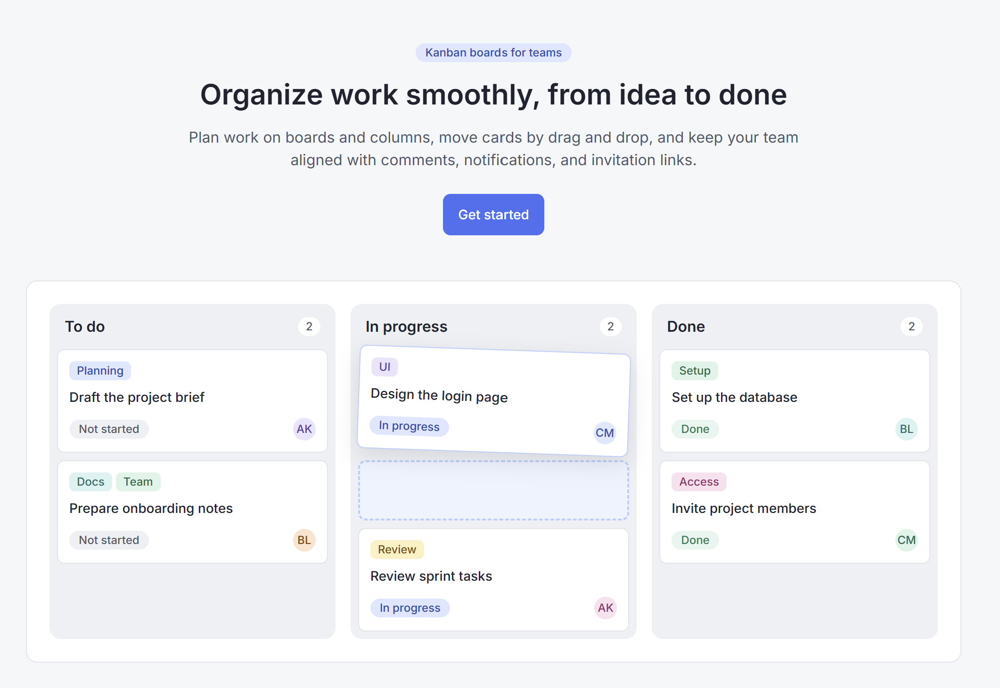
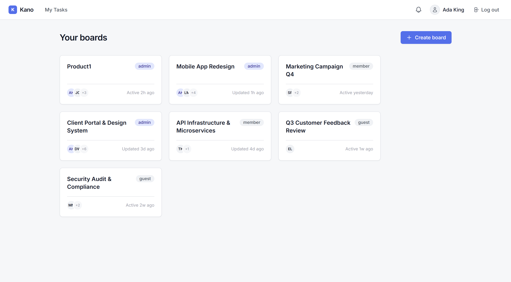
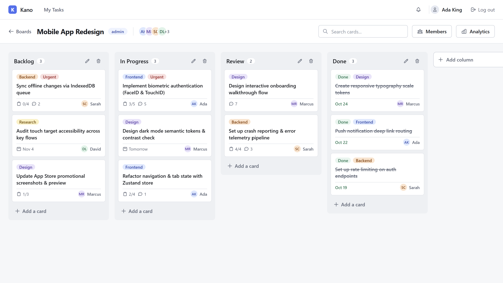

<p align="center">
  
</p>

<h1 align="center">Kano</h1>

<p align="center">Kanban boards for teams: plan work in columns, move cards by drag and drop, and keep everyone aligned with comments, notifications, and invitation links.</p>

---

## Overview

Kano is a Trello-like task management app. Users create boards, organize work into columns, drag cards between columns, discuss cards in comments, and follow their assigned tasks across boards. The repository is a monorepo with two separately deployed projects: **Kano_API**, a Flask REST API in [`app/`](app/), and **Kano_Web**, a Next.js frontend in [`web/`](web/).

| Project | Public URL |
|---|---|
| Kano_API | `PENDING: https://<kano-api>.vercel.app` |
| Kano_Web | `PENDING: https://<kano-web>.vercel.app` |

## AI Workflow Summary

### How the project brief was written

The project started from a written brief that described Kano's purpose, the per-board roles, the core features, and the tech stack, together with a separate preferences file. Kiro asked clarifying questions about that brief before writing anything, and the answers were folded into the first specification. The resulting project brief is kept at the top of [`requirements.md`](.kiro/specs/kano/requirements.md), so every later change can be checked against it.

### How Kiro generated and iterated the specifications

Kiro generated the requirements in EARS form, then a design document, and then a task plan, all in [`.kiro/specs/kano/`](.kiro/specs/kano/). Each requested change became a new version (V1 to V9 so far), recorded in [`CHANGELOG.md`](.kiro/specs/kano/CHANGELOG.md) with the text before and after, the reason, and the affected requirements, design sections, and tasks. Two workspace steering rules made this repeatable. One requires a version history for every revision. The other requires design and task updates and a consistency check after every change. Kiro executed the plan task by task, and a task is only checked off once its tests pass.

### How the Guidelines were authored and applied

The coding rules live in [`guidelines/`](guidelines/): [`backend.md`](guidelines/backend.md) (G-BE), [`database.md`](guidelines/database.md) (G-DB), and [`frontend.md`](guidelines/frontend.md) (G-FE). Each entry has a one-sentence Rule, a short Rationale, and a concrete Kano Example, and each file ends with a quick checklist. Implementation tasks in `tasks.md` name the entries they must follow, and the generator reads the guideline files before writing code. The files are deliberately not copied into `.kiro/steering/`, which `scripts/check_repo_hygiene.py` verifies.

### How code was reviewed against the Guidelines

After each phase, the generated code was checked entry by entry against the guideline checklists. Mechanical rules are enforced by tests and scripts instead of by reading: `scripts/check_file_size.py` (300-line limit), `app/tests/test_hygiene.py` (no dynamic SQL, no hard deletes), and `web/__tests__/no-wait-for-timeout.test.ts` (no `waitForTimeout`, no literal credentials in E2E specs). The latest review covered the V6 backend and the whole frontend, including scans for raw `fetch`, raw `<button>`, direct toast imports, cookie writes, and `dangerouslySetInnerHTML`.

### How violations were documented and resolved

Every violation found is recorded in [`docs/violation-report.md`](docs/violation-report.md) with the guideline id, the file, and the fix or the reason it was accepted. Most were fixed in code, for example oversized test files that were split, and missing active-only filters that were added with a regression test. Some were accepted on purpose, for example inline board forms that the requirements ask for. Those carry a suggested rewording of the guideline. A controlled experiment in [`docs/guideline-comparison.md`](docs/guideline-comparison.md) generated the same comments feature with and without the guidelines and counted 14 violations before and 1 after.

### How Antigravity was used in the workflow

**Antigravity (Frontend & E2E Testing)**
The client side of the application was built and verified using Antigravity. It handled the **Next.js** architecture, UI components, and client-side state management, while also driving the testing phase by generating and running **Playwright** end-to-end test suites to ensure reliable user flows.

### How Claude Code generated and refined tests and documentation

**Claude Code (Backend & Unit/Integration Testing)**
The server side was developed and validated using Claude Code. It managed the **Flask** API endpoints, core business logic, and database interactions, alongside writing and executing **Pytest** suites to verify backend stability and edge cases before integration.

## Features

- **JWT authentication with access and refresh tokens:** a 1-hour access token and a 7-day refresh token. The browser refreshes once on a 401, and the middleware renews the token for server rendering.
- **Board management:** create, rename, and delete boards. Deletes are soft and cascade to columns, cards, and comments.
- **Column management:** add, rename, reorder, and delete columns.
- **Card management:** title, description, due date, labels, and assignee. New cards are added with a title and then open in the detail modal.
- **Card status:** Not started, In progress, or Done, independent of the column. Done cards record a completion time.
- **Board members with roles:** admin, member, and guest. Guests are read-only.
- **Board invitation links with the guest role:** one member link and one guest link per board, which the admin can regenerate.
- **Drag-and-drop with FLOAT ordering:** mouse and touch (300 ms long-press). A move stores one new order value without renumbering siblings.
- **Comments:** add, edit, and delete your own comments on a card.
- **Notifications:** on assignment and on new comments, with an unread badge polled every 30 seconds.
- **Card search:** debounced search across your boards or within one board.
- **My Tasks view:** every card assigned to you, across boards.
- **User profile:** change your name and password. The email is fixed after registration.
- **Board analytics:** cards per column, cards completed this week, and member activity, visible to admins.
- **Welcome page:** a landing page for first-time visitors.

## Technologies

| Area | Technologies |
|---|---|
| Frontend | Next.js (App Router), React, TypeScript, Tailwind CSS, react-hot-toast |
| Backend | Flask, SQLAlchemy, Flask-Migrate, Flask-JWT-Extended, Marshmallow, flask-cors, python-dotenv, Gunicorn |
| Database | PostgreSQL (psycopg2-binary) |
| Testing | pytest and Hypothesis (backend), Vitest and React Testing Library (frontend), Playwright (end to end) |
| Deployment | Vercel (two projects), Railway (optional alternative for the backend) |
| AI tools | Kiro, Antigravity, Claude Code |

## Local Run Steps

**Prerequisites:** Python 3.14, Node.js 20.9 or later (required by Next.js 16, developed on Node.js 24), and a running PostgreSQL server with an empty `kano` database (and a `kano_test` database for the tests). The commands below are for Windows PowerShell. On macOS or Linux, use `python3` and `source venv/bin/activate`.

1. Clone the repository:
   ```powershell
   git clone https://github.com/jonathanch12/kano-app.git
   cd kano-app
   ```
2. Create and activate a Python virtual environment:
   ```powershell
   cd app
   py -m venv venv
   venv\Scripts\activate
   ```
3. Install the backend dependencies from `app/requirements.txt`:
   ```powershell
   py -m pip install -r requirements.txt
   ```
4. Copy `app/.env.example` to `app/.env` and set its values (`DATABASE_URL`, `JWT_SECRET_KEY`, `JWT_ACCESS_TOKEN_EXPIRES`, `JWT_REFRESH_TOKEN_EXPIRES`, `CORS_ORIGINS`, `TEST_DATABASE_URL`):
   ```powershell
   Copy-Item .env.example .env
   ```
5. **Manual Migration_Step:** apply the schema with `flask db upgrade`. The migrations are created and applied by the project owner, never by the code. The V6 schema changes (card `status` and `completed_at`, the two invitation token columns, and the `guest` role) needed `flask db migrate` followed by `flask db upgrade`. Alembic does not detect check constraints, so `ck_cards_status` and the three-role `ck_board_memberships_role` were added to that migration by hand. In a fresh clone the migration already exists, so only the upgrade is needed:
   ```powershell
   flask db upgrade
   ```
6. Start the API with `flask run`. It listens on **http://127.0.0.1:5000**, and `GET /api/health` returns `{"data":{"status":"ok"}}`.
   ```powershell
   flask run
   ```
7. In a second terminal, install the frontend dependencies in `web/`:
   ```powershell
   cd web
   npm install
   ```
8. Copy `web/.env.example` to `web/.env.local` and set `NEXT_PUBLIC_API_BASE_URL` and `API_BASE_URL` to `http://127.0.0.1:5000`:
   ```powershell
   Copy-Item .env.example .env.local
   ```
9. Start the web app with `npm run dev`. It runs on **http://localhost:3000**.
   ```powershell
   npm run dev
   ```

More backend detail (database schema, endpoint list, test markers) is in [`app/README.md`](app/README.md), and the API reference is [`app/openapi.yaml`](app/openapi.yaml).

## Test Steps

**Backend** (run in `app/` with the virtual environment active; `TEST_DATABASE_URL` must point at a database whose name ends in `_test` and that has the schema applied):

```powershell
pytest -v
```

**Frontend unit tests** (run in `web/`):

```powershell
npm test
```

**End-to-end tests with Playwright** (run in `web/`):

1. Copy `web/.env.test.example` to `web/.env.test`. This file is git-ignored, so never commit it.
2. Set `E2E_BASE_URL` to the frontend under test. This is the variable that holds the live Vercel frontend URL for the production run, or `http://localhost:3000` locally.
3. Set `E2E_USER_EMAIL` and `E2E_USER_PASSWORD` to an account that **already exists** in the database behind that frontend. The suite logs in with it and does not create it.
4. Install the browsers, run the suite, and open the report:
   ```powershell
   npx playwright install
   npx playwright test
   npx playwright show-report
   ```

**Repository checks** (run from the repository root):

```powershell
py scripts/check_file_size.py
py scripts/check_repo_hygiene.py
py scripts/check_readme_links.py
```

## Screenshots

| Screen | Image |
|---|---|
| **Welcome page:** the landing page for first-time visitors, with a sample board and a card being dragged into In progress |  |
| **Dashboard:** all boards of the signed-in user, each with the user's role (admin, member, or guest), member avatars, and last activity |  |
| **Board Detail:** the Mobile App Redesign board with Backlog, In Progress, Review, and Done columns, labels, assignees, due dates, card search, Members, and Analytics |  |

## Security note

- **Both tokens are in readable cookies.** The access token (`kano_access`) and the refresh token (`kano_refresh`) are stored in non-httpOnly cookies (`SameSite=Lax`, `Secure` on HTTPS), so Server Components and the middleware can read them. JavaScript can read them too, so any XSS on the Kano_Web origin exposes **both** tokens.
- **The refresh token raises the impact.** A stolen access token works for at most 1 hour. A stolen refresh token can mint new access tokens for up to 7 days.
- **Refresh tokens are stateless and cannot be revoked.** Logout only clears the browser cookies. A refresh token copied before logout stays valid until it expires, because the server keeps no token list and does not rotate tokens.
- **Invitation tokens are bearer credentials.** Anyone who has an invitation link can join the board with its role, and links do not expire. An admin who suspects a leak should regenerate the link, which makes the old token stop working immediately. Tokens are removed from request lines in the API logs.
- **Mitigations in place:** a short access-token lifetime, a bounded refresh lifetime, React's default escaping of all user text, no `dangerouslySetInnerHTML` anywhere in `web/` (guideline G-FE-20), CORS limited to the configured frontend origin, server-side role checks on every endpoint, and secrets read only from environment variables. Moving the tokens to httpOnly cookies set by the API, and adding refresh-token rotation with a server-side deny list, would remove the XSS and revocation exposure.
